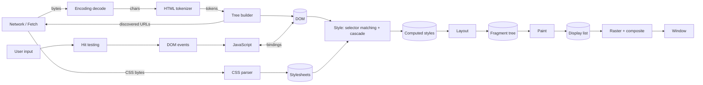
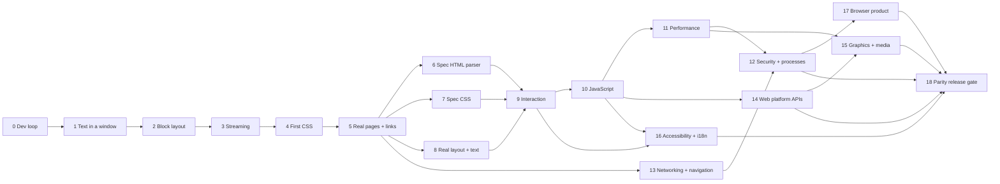

# Rust Browser Architecture and Development Roadmap

This document describes the architecture we are building toward and the order
in which we should build it.

The roadmap is organized for learning. We first build a **thin, naive version
of the whole pipeline** so that something appears on screen early. Then we
repeatedly replace naive pieces with spec-correct, production-style versions.
The page keeps rendering throughout, so every improvement is visible.

Real browsers such as Chromium, Firefox (Gecko/Servo), and WebKit differ in
details, but they share the same core ideas. We follow those ideas while
keeping the codebase small enough to learn from.

## How to use this roadmap

- Work through milestones in order. Within a milestone, do steps in order.
- Each step should fit in roughly one work session and one commit.
- Every step ends with **You'll see**: a new passing test, a debug dump, or a
  visible change in the window. If a step can't show a result, split it or
  add a debug tool that makes the result visible.
- Naive shortcuts are intentional. Each is marked **(naive)** and has a later
  step that replaces it. Keep the shortcuts behind the same interface as the
  real version so the replacement is local.
- Check off steps (`- [x]`) as they land, and update the "Current state"
  table when a milestone is complete.
- Later steps that cover a whole specification or test suite are umbrellas.
  When you start one, split it into session-sized substeps below it and keep
  the umbrella checkbox until its conformance target is met.
- A milestone with **Exit criteria** is complete only when those criteria
  pass, not when every step has been started.

## Guiding principles

1. **Follow the specifications.** HTML, CSS, DOM, URL, Fetch, and Encoding are
   defined by WHATWG and W3C specs. Name types and steps after the spec where
   practical, and link the relevant section in comments.
2. **Never reject the web.** Browsers recover from malformed input instead of
   failing. Parsers should record parse errors for diagnostics, but still
   produce a document or stylesheet.
3. **Stream and work incrementally.** Parse data as it arrives. Later, restyle,
   re-layout, and repaint only what changed.
4. **Keep stages separate.** Each pipeline stage consumes the previous stage's
   output through a narrow interface. Layout should not parse CSS; paint should
   not inspect the DOM.
5. **Test against shared test suites.** Use html5lib-tests, the CSS parsing
   tests, and Web Platform Tests (WPT) rather than only hand-written examples.
6. **Build what teaches us; reuse what does not.** Implement engine concepts
   ourselves. Use proven crates for specialized infrastructure such as TLS,
   image decoding, font rasterization and shaping, and GPU access.
7. **Design for untrusted content.** Everything from the network is hostile.
   Avoid panics on input, bound resource usage, and plan for process isolation.
8. **Measure parity; don't assume it.** "Works like Chrome and Firefox" is a
   set of measured gates (see [Standards parity target](#standards-parity-target)),
   rechecked every release because the platform keeps changing.

## Current state

| Area | Location | Status |
| --- | --- | --- |
| App entry | `src/app` | Starts interactive browsing or resource-aware DOM/stylesheet/CSS-token/typed-style/value-stage/layout/display-list dumps. |
| Engine | `src/engine` | Owns document snapshots, final/base URLs, retained stylesheets/import graphs/resources, viewport/interaction restyling, bounded real-layout container feedback, cancellable loading, and bounded back/forward history. |
| Networking | `src/net` | Bounded HTTP/file bodies, GET redirects, response metadata, raw document-byte streaming, and explicit UTF-8 text utilities. |
| HTML/XML | `src/html`, `src/xml` | Resumable UTF-8/lossless UTF-16 tokenization, insertion-mode tree construction, contextual fragments, encoding sniffing/restarts, and bounded XML parsing; all applicable current-WHATWG fixture outputs and diagnostics pass. |
| DOM | `src/dom` | Arena of nodes addressed by `NodeId`; supports append only. |
| CSS | `src/css` | Resumable CSS Syntax tokenizer and token-based rule parsing with bounded diagnostics/recovery; source-retaining AST, three-valued MQ range/dimension/preference/input conditions, typed container establishment, attribute/combinator/structural selector matching and specificity, colors, dimension-checked bounded math, contextual lengths including container units, and angle/time/resolution parsers. |
| Style | `src/style` | Embedded/external/inline and optional user sheets, origin/importance/layer cascade with rollback candidates, nested media/supports/container conditions, nesting and scoped/namespace-aware matching, bounded typed registrations, indexed/Bloom matching, typed values and atomic shorthands, token-based custom properties, font/root/viewport/container length computation against immutable real layout snapshots, inherited styles keyed by `NodeId`, and `--dump=style`. |
| Layout | `src/layout` | Block/inline box generation with anonymous block wrappers and block-in-inline continuations; percentage/math used values, non-replaced block size containment and definite length heights, image sizing, naive spacing/text flow, list markers, fragment-aware hit testing, and explicit device-pixel rectangle quantization. |
| Paint | `src/paint` | Rasterizes text, backgrounds, borders, and shared RGBA images with clipping, scaling, alpha blending, and scrolling. |
| Media | `src/media` | Bounded PNG/JPEG/GIF/WebP decoding, with shared intrinsic-size image data. |
| Window | `src/ui` | CSS-pixel resize/scale/theme restyle-layout-paint with bounded container and pointer feedback, click navigation, back/forward shortcuts, scroll restoration, and current URL/loading/error titles. |

The DOM arena with stable IDs is a good foundation. The CSS rule parser used
in Milestone 4 has been rebuilt on the tokenizer in steps 7.1 and 7.2.

## Target architecture

This is the end state. The milestones build toward it one stage at a time.

### Rendering pipeline



| Stage | Input | Output | Notes |
| --- | --- | --- | --- |
| Fetch | URL, request | Response bytes and metadata | Handles redirects, headers, and eventually caching and cookies. |
| Decode | Bytes and charset | Unicode text | Uses the Encoding spec's sniffing rules. |
| HTML parse | Text chunks | DOM mutations | Uses a resumable tokenizer and insertion modes. |
| CSS parse | Text | Stylesheet object model | Tokenizes, then parses rules, selectors, and values. |
| Style | DOM and stylesheets | Computed value per element | Handles specificity, origin, inheritance, and initial values. |
| Box generation | DOM and styles | Box tree | Applies `display`, generates anonymous boxes, and skips `display: none`. |
| Layout | Box tree and viewport | Fragment tree | Computes positioned rectangles, line boxes, and glyph runs. |
| Paint | Fragment tree | Display list | Creates drawing commands in paint order and stacking contexts. |
| Raster/composite | Display list | Pixels | Starts in software; later uses GPU layers. |

### Target module layout

Add modules when a milestone first needs them. Split into a Cargo workspace
when compile times or dependency boundaries justify it.

```text
src/
  app/        window, event loop, browser UI shell (tabs, URL bar)
  engine/     navigation, per-document "frame" that owns the pipeline
  net/        fetch, HTTP, redirects, cache, cookies
  html/       tokenizer/  tree_builder/  (streaming, spec-based)
  dom/        nodes, document, mutation API, events
  css/        tokenizer/  parser/  selectors/  values/
  style/      matching, cascade, computed values, invalidation
  layout/     box tree, block, inline, text, flex, grid
  text/       font loading, shaping, line breaking
  paint/      display list and stacking contexts
  gfx/        rasterization and compositing
  script/     JS engine integration, DOM bindings, event loop
  media/      image, audio, and video decoding and playback
  a11y/       accessibility tree and platform bridges
  webdriver/  WebDriver and WebDriver BiDi automation
  devtools/   DOM, style, layout, and display-list dumps
```

### Key data-model decisions

- **The DOM is an arena, not `Rc<RefCell<...>>`.** Keep `NodeId` indexes. This
  avoids reference cycles and supports style caches and layout side tables
  keyed by `NodeId`. Node removal will require tombstones or
  generation-checked IDs so old IDs cannot refer to reused slots.
- **Layout does not mutate the DOM.** Styles, boxes, and fragments are
  separate trees or side tables that can be rebuilt. This keeps incremental
  invalidation manageable.
- **Paint produces a display list, not pixels.** Layout and paint never call
  the rasterizer directly. This lets us swap software rendering for GPU
  rendering later and makes paint output testable.
- **Strings will need interning.** Tag names, attribute names, and CSS
  identifiers repeat constantly. Introduce an atom type (similar to Servo's
  `string_cache`) before selector matching becomes expensive.
- **Parsers own resumable state.** HTML and CSS tokenizers should become state
  machines driven by `feed(chunk)` and `finish()`.

## Standards parity target

The finished browser should be interchangeable with current stable Chrome and
Firefox for users and web developers. No roadmap can guarantee that once and
for all: standards change every release, and both engines also implement
de facto behavior that specifications describe only partially. Parity is
therefore defined as measurable gates that are enforced continuously.

### Standards in scope

| Area | Standards | Conformance evidence |
| --- | --- | --- |
| Markup and DOM | WHATWG HTML, DOM, Infra, DOM Parsing; XML 1.0 and Namespaces in XML; SVG 2; MathML Core | html5lib-tests, WPT |
| Script | ECMA-262, ECMA-402 (Intl), ECMA-404 (JSON), WHATWG Web IDL, WebAssembly Core, JS API, and Web API | Test262, WebAssembly spec tests, WPT `webidl/` and `wasm/` |
| Style and layout | CSSWG modules in the current CSS snapshot, CSSOM, CSSOM View, Web Animations, WHATWG Compat and Quirks Mode | css-parsing-tests, WPT `css/` reftests |
| Networking | WHATWG URL, Fetch, Encoding, MIME Sniffing, Streams, XHR, WebSockets; IETF HTTP (RFC 9110–9114), QUIC (RFC 9000), TLS 1.3 (RFC 8446), cookies (RFC 6265bis), HSTS (RFC 6797) | WPT, h2spec, QUIC Interop Runner |
| Storage and workers | WHATWG Storage, HTML Web Storage and workers, IndexedDB, Service Workers | WPT |
| Graphics and media | HTML canvas and media elements, WebGL, WebGPU and WGSL, Media Source Extensions, Web Audio, WebCodecs, WebRTC | Khronos WebGL CTS, WebGPU CTS, WPT |
| Security and privacy | HTML origins, CORS, CSP, Mixed Content, Referrer Policy, Fetch Metadata, Permissions Policy, SRI, Trusted Types, COOP/COEP | WPT, fuzzing, external audit |
| Accessibility and i18n | WAI-ARIA, Core-AAM, HTML-AAM, Accessible Name Computation, WCAG for browser UI, Unicode (UAX #9, #14, #29) and CLDR | WPT `accname/`, `*-aam/`, `wai-aria/`; screen reader scripts; Unicode test data |
| Automation | W3C WebDriver and WebDriver BiDi | WPT `webdriver/`, `wptrunner` |

### Parity gates

1. **Feature coverage.** Track features with
   [web-features](https://github.com/web-platform-dx/web-features) and
   [MDN browser-compat-data](https://github.com/mdn/browser-compat-data).
   Implement every Baseline feature and every feature shipped in both stable
   Chrome and Firefox. Generate a report of missing features by milestone.
2. **Conformance.** For each WPT directory, pass at least as many tests as
   the lower of stable Chrome and Firefox on [wpt.fyi](https://wpt.fyi/), with
   the higher as the long-term target. Match or exceed both on
   [Interop](https://wpt.fyi/interop) focus areas. For Test262, match the
   pass rate of V8 or SpiderMonkey. Other suites, such as html5lib-tests and
   the graphics CTSs, must pass apart from documented, justified exclusions.
3. **Web compatibility.** Load a corpus of top sites, such as the Tranco top
   1,000, and compare screenshots, console errors, and scripted user flows
   with Chrome and Firefox. Classify every difference as our bug, a spec
   issue, or an entry for the WHATWG Compat or Quirks Mode standards.
4. **Performance.** Score within an ADR-recorded margin (initially 20%) of
   Chrome and Firefox on the same hardware for Speedometer 3, JetStream 2,
   MotionMark, page-load metrics (LCP, INP, CLS), and memory use.
5. **Security and stability.** Continuously fuzz parsers and IPC boundaries,
   run sanitizers in CI, sandbox renderers, isolate sites, and pass an
   external security review before release.
6. **Accessibility.** Expose an accessibility tree through platform APIs,
   meet the accessibility conformance gate, and complete scripted screen
   reader workflows on every supported platform.

Each remaining milestone has **Exit criteria** that apply these gates to its
area. Milestone 18 applies them to the whole browser and keeps them enforced.

## Milestones

Milestones 1–5 build the thin end-to-end browser. Milestones 6–8 make each
stage correct against the specs. Milestones 9–12 add interactivity, scripting,
performance, and security. Milestones 13–17 complete the web platform and the
browser product, and Milestone 18 enforces parity with Chrome and Firefox.



Milestones 6, 7, and 8 are independent and can be interleaved. Milestone 13
can start after Milestone 5 and must provide Fetch before 12.1 needs CORS.

### Milestone 0: A fast development loop

**Goal:** Make it easy to load any page and inspect each pipeline stage.

- [x] **0.1 Take the URL from the command line.** `cargo run -- <url>`, with
  `https://example.com` as the default.
  *You'll see:* the DOM dump for any site you choose.
- [x] **0.2 Load local files.** Accept a file path or `file://` URL, and add
  `tests/pages/` with small hand-written HTML pages.
  *You'll see:* your own test pages parsed without network access.
- [x] **0.3 Pretty-print the DOM as an indented tree.** Add a `devtools`
  module with `dump_dom`, and a `--dump=dom` flag, instead of `{:#?}`.
  *You'll see:* a readable tree such as `<body>` → `<p>` → `"Hello"`.
- [x] **0.4 Add snapshot tests.** Compare `dump_dom` output for test pages with
  committed `.expected` files, for example using the `insta` crate.
  *You'll see:* parser changes show up as readable diffs.

### Milestone 1: Text in a window

**Goal:** See the page's words in a real window as early as possible.

- [x] **1.1 Open a window.** Use `winit` for the window and `softbuffer` for a
  CPU framebuffer. Fill it with white.
  *You'll see:* an empty browser window that closes cleanly.
- [x] **1.2 Draw one string.** Bundle an open-licensed font (for example Noto
  Sans, under `assets/fonts/`) and rasterize glyphs with `fontdue` or
  `ab_glyph`. **(naive)** No shaping yet; replaced in 8.6.
  *You'll see:* "Hello, browser" rendered in the window.
- [x] **1.3 Draw the document's text.** Walk the DOM, collect text nodes, and
  skip `head`, `script`, and `style`. Draw them one after another on a single
  line. **(naive)** Replaced by layout in Milestone 2.
  *You'll see:* example.com's words in the window.
- [x] **1.4 Wrap words.** Split text on whitespace and start a new line when
  the next word would overflow the window width. **(naive)** Replaced by
  inline layout in 8.4.
  *You'll see:* readable paragraphs.
- [x] **1.5 Re-wrap on resize.** Recompute line positions on window resize.
  *You'll see:* text reflowing as you drag the window edge, which is layout
  reacting to viewport changes.
- [x] **1.6 Scroll.** Offset drawing by a scroll position controlled by the
  mouse wheel and arrow keys. Draw only lines that are visible.
  *You'll see:* long pages that you can scroll.
- [x] **1.7 Introduce a display list.** Have text placement produce
  `Vec<DisplayItem>` values such as `Text { x, y, text, size }` and
  `Rect { x, y, w, h, color }`, then have a separate rasterizer draw them.
  *You'll see:* the same output, now with the paint/raster separation real
  browsers use. Add `--dump=display-list`.

### Milestone 2: Boxes and block layout

**Goal:** Turn the DOM into a layout tree and render document structure.

- [x] **2.1 Build a layout tree.** Create a `layout` module with a box tree
  parallel to the DOM. Classify elements as block or inline using a
  hard-coded list (`div`, `p`, `h1`–`h6`, `ul`, `li`, and so on).
  **(naive)** Replaced by the CSS `display` property in 4.5.
  *You'll see:* `--dump=layout` prints the box tree.
- [x] **2.2 Stack blocks vertically.** Give each block box `x`, `y`, `width`,
  and `height`. Children stack from top to bottom, and each block's width is
  its parent's width.
  *You'll see:* paragraphs separated into their own lines.
- [x] **2.3 Add a debug overlay.** Toggle outlines around each box with F12.
  *You'll see:* the box tree drawn over the page, much like browser
  developer tools.
- [x] **2.4 Size headings and add spacing.** Hard-code larger font sizes for
  `h1`–`h6` and vertical margins for `p` and headings. **(naive)** Replaced by
  the user-agent stylesheet in 4.4.
  *You'll see:* a page hierarchy that looks roughly like a real browser.
- [x] **2.5 Support inline formatting.** Handle `b`, `strong`, `i`, and `em`
  with bold and italic styling, and handle `br`. Step 8.6 selects installed
  bold/italic faces, synthesizing only when an appropriate face is unavailable.
  *You'll see:* emphasis and manual line breaks.
- [x] **2.6 Add list markers.** Indent `ul` and `ol`, and draw bullets or
  numbers for `li`.
  *You'll see:* lists rendered as lists.

### Milestone 3: Streaming parsing

**Goal:** Parse HTML while it downloads, as real browsers do.

- [x] **3.1 Add a resumable parser API.** Introduce
  `HtmlParser::feed(&str) -> Result<(), HtmlError>` and
  `finish() -> Result<Document, HtmlError>`, and keep `parse(&str)` as a
  wrapper around them. Buffer incomplete tags between chunks for now.
  *You'll see:* all existing parser tests still pass through the new API.
- [x] **3.2 Test chunk boundaries.** Assert that splitting input at every
  possible character boundary produces the same DOM.
  *You'll see:* tests catching splits inside tags, attributes, comments, and
  multi-byte characters.
- [x] **3.3 Stream the network body.** Read the response in chunks, decode
  UTF-8 incrementally without splitting multi-byte characters, and feed each
  chunk to the parser.
  *You'll see:* `--trace` logs the DOM node count after each chunk.
- [x] **3.4 Move loading off the UI thread.** Fetch and parse on a worker
  thread and send results to the window through a channel.
  *You'll see:* the window opens and stays responsive while a page loads.
- [x] **3.5 Render progressively.** Re-run layout and paint on partial DOMs.
  Use `--throttle-ms <milliseconds>` to slow chunks so the effect is visible.
  *You'll see:* a slow page render from top to bottom as it arrives.

**Measure the tradeoff:** Run `cargo bench --bench streaming` for a
dependency-free, release-mode comparison. It reports median parsing CPU time
with and without DOM snapshots, and time to first text versus complete DOM
over a controlled slow loopback HTTP response. The buffered reference uses
the same parser after downloading the entire body; this isolates streaming,
not changes from the old tokenizer. These are DOM timings, not first-paint
timings, and the benchmark excludes the UI channel, layout, and rasterization.

**Naive limitations at this checkpoint:** Each progress update clones the entire DOM and rebuilds
layout. The UI consumes at most one snapshot per event-loop turn so a busy
loader cannot indefinitely postpone redraws. Trailing text waits for the next
`<` or EOF, and incomplete markup is rescanned on each feed. Streaming improves
early-content latency, but these costs can make total processing slower.

Example measurements on ARM64 macOS with Rust 1.98.0 (2026-10-10, medians of
seven release-mode samples; 64 KiB HTTP body, 40 ms before headers, eight 8 KiB
writes 20 ms apart):

| Measurement | Buffered | Streaming |
| --- | --- | --- |
| HTTP: first text in DOM | 216.8 ms | 44.9 ms |
| HTTP: complete DOM | 216.8 ms | 211.0 ms |
| 1 MiB paragraphs: parsing only | 2.62 ms | 2.75 ms |
| 1 MiB paragraphs: parsing and progress snapshots | N/A | 97.18 ms |
| 1 MiB single attribute: parsing only | 4.38 ms | 186.79 ms |

The HTTP streaming measurements include snapshots, but not rendering. First
text was about 79% earlier; total-load differences were small and varied
between runs. The large-attribute case demonstrates the cost of rescanning
incomplete markup, not a typical page.
Milestone 6.2 removes the trailing-text delay and incomplete-token rescanning;
its current measurements are recorded below.

### Milestone 4: First CSS

**Goal:** Apply real styles using the existing CSS parser.

- [x] **4.1 Collect `<style>` text.** Parse each `<style>` element's contents
  with `css::parse` and list the resulting rules.
  *You'll see:* `--dump=stylesheets` prints the page's rules.
- [x] **4.2 Parse simple selectors.** Parse type, `.class`, `#id`, and
  descendant selectors from rule preludes. Compute specificity.
  *You'll see:* unit tests for selectors and their specificity.
- [x] **4.3 Match and apply `color` and `background-color`.** Build a
  `style` module that matches rules against elements and parses named and
  hexadecimal colors. Apply the winning value by specificity and source order.
  *You'll see:* the first styled page, with colors taken from its CSS.
- [x] **4.4 Replace hard-coded styles with a user-agent stylesheet.** Move the
  font sizes, margins, and block/inline list from Milestone 2 into a built-in
  stylesheet based on the HTML spec's rendering section.
  *You'll see:* the same rendering, now driven entirely by CSS.
- [x] **4.5 Use `display`, `font-size`, `margin`, and `padding`.** Read these
  from computed styles in layout. Support `px`, `em`, and `%` for margins,
  padding, and widths.
  *You'll see:* page CSS changing spacing and layout.
- [x] **4.6 Add inheritance.** Inherit `color`, `font-size`, and
  `font-family` from parent elements.
  *You'll see:* text inheriting its container's color.
- [x] **4.7 Draw borders and backgrounds.** Paint `border-width`,
  `border-color`, and `background-color` rectangles.
  *You'll see:* boxes with visible borders and backgrounds.
- [x] **4.8 Support `style=""` attributes.** Parse inline declarations and
  apply them above stylesheet rules.
  *You'll see:* inline styles overriding stylesheet rules.

**Try it:** `cargo run -- tests/pages/styles.html`, or add
`--dump=stylesheets`, `--dump=style`, `--dump=layout`, or `--dump=display-list`.
Stylesheet dumps have a committed snapshot. Unit and pipeline tests cover
specificity, source order, inline priority, `!important`, inheritance,
shorthand/longhand interactions, box geometry, paint order, scrolling, and
stylesheets arriving after already-rendered content.

**Implementation boundaries:** `css/selectors.rs` handles selector lists,
compound selectors, the universal selector, and descendants. Step 7.3 adds
token-based attributes, child/sibling combinators, structural pseudo-classes,
and `:not()`.
`css/values/` handles named colors, three/six-digit hex, `transparent`,
`currentcolor`, opaque `rgb()` (added in 7.5), and `px`/`em`/`%` lengths.
Step 7.10's local substeps extend the color pipeline to typed Color 4/5
functions, interpolation, relative colors, and per-color alpha, while retaining
the sRGB framebuffer and leaving the external conformance umbrella open.
`style/` collects and compiles sheets and resolves the cascade independently
of layout. The built-in
`style/user_agent.css` preserves the earlier heading, emphasis, paragraph,
and list defaults. `layout/` separates box generation, geometry, block flow,
and inline flow. Element widths use the content-box model; percentages for
width, margin, and padding resolve against the containing block's width.

**Naive limitations:** The HTML parser buffers `<style>` contents as raw text
until its closing tag or EOF, including across chunk boundaries. This is not
a complete raw-text tokenizer. The original whole-sheet/inline-list CSS
rejection was replaced by token-based recovery in 7.2; invalid/unsupported
selectors and typed values are still ignored with diagnostics. At-rules,
media-query semantics, advanced selectors, alpha colors, and font-face
selection are still deferred at this initial pipeline stage. Steps 8.2–8.3
add horizontal auto margins and normal-flow vertical margin collapsing.
`font-family` is
computed and inherited; 8.6 adds installed-face selection and outline fallback;
8.7 adds document-owned downloadable author faces.
Nonzero
border widths originally painted solid rectangular strips without a
`border-style` model; 7.5 adds visible-style widths and basic border patterns.
Wrapped inline backgrounds/borders use a single bounding rectangle
rather than per-line fragments. The browser's existing 24px viewport gutter
remains separate from element CSS. Font sizes are capped at 512 CSS px with
a diagnostic to bound glyph rasterization.
External stylesheets and raster images are added in Milestone 5.

**Measure styling:** `cargo bench --bench styling` reports median CSS
syntax parsing, full style resolution, and styled box generation/layout
CPU time over nine release-mode samples. Full resolution includes sheet
collection, selector/value parsing, matching, and the cascade. HTML parsing,
font loading, networking, rasterization, and final result destruction are
outside the timed regions. The naive matcher examines every rule for every
element, and each progressive update rebuilds all styles and layout.

Example measurements on ARM64 macOS with Rust 1.98.0 (2026-10-10):

| Elements / author rules | CSS parsing | Style resolution | Styled box layout |
| --- | --- | --- | --- |
| 100 / 10 | 0.009 ms | 0.168 ms | 0.082 ms |
| 1,000 / 100 | 0.076 ms | 2.911 ms | 0.753 ms |

### Milestone 5: Real pages and links

**Goal:** Browse between real pages.

- [x] **5.1 Resolve URLs.** Use the `url` crate to resolve relative URLs
  against the document URL and `<base href>`.
  *You'll see:* unit tests for relative, absolute, and fragment URLs.
- [x] **5.2 Load external stylesheets.** Fetch `<link rel=stylesheet>` files
  and add them to the cascade in document order.
  *You'll see:* sites with external CSS render with their styles.
- [x] **5.3 Make links clickable.** Hit-test a click to a layout box, find
  the enclosing `<a href>`, and navigate. **(naive)** Replaced by full hit
  testing and DOM events in Milestone 9.
  *You'll see:* clicking a link loads the next page.
- [x] **5.4 Add back and forward.** Keep a history stack with keyboard
  shortcuts. **(naive)** Replaced by navigables and session history in 13.7.
  *You'll see:* navigation back and forth between pages.
- [x] **5.5 Show the URL in the title bar.** Also show a loading indicator.
  *You'll see:* the current page and loading state.
- [x] **5.6 Render images.** Fetch `` sources, decode them with the
  `image` crate, and lay them out using their intrinsic size and `width` and
  `height` attributes.
  *You'll see:* images on pages.
- [x] **5.7 Handle redirects and errors.** Follow redirects and show an error
  page for failed loads. **(naive)** Replaced by Fetch redirects in 13.2.
  *You'll see:* failed loads produce a helpful page instead of a crash.

**Try it:** `cargo run -- tests/pages/navigation/index.html`. Click the
next-page, missing-page, and fragment links. Back/forward use `Alt+Left` /
`Alt+Right`, or `Command+[` / `Command+]` on macOS. History traversal restores
the saved scroll offset after reloading; a new navigation discards forward
entries. The title shows the current URL and `Loading` or `Load failed`.
Error pages show the address, failure details, and a clickable `Try again`
link. Dump modes fetch the same external resources as the window, but return
a nonzero exit status for a failed document load.

**Implementation boundaries:** `engine/frame.rs` owns the DOM, final URL,
parsed stylesheets, computed styles, and images for one snapshot.
`engine/urls.rs` implements relative resolution and the first `<base href>`
rule; invalid or forbidden base URLs fall back to the document URL.
`engine/loader.rs` streams HTML snapshots before loading discovered resources.
`engine/resources.rs` loads sheets and images, caches repeated URLs within a
load, and records failures without replacing otherwise usable content.
Stylesheet slots follow DOM preorder, not response order; repeated sheet
references still occupy separate cascade slots. Parsed sheets and decoded
images are shared with `Arc` rather than copied into each snapshot.
Networking, initial HTML/CSS parsing, image decoding, and initial style resolution
run on the page-loader thread. Viewport changes restyle retained sheets on the
window thread; layout and rasterization also remain on that thread.
Replacing navigation drops its old receiver and signals cancellation, so an
old worker cannot overwrite the new page.

Images use intrinsic dimensions unless HTML `width` / `height` attributes
specify them. Specifying only one dimension preserves the intrinsic aspect
ratio. HTML width is a presentational hint below author CSS, including
`width: auto`; CSS widths also support the existing `px` / `em` / `%` values.
Failed or not-yet-decoded images render their `alt` text. Display lists retain
shared image data; nearest-neighbor rasterization clips to the viewport and
alpha-blends onto the existing destination pixels.
Text hit testing uses individual line fragments instead of treating the
whitespace inside a wrapped link's bounding rectangle as clickable. Clicks
convert device pixels to CSS coordinates and add the scroll offset before
walking to the enclosing anchor. Same-document fragment clicks scroll without
refetching; fragment lookup decodes percent escapes and prefers IDs over
legacy named anchors.

**Limits and recovery:** HTTP GET follows 301/302/303/307/308, resolves relative
`Location` values, inherits a fragment only when the redirect has none, and
keeps the final URL even on an HTTP/body error. Redirects are capped at ten
with a fifteen-second chain timeout. Redirects to non-HTTP(S) URLs are
rejected. HTTP pages cannot load or navigate to local files.
HTML is capped at 16 MiB, each stylesheet at 4 MiB, and each encoded image
body at 16 MiB. Each page processes at most 128 resource elements, 16 MiB of
external CSS source fetched for parsing, and 128 MiB of retained decoded images. Image
dimensions are limited to 4096 pixels per axis with a 64 MiB decoder allocation
budget; the image crate's allocation limit is best-effort, while dimension
limits are strict. HTML image dimension hints above 1,000,000 CSS pixels are
ignored. History retains at most 256 entries. Resource limit failures are
diagnostics; document failures become error pages, not crashes.

**Naive limitations:** Resources load sequentially after HTML finishes, not
through a preload scanner or concurrent Fetch scheduler. Failed URLs may be
retried by separate resource elements. Only HTTP(S) and local-file URLs are
supported; `data:`, `blob:`, SVG, responsive `srcset` / `<picture>`, animation,
and CSS `height` sizing remain deferred. Images share a top-aligned inline
line model rather than full replaced-element baseline layout.
External CSS requires `text/css` for HTTP responses, accepts a UTF-8 BOM, and
otherwise uses the existing strict UTF-8 decoding policy; Encoding sniffing
comes later. Alternate/disabled external sheets are skipped. External
`media` accepts empty, `all`, or `screen`; media queries and `@import` remain
unsupported. Embedded-sheet media semantics still await Milestone 7.
Link appearance uses a simple blue user-agent `a` rule rather than
`:link` / `:visited` or text-decoration support. Hit testing is not a stacking
context, clipping, pointer-events, or DOM-event implementation. Back/forward
reload documents rather than retaining a back-forward cache or implementing
the HTML navigable/session-history model. Existing HTML/CSS parser limitations
still apply, including undecoded character references in URL attributes.

**Coverage and measurement:** Unit and localhost HTTP integration tests cover
relative/base/final URLs, redirect fragments and limits, external cascade
order, file loading and CLI paint dumps, failed resources, image intrinsic and
attribute/CSS sizing, repeated-resource sharing, paint order, alpha/scaled/
clipped/scrolled image pixels, wrapped links, history branching, modifier
shortcuts, titles, cancellation, and renderable error/retry pages.
`cargo bench --bench images` reports nine-sample median PNG decoding time,
including RGBA conversion but excluding source encoding, networking, and final
result destruction. On ARM64 macOS with Rust 1.98.0 (2026-10-10), the medians
were 0.029 ms for 64x64 and 4.906 ms for 1024x768.

**Checkpoint:** You now have a small working browser. Milestones 6–8 make its
stages spec-correct one at a time.

### Milestone 6: A spec-correct HTML parser

**Goal:** Parse HTML the way the WHATWG HTML Standard specifies.

**Scope:** Cover all applicable tokenizer states and tree-construction rules,
not only the examples below. Track missing rules against their specification
sections; script-execution integration belongs to 10.6.

- [x] **6.1 Add the html5lib-tests harness.** Add the suite as a git
  submodule or vendored data. Run tokenizer, document, and fragment cases,
  reporting tokenizer and tree-construction pass rates separately without
  failing CI yet. Also run cases across chunk boundaries: equivalent chunked
  output alone does not establish HTML5 correctness.
  *You'll see:* a baseline pass rate. Each following step should raise it.
- [x] **6.2 Tokenizer: data, tag, and attribute states.** Replace the
  tokenizer with the spec's state machine, starting with the core states in
  [HTML section 13.2.5]. Keep the `feed` API, retaining state and partially
  built tokens rather than rescanning buffered input. Implement the specified
  tag-name, attribute, case-folding, and duplicate-attribute rules, character
  and EOF tokens, and self-closing tag metadata.
  *You'll see:* tokenizer test pass rate increase, and the large split
  attribute benchmark no longer pays for repeated scans.
- [x] **6.3 Tokenizer: comments and doctypes.** Emit comment and doctype
  tokens, and add comment and doctype nodes to the DOM. Cover malformed and
  bogus comments, doctype public/system identifiers, and the force-quirks
  flag consumed by the tree builder.
  *You'll see:* comments and doctypes in `--dump=dom`.
- [x] **6.4 Tokenizer: character references.** Decode named and numeric
  character references using the spec's entity table. Cover decimal and
  hexadecimal forms, context-dependent text/attribute and semicolon rules,
  and invalid-code-point recovery.
  *You'll see:* `&amp;`, `&copy;`, and `&#8212;` render correctly.
- [x] **6.5 Tokenizer: contextual text states.** Handle RCDATA for `title`
  and `textarea`, RAWTEXT for `style` and other raw-text elements, script data
  including escaped and double-escaped states, and PLAINTEXT. Have the tree
  builder switch tokenizer states, with context-appropriate end-tag matching.
  *You'll see:* `<style>` contents containing `<` no longer break parsing.
- [x] **6.6 Make parse errors non-fatal.** Record errors as diagnostics with
  source positions and apply the spec's tokenizer and tree-builder recovery
  rules rather than aborting on malformed HTML. Cover literal `<` in text,
  malformed attributes, state-specific NULL handling, input control-character
  and noncharacter diagnostics, and EOF recovery for incomplete constructs.
  *You'll see:* `--dump=parse-errors` lists problems while pages still render.
- [x] **6.7 Tree builder: implied `html`, `head`, and `body`.** Implement the
  `initial`, `before html`, `before head`, `in head`, `after head`, and
  `in body` insertion modes, and select no-quirks, limited-quirks, or quirks
  document mode from doctype information.
  *You'll see:* bare text such as `Hello` produces a full document structure.
- [x] **6.8 Tree builder: implied end tags.** Automatically close elements
  such as `p` and `li` when the spec requires it.
  *You'll see:* `<p>a<p>b` produces sibling paragraphs.
- [x] **6.9 Tree builder: active formatting elements.** Implement the list of
  active formatting elements and the adoption agency algorithm.
  *You'll see:* misnested markup such as `<b><i></b></i>` matches browsers.
- [x] **6.10 Tree builder: tables.** Implement table insertion modes and
  foster parenting.
  *You'll see:* stray content in tables is moved where browsers place it.
- [x] **6.11 Tree builder: SVG and MathML.** Add namespaces and foreign
  content rules, including HTML integration points, tag/attribute name
  adjustments, and self-closing tag handling. Feed foreign-content context
  back to the tokenizer so CDATA is recognized only where permitted.
  *You'll see:* inline SVG elements have the correct namespace in the DOM.
- [x] **6.12 Detect encodings.** Use `encoding_rs` with the BOM,
  `Content-Type` charset, and `<meta charset>` prescan. Apply encoding
  precedence, fallback, replacement decoding, and parser-restart rules rather
  than assuming strict UTF-8. This belongs before tokenization.
  *You'll see:* non-UTF-8 pages display correctly.
- [x] **6.13 Fuzz the parser.** Add a `cargo fuzz` target.
  *You'll see:* fuzzing runs without panics.
- [x] **6.14 Tree builder: templates and remaining parsing rules.**
  Implement template contents and the template insertion-mode stack. Complete
  remaining insertion modes and element-specific rules, including `noscript`
  behavior controlled by the scripting flag, select handling, after-body
  modes, and legacy frameset parsing.
  *You'll see:* template content stays outside the document's rendered tree,
  and the remaining tree-construction conformance cases pass.
- [x] **6.15 Parse HTML fragments with context.** Initialize tokenizer and
  tree-builder state from the context element, namespace, document mode, and
  scripting flag. Reuse this parser for markup-insertion DOM APIs later.
  *You'll see:* fragment tests for contexts such as `textarea`, `table`,
  `template`, and SVG match the specification.
- [x] **6.16 Parse XML documents.** Add an XML 1.0 and Namespaces in XML
  parser for `application/xhtml+xml`, `image/svg+xml`, and other XML MIME
  types. Display well-formedness errors as browsers do, and reuse it for
  `DOMParser` and `XMLSerializer` later.
  *You'll see:* XHTML and standalone SVG documents load with the right
  namespaces, and malformed XML shows an error document.

**Exit criteria:** A 90% tree-construction pass rate is an intermediate
checkpoint, not proof of WHATWG completeness. Complete this milestone when
the applicable html5lib tokenizer and tree-construction suites pass against
current WHATWG expectations and CI prevents output and diagnostic regressions.
Audit corrections to historical fixtures explicitly while continuing to report
their unmodified raw scores. Document any script-execution-dependent exclusions and
carry them explicitly into 10.6; chunk-boundary tests must continue to pass.
WPT `html/syntax/`, `encoding/`, and the parsing parts of `domparsing/` must
meet the conformance gate once 9.8 can run WPT.

**Implementation checkpoint (6.3-6.16):** The HTML parser remains in-house.
The tokenizer now emits comments, doctypes, character references, contextual
text, CDATA, and living-standard processing instructions. It retains partial
tokens and reconsumption state rather than rescanning unfinished input.
`tools/generate_entities.py` regenerates the checked-in normative entity table
from the WHATWG `entities.json` data.

`html/tokenizer/` separates input, tags, comments, doctypes, references,
contextual text, and processing instructions. `html/tree_builder/` separates
shared construction, body rules, structural insertion modes, formatting,
tables, foreign content, and selected-option cloning. It implements implied
document structure and document modes, scope and implied-end rules,
formatting reconstruction/adoption agency, foster parenting, SVG/MathML
adjustments and integration points, template insertion modes, scripting-aware
`noscript`, after-body modes, and framesets. Select parsing follows the
current in-body rules, not the removed historical "in select" modes.

Template contents have detached document-fragment roots and cannot form
host-including cycles through reparenting. They stay out of layout and
resource discovery. `selectedcontent` receives independent deep clones of
the selected option, including separate template contents when applicable.
DOM mutation helpers preserve arena IDs; `Document::validate` checks child
ownership, parent links, template hosts, and cycles.

`HtmlParser::fragment` and `parse_fragment` reuse the construction algorithm
with a context element, namespace, document mode, scripting flag, and
nearest-first ancestor information for form handling. The returned arena
has a document-fragment root. `HtmlParser::with_options` controls scripting
without executing scripts.

Adjacent text coalesces without changing node IDs; progressive snapshots
still use mutation revisions. Styles remain buffered until close/EOF to
avoid parsing partial CSS. Safe in-body/text runs are inserted together;
contexts with character-specific recovery retain individual source positions.
Both live and finished parser diagnostics combine tokenizer and tree errors,
cap storage at 256, and expose an explicit omitted count. Frames retain these
diagnostics, and `--dump=parse-errors` prints them without aborting rendering.
Columns count UTF-16 code units. Byte offsets refer to the decoded UTF-8
source, **not original network-byte offsets for legacy encodings**.

`Utf16Tokenizer` shares the UTF-8 tokenizer's state machine and emits
`Token<Vec<u16>>`. It preserves lone surrogates in characters, tag and
attribute names/values, comments, doctypes, and processing-instruction data,
while recording `surrogate-in-input-stream`. Surrogate pairs may straddle
feeds. Its offsets use decoded WTF-8 widths (three bytes per lone surrogate);
columns still count UTF-16 code units. The existing `str` parser APIs and DOM
arena remain scalar-string interfaces; script-visible DOMString integration
is future work.

`HtmlByteParser` selects BOM, transport charset, the first accepted meta
declaration/prescan, XML-declaration fallback, or Windows-1252, and uses
incremental replacement decoding. UTF-16 meta labels normalize to UTF-8;
`x-user-defined` meta labels normalize to Windows-1252. Tentative parsing
retains original bytes and restarts when a later accepted declaration changes
the encoding; BOM/transport selections are certain and cannot be overridden.
Resources load only after the final parse so restarts cannot leave stale
resource node IDs. The existing `net::stream_html`/`fetch_html` text utilities
remain explicitly strict UTF-8; navigations use raw document-byte streaming.

XML MIME types (`application/xml`, `text/xml`, and `+xml` suffixes) dispatch to
`src/xml`, using `xml-rs` for XML syntax and `encoding_rs` before parsing.
XHTML and SVG retain namespaces, prefixes, case-sensitive attributes,
namespace declarations, comments, PIs, and doctypes. Duplicate expanded
attributes and namespace declarations, reserved namespace violations, and
invalid encoding declarations are fatal XML well-formedness errors, shown
in an error document. Local `.xml`, `.xhtml`/`.xht`, and `.svg` files receive
XML MIME metadata. This is non-validating XML 1.0: no network entity resolver
is installed, XML 1.1 is rejected, and external-DTD validation is not provided.
Input/expanded data is bounded to 16 MiB, with entity depth 10 and a 1 MiB
per-expansion limit. XML serialization and script-visible DOM APIs remain
future integration work.

**Run the conformance baseline:**

```sh
git submodule update --init --recursive
cargo test --test html5lib -- --nocapture
```

The fixtures are pinned at html5lib-tests
`9329e64694e7835d0dcff9811e22856ef6ad16f9` in
`tests/fixtures/html5lib`. This revision retains the tree-construction data;
upstream subsequently moved that data to WPT. The fixture license and author
notices remain in the submodule.

The harness expands tokenizer initial states and tree-construction scripting
variants, and compares full output plus exact tokenizer errors or tree error
counts. Outputs **and positioned diagnostics** must agree for whole input and
1-, 7-, and 64-character chunks. Tokenizer fixtures also run through the
lossless UTF-16 API with 1-, 7-, and 64-code-unit chunks, including splits
inside surrogate pairs. It preserves literal multiline fixture data,
double escapes, and UTF-16 attribute ordering. Optional XML-infoset coercion
(`xmlViolation.test`) is excluded. The `tree-construction/scripted/` directory
requires execution and is explicitly deferred to 10.6. Pending-spec-change
fixtures remain in the baseline.

The full raw fixture scores remain visible. All four lone-surrogate tokenizer
fixtures now pass losslessly, including their exact positioned errors;
there are no unsupported tokenizer inputs or initial states.

Current measurements on 2026-10-10:

| Suite | Current WHATWG output and errors | Raw pinned output and errors | Raw output only |
| --- | --- | --- | --- |
| Tokenizer | 7,032 / 7,032 (100%) | 6,994 / 7,032 (99.46%) | 7,021 / 7,032 |
| Core data/tag/attribute subset | 834 / 834 (100%) | 834 / 834 (100%) | 834 / 834 |
| Tree construction, document/scripting variants | 3,165 / 3,165 (100%) | 2,519 / 3,165 (79.59%) | 3,157 / 3,165 |
| Tree construction, fragment/scripting variants | 384 / 384 (100%) | 360 / 384 (93.75%) | 384 / 384 |

The current living standard's processing-instruction states differ from
38 tokenizer expectations in the pinned revision. Their exact current outputs
and positioned diagnostics are stored in
`tests/html5lib/tokenizer-living-standard.json`, not inferred from parser output.
All other tokenizer fixtures retain their original expectations. Living-standard
PI target/data/EOF behavior also has separate boundary tests. Four old document
PI inputs, each run with both scripting
flags, explain the eight raw tree-output differences. Their current expected
trees and error counts are explicitly stored in
`tests/html5lib/living-standard.dat`; they do not alter the raw scores.

`tests/html5lib/expectations.rs` records the diagnostic audit. For the current
gate only, named legacy tokenizer diagnostics paired with their renamed
`#new-errors` entries represent one condition, not two. Independent tree
errors and genuinely additional tokenizer errors are retained. The raw report
continues to count both sections additively, as the pinned README specifies.
Fixed, per-fixture deltas cover buffered table runs, foreign-to-HTML end-tag
fallback, template whitespace, removed table-close errors, and newer fixtures
that omitted diagnostic expectations. Every case still checks its output and
exact error count; no mismatch is skipped or treated as a pass.

The parser now emits the run-level table-text error **and** each required
table-fallback error, preserving the positions of buffered characters across
references, ignored NULLs, and normalized newlines. It checks unacknowledged
self-closing flags after every insertion mode, handles the foreign-fragment
root boundary, and inserts forms in template tables without replacing the
outer form pointer. The raw document diagnostic score decreased because the
historical table counts omit the required run-level error; restoring the old
score would require suppressing real WHATWG errors.

**Milestone 6 is complete for the currently runnable parser conformance gate.**
All 7,032 tokenizer cases and all 3,549 document/fragment cases pass current
outputs and diagnostics. The harness enforces this unconditionally, checks
the pinned fixture inventory, and rejects unsupported input.
`HTML5LIB_STRICT=1 cargo test --test html5lib` now passes; CI runs the strict
gate alongside formatting, strict Clippy, ordinary regressions, and bounded
fuzzing. Script execution and the future WPT infrastructure remain explicitly
deferred below rather than claimed as tested.

**Remaining conformance and integration work:**

| Work | Specification / roadmap step |
| --- | --- |
| Wire lossless UTF-16 tokenization into future script-visible DOMString parsing APIs | HTML input-stream preprocessing; DOM-facing API integration |
| Map decoded diagnostic offsets back to original network bytes | HTML 13.2.3; diagnostic fidelity |
| Script-execution-dependent parsing and insertion hooks | 10.6 |
| WPT syntax, encoding, and DOM parsing gates | 9.8 |

**Fuzzing:** `fuzz/` contains `html` and `xml` cargo-fuzz targets and seed
corpora. HTML checks whole/chunked byte decoding, identical final DOMs and
positioned errors, fragment contexts, and arena invariants. XML checks both
successful trees and well-formedness error documents. Deterministic tests
also cover 10,000 nested elements, long table text, formatting recovery,
split 1 MiB attributes, encoding boundaries, and template-host cycles.
The HTML target additionally checks lossless whole/chunked UTF-16 tokenization,
including arbitrary lone surrogates and contextual initial states.

```sh
cargo install cargo-fuzz --locked
cargo +nightly fuzz run html -- -runs=50000 -max_len=16384
cargo +nightly fuzz run xml -- -runs=50000 -max_len=16384
```

Both targets completed 50,000 coverage-guided runs locally without crashes.
The local Homebrew Rust toolchain lacks the ASan runtime, so those runs used
`--sanitizer none`; CI uses nightly with the default address sanitizer.
Bounded smoke runs are not proof that all hostile inputs are safe.

**Performance:** `cargo bench --bench streaming` retains the
buffered/streamed comparison with seven release-mode samples and 8 KiB
chunks and now measures byte decoding and XML. On ARM64 macOS with Rust
1.98.0 (2026-10-10):

| Input | Buffered parse | Stream parse | Stream plus snapshots |
| --- | --- | --- | --- |
| 64 KiB paragraphs | 1.339 ms | 1.358 ms | 1.946 ms |
| 1 MiB paragraphs | 21.238 ms | 21.310 ms | 125.320 ms |
| 1 MiB single attribute | 9.564 ms | 9.653 ms | 9.713 ms |

The split-attribute penalty is gone: the same input took 186.79 ms streamed
at the Milestone 3 checkpoint. Core tokenization has a higher per-character
cost than that naive parser, especially for paragraphs; no general parsing
speedup is claimed. Tests also feed 1 MiB attribute **names and values** in
127-byte chunks and assert that every source character is consumed exactly
once. Loopback HTTP first text was 45.644 ms streamed versus 215.425 ms
buffered (78.8% earlier); these remain DOM timings, not first-paint timings.
Incremental decode plus parse medians were 21.460 ms for 1 MiB UTF-8 HTML,
47.883 ms for 961,180 bytes of reference-heavy Windows-1252 HTML, and
22.112 ms for 2,015,234 bytes of UTF-16 HTML. XML namespaces/entities took
42.238 ms for 1,075,029 UTF-8 bytes. These inputs are different workloads,
not comparisons of encoding throughput on equivalent trees.

### Milestone 7: Spec-correct CSS

**Goal:** Parse and cascade CSS as the CSS specifications define.

- [x] **7.1 Add a CSS tokenizer.** Implement CSS Syntax Level 3 tokens:
  identifiers, functions, hashes, strings, numbers, dimensions, and
  percentages.
  *You'll see:* `--dump=css-tokens` and passing css-parsing-tests token cases.

  `src/css/tokenizer/` implements the default CSS Syntax token stream:
  preprocessing, comments, escapes, numeric type/sign/source spelling, hashes,
  strings, URLs, functions, delimiters, and punctuation. Feed decoded UTF-8
  chunks with `feed()`, drain `next_token()`, then call `finish()` and drain
  through EOF. Token spans retain original UTF-8 byte offsets and normalized
  line/column positions. Recoverable lexical diagnostics are capped at 256,
  with an explicit omitted-error count. Unicode-range descriptors require a
  later parser-level opt-in rather than changing default tokenization.

  Run `cargo run -- tests/pages/styles.html --dump=css-tokens` to inspect
  embedded, external, and inline CSS in document order, including source text
  rejected by the existing rule parser. External sources retain final redirect
  URLs and share cached text. Step 7.1 left the rule parser and rendering
  unchanged; step 7.2 now consumes these tokens and recovers rules.

  **Token conformance:** all 44 pinned css-parsing-tests component-value cases
  pass with current-spec expectations; 43/44 match the historical expectations.
  The single audited update follows the current non-ASCII ident code point
  ranges (U+0080/U+0081 are delimiters). Original fixtures remain unchanged,
  and no cases are skipped. The harness compares numeric values/type flags
  rather than serializer spelling and expands legacy match operators into
  current delimiter tokens. Every UTF-8 chunk boundary is checked for identical
  tokens, positions, and diagnostics; regressions also cover long tokens,
  input compaction, error limits, and EOF recovery. See
  `tests/fixtures/css-parsing/README.md` for provenance and adaptation details.

- [x] **7.2 Rebuild the rule parser on tokens.** Keep the current AST, and use
  spec error recovery so an invalid declaration or rule drops only itself.
  *You'll see:* broken CSS no longer discards the rest of the stylesheet.

  `css::parse_recovering` and `css::parse_declarations_recovering` return the
  existing AST plus lexical/syntax diagnostics and an exact omitted-error
  count. Embedded sheets, cached external sheets, and inline styles use these
  entry points, so valid declarations/rules before and after a bad construct
  still reach the cascade. External diagnostics retain each link's node,
  requested resource, and final redirect URL. `css::parse` and
  `css::parse_declarations` remain strict compatibility wrappers for callers
  such as the bundled user-agent sheet.

  Parsing follows CSS Syntax component boundaries rather than source-character
  delimiter scans. Names are decoded from identifier/at-keyword tokens;
  selector preludes and declaration values retain source text. Strings, URLs,
  functions, and simple blocks shield their internal delimiters. `!important`
  is recognized from the last two non-whitespace top-level tokens, including
  comments and escapes. Top-level CDO/CDC tokens are ignored; at-rules may end
  at EOF or a containing block boundary, and EOF closes unfinished blocks
  without discarding their completed contents.

  Recovery is not a heuristic that searches for the next semicolon or brace:
  an unclosed function or simple block can consume the remaining input, and
  a semicolon in a top-level qualified-rule prelude does not terminate it.
  Nested bad declarations stop at a top-level semicolon or the containing
  block boundary. Bad strings/URLs and unmatched closing delimiters invalidate
  their declaration or rule prelude, not an entire stylesheet.

  Component indexing is iterative, including deeply nested function values.
  Rule-block nesting is capped at 128; an over-limit rule is skipped with a
  diagnostic. The earliest 256 combined lexical/syntax diagnostics are retained
  in original UTF-8 byte order, with an explicit omitted count. Regressions cover
  nested/custom-property blocks, malformed-token combinations, EOF recovery,
  diagnostic limits, cascade/CLI behavior, and malformed external sheets reused
  from cache at multiple document slots. Selector/property grammars and at-rule
  semantics remain separate; this does not claim full CSS/WPT conformance.
- [x] **7.3 Complete selectors.** Add attribute selectors, child and sibling
  combinators, and pseudo-classes such as `:first-child` and `:not()`.
  *You'll see:* selector tests for each new form.

  Selector lists now consume CSS tokens, preserving comments, escaped
  identifiers/strings, and commas or whitespace inside attribute values and
  function arguments. Attributes support presence, `=`, `~=`, `|=`, `^=`,
  `$=`, and `*=` with optional ASCII `i`/`s` flags. Matching respects HTML
  attribute-value case rules, case-sensitive XML/foreign names, and quirks-mode
  ID/class matching; empty word/prefix/suffix/substring needles never match.

  Child (`>`), next-sibling (`+`), and subsequent-sibling (`~`) combinators
  operate on DOM tree order, ignoring non-element siblings. Structural
  pseudo-classes include `:root`, `:empty`, `:first-child`, `:last-child`,
  `:only-child`, and the corresponding `*-of-type` forms. `:empty` follows
  shipping browsers: nonempty text, including whitespace, prevents a match.
  `:not()` accepts compound/complex selector lists and nested negations,
  using its most specific argument without adding pseudo-class specificity.
  Invalid/unsupported selectors invalidate the entire rule's selector list
  and retain the existing style diagnostic.

  Matching is iterative across combinator chains and backtracks over
  ancestor/sibling candidates with memoized states. Nested negation is capped
  at 64 with a diagnostic on rejection. Regressions cover each form, syntax
  failures, specificity, tree mutation, deep chains, embedded-sheet cascade,
  and redirected/cached external sheets reaching layout and paint.
  Namespace-qualified selectors, `:nth-*`, other functional/stateful
  pseudo-classes, and pseudo-elements remain deferred; this step does not
  claim full Selectors Level 4 or WPT conformance.

- [x] **7.4 Implement the full cascade.** Handle origins, `!important`,
  `inherit`, `initial`, and `unset`.
  *You'll see:* `!important` and explicit keywords behaving as in browsers.

  Normal declarations rank user-agent < user < author; important declarations
  reverse the origins and outrank all normal declarations. Inline priority
  applies within the author origin, followed by matching-selector specificity
  and stylesheet/rule/declaration source order. Image width hints remain
  normal author declarations before author rules, with zero specificity.
  Existing resolution entry points are unchanged;
  `style::resolve_with_user_stylesheets(document, author_sheets, &[user_css])`
  adds ordered user-origin CSS sources. User sources recover syntax errors and
  report prefixed diagnostics without a DOM node.

  CSS-wide keywords are single decoded identifier tokens (including escapes
  and surrounding comments), expanded to every longhand of the supported
  `margin`, `padding`, `border-width`, and `border-color` shorthands.
  `inherit` copies computed values, retaining percentages and symbolic
  `currentcolor` for background/border inheritance; `initial` uses initial
  values rather than user-agent rules, and `unset` chooses inheritance only
  for inherited properties. Root inheritance uses initial values rather than
  the synthetic document's block display. Invalid declarations remain ignored
  with diagnostics and do not displace valid winners.

  Regressions cover every supported property and shorthand, all six origin/
  importance levels, inline priority, specificity/source order, root/relative
  inheritance, initial versus heading/link/list defaults, syntax recovery,
  and embedded/redirected-external/inline CSS reaching computed style and CLI
  paint. Existing initial font/color choices (16px sans-serif and black),
  and the 512px font-size cap remain. Property grammars and a `border-style`
  model arrive in 7.5 rather than this cascade step. Cascade
  layers, animations/transitions, `revert`/`revert-layer`, and at-rule semantics
  remain deferred, not claimed as Milestone 7 conformance.

- [x] **7.5 Parse typed values and shorthands.** Represent lengths, colors,
  keywords, and percentages as types, and expand shorthands such as `margin`,
  `border`, `font`, and `background`.
  *You'll see:* `--dump=style` shows typed computed values per element.

  Property grammars consume decoded CSS tokens and top-level component values,
  keeping color functions intact across whitespace/comments. Lengths (`px`,
  `em`, `%`), colors, font families/weights/styles, line heights, and border
  styles have typed representations. Element-relative `em` values compute to
  pixels; widths/margins/padding retain percentages until layout has their
  containing width. Font-size and percentage line-height resolve against the
  appropriate font size during computation; unitless line-height stays a
  number through inheritance and is used with each descendant's font size.

  Supported shorthands expand atomically before the cascade:
  - `margin`, `padding`, `border-width`, `border-style`, and `border-color`
    accept one to four component values and expand clockwise.
  - `border` and all four side forms accept unordered width/style/color,
    resetting omitted components to medium (3px), none, and currentcolor.
    Widths accept thin/medium/thick and nonnegative `px`/`em` lengths.
    None/hidden compute to zero width and do not paint. Solid, dashed, dotted,
    and double styles reserve visible widths and paint basic strip patterns.
  - `font` accepts optional normal/italic/oblique style and normal/bold/
    numeric/bolder/lighter weight, mandatory size, optional `/ line-height`,
    and quoted/identifier-sequence families or standalone generic families.
    It resets all supported font longhands, including line-height, when omitted.
    Numeric weights (1–1000, including fractions) remain typed; absolute size
    keywords and smaller/larger use the engine's fixed size table/1.2 ratio.
  - `background` supports a single color and/or `none`; it resets both
    supported longhands, background-color and the no-image background-image.
    Images, gradients, layers, positioning, repeat, attachment, size, and
    box keywords are diagnosed and rejected, not silently dropped.

  Every new longhand/shorthand participates in origin/importance/source-order
  resolution and `inherit`/`initial`/`unset`, including shorthand resets.
  Invalid values reject the entire declaration without displacing earlier
  valid longhands. This milestone's color subset is named colors,
  three/six-digit hex, transparent/currentcolor,
  and opaque `rgb()` with comma or space-separated uniform number/percentage
  channels; the local 7.10 substeps extend it with alpha and modern typed
  color functions without claiming the full conformance gate.

  **Try it:** `cargo run -- tests/pages/styles.html --dump=style`. Output lists
  every element (including hidden elements, excluding text) in DOM preorder,
  with stable typed longhands. It uses the same final, redirected/cached
  external sheets as rendering without needing a raster font. CSS/resource
  errors go to stderr with node/source context; external value diagnostics
  carry the final stylesheet URL. A computed-style snapshot and targeted
  style/layout/paint/HTTP/CLI tests cover grammar, escapes/comments, atomic
  rejection, resets, inheritance, importance, and source order.

  This is a bounded property subset, not CSS conformance: auto margins,
  font-variant/stretch, oblique angles, 3D border styles, and background images
  remain deferred. Later 7.9 and 8.4–8.6 add contextual units, shared
  alphabetic baselines, installed-face selection, and shaped glyph painting.
  Border patterns are naive rectangles (including square dots), with no
  rounded joins or per-line inline decorations and bounded pattern counts.
  Milestones 7.9/7.10 and the later font/layout umbrellas remain unchecked.

- [x] **7.6 Speed up matching.** Match selectors right to left, add a rule hash
  keyed by ID, class, and tag, and add an ancestor Bloom filter.
  *You'll see:* a benchmark showing style time drop on a large page.

  Reuses the iterative right-to-left matcher with memoized backtracking;
  single-compound selectors bypass its worklist allocation. Each compiled
  sheet indexes positive rightmost IDs, classes, or tags, with universal
  fallback for unindexable list members and generation-marked rule
  deduplication. All matching list members still contribute to maximum
  specificity. ASCII-folded, kind-tagged hashes conservatively admit extra
  candidates in case-sensitive HTML/foreign/XML trees; exact matching remains
  authoritative. A 512-bit counting ancestor Bloom filter is pushed/popped
  during traversal, using constant counter storage rather than per-depth
  filter copies. Only positive compounds across child/descendant edges supply
  requirements; siblings and negations never become ancestry requirements.
  Every resolution rebuilds ancestry from the current DOM. Differential
  tests compare all computed styles and diagnostics against unindexed and
  index-only references, including randomized mixed chains, all origins,
  specificity/source order, quirks/XML/foreign names, collisions/saturation,
  repeated keys, sibling exits, mutations, and a 4096-level tree.

  Measured after 7.15 with
  `cargo bench --bench styling --features style-bench-reference`
  on Apple M4 Pro (arm64, Rust 1.98.0, release): nine-sample medians with
  rotating mode order, identical deterministic DOM/CSS per mode, 8000
  paragraphs, 400 section branches, and 500 author rules. Full style time
  includes sheet collection, CSS/selector/value parsing, indexing, matching,
  and cascade; HTML parsing, font loading, networking, layout, and
  rasterization are outside these comparison timings. All computed styles
  are compared before timing; cached UA rules are warmed in every mode.
  Class-selective rules: unindexed **369.717 ms**, index-only **64.847 ms**,
  index + Bloom **66.339 ms** (**5.57×** overall). Shared-tag rules with
  selective ancestors: **1526.761 / 1503.950 / 118.986 ms**, respectively
  (**12.83×** overall). These are workload-specific, not timing assertions:
  Bloom adds modest overhead when indexing already prunes well, and saturated
  filters/universal rules can still require full matching. Author indexes are
  reused throughout each resolution, not cached across separate resolutions;
  reference modes are confined to tests and the explicit benchmark feature.

- [x] **7.7 Add media queries.** Support `@media` width queries.
  *You'll see:* responsive sites changing layout as the window resizes.

  **Implemented subset:** token-based `(width: length)`, `(min-width: length)`,
  `(max-width: length)`, and boolean `(width)`, with inclusive boundaries.
  Lengths accept `px`, zero without units, absolute CSS units
  (`in`, `cm`, `mm`, `q`, `pt`, `pc`), and `em` / `rem` relative to the
  **initial** font (16px by default), never a styled document root. Query lists
  use comma OR; media types `all`, `screen`, and `print`, legacy `not` / `only`,
  `and`, condition-only `or`, and parenthesized boolean groups are supported.
  Other media types do not match; their negation follows media-type semantics.
  Nested `@media` blocks combine with their ancestors and preserve flattened
  rule source order, selector indexing, and Bloom-filter correctness.
  `<style media>` and `<link rel=stylesheet media>` use the same evaluator.

  Invalid query-list members never match and report diagnostics without
  discarding other members or neighboring rules. Unknown features and
  general-enclosed conditions remain unknown, including under negation,
  rather than becoming unconditional rules. Empty HTML media attributes match
  all; empty/comment-only `@media` preludes and blockless `@media` do not.
  Inactive/unknown rule ASTs remain in stylesheet dumps and can be reevaluated.
  Inactive external sheets are fetched within the existing resource budgets,
  parsed, and retained at their DOM-order slots; resizing does **not** refetch.

  **API:** `css::media::MediaEnvironment::new(width, height)` takes CSS pixels.
  `MediaQueryList::parse(source)` retains a query list for repeated `matches`
  calls and exposes diagnostics. `style::resolve_with_environment`,
  `resolve_with_stylesheets_and_environment`, and
  `resolve_with_user_stylesheets_and_environment` accept an explicit
  environment; compatibility APIs and CLI dumps default to an 800 × 600
  screen viewport. `Frame::new_with_environment` and
  `Frame::set_media_environment` expose viewport-aware snapshots. The latter
  performs a full restyle from retained collected sheets; callers rebuild
  layout/paint after it returns `true`. Frames keep collection/resource
  diagnostics separate from resolution diagnostics, so repeated resizes do
  not accumulate errors. This is not incremental style invalidation.

  The window resize, display-scale, and progressive-snapshot paths share a
  restyle/layout/paint helper. Physical window dimensions are converted to
  logical CSS pixels before evaluating queries. Existing scroll position is
  preserved (clamped when content shrinks); navigation/history and retained
  image/CSS resources are not replaced by resize.

  **Try it:** `cargo run -- tests/pages/media.html`, then resize across 600
  CSS pixels (and 400px for the nested query). At 600px, both inclusive
  boundaries apply. `--dump=stylesheets` retains inactive nested rules;
  `--dump=style`, `--dump=layout`, and `--dump=display-list` show the default
  wide viewport. Boundary/list/negation/invalid-input tests, multi-viewport
  optimized/reference comparisons, redirected/cached resource integration,
  CLI dumps, and the extracted window helper cover this subset; native window
  resize is tested through the actual helper, not claimed as GUI automation.

  **Follow-up in 7.13:** Local substeps below add MQ range syntax,
  height/orientation/resolution and explicit preference/input features,
  container queries/units, viewport-relative query lengths, and typed math.
  Neither this original width-query step nor those local substeps claim full MQ
  conformance.

- [x] **7.8 Add custom properties.** Support `--name` declarations and
  `var()`.
  *You'll see:* sites using CSS variables render their themes.

  **Implemented subset:** Unregistered, case-sensitive custom properties retain
  CSS component tokens and whitespace in the AST and computed style. They inherit
  already-computed parent tokens; missing values and `initial` are
  guaranteed-invalid, while `inherit`/`unset` inherit. Nested `var()` supports
  empty values/fallbacks and comma-rich fallbacks, used only for missing/invalid
  custom properties, not as retries for incompatible property grammars.
  Iterative dependency analysis includes unused fallback references in cycles.
  Invalid computed declarations become unset without resurrecting older values.
  Variable-bearing shorthands retain pending substitutions for each cascaded
  longhand, expand atomically, and preserve winning priorities and omitted resets.
  Token substitution never concatenates or retokenizes identifier/dimension
  boundaries. All existing typed properties/shorthands, origins, importance,
  inline/external/cache paths, and media/environment restyling use this machinery.
  `--dump=style` reports sorted custom properties as bounded `Tokens(...)`
  previews, including empty streams and `GuaranteedInvalid`.

  **Resource policy:** Flat tokens and iterative graph/substitution walks avoid
  recursive stack growth. Limits are 4,096 custom-property names per element,
  16,384 tokens / 1 MiB of token payload per value, and 65,536 tokens / 4 MiB
  for both local custom-property input and per-element substitution work.
  Exceeding limits fails closed at computed-value time; a name-limit overflow
  invalidates the element's entire custom-property environment. Variable
  diagnostics stop when total resolution diagnostics reach 256 entries, with an
  omission notice, without changing syntax recovery for unrelated CSS.
  Regressions cover escaped/case-sensitive names, inheritance/keywords,
  empties/fallbacks, cycles, token boundaries, every supported longhand/shorthand,
  cascade winners, all six origins/importance levels, redirected/cached resources,
  media restyling, CLI dumps, optimized/reference matching, 3,000-dependency
  chains/deep fallbacks, and input/expansion/diagnostic limits.

  **Deferred:** `@property` registration, typed custom properties, `revert`, and
  `revert-layer` remain in 7.11. Variables do not add the deferred value grammars
  from 7.9/7.10 (math functions, additional units/colors, or image backgrounds).

- [ ] **7.9 Complete values and units.** Implement CSS Values and Units 4:
  `calc()` and the other math functions, `rem`, `ch`, `ex`, `lh`, viewport
  units including `svh`, `lvh`, and `dvh`, and angle, time, and resolution
  types. Distinguish specified, computed, used, and actual values.
  *You'll see:* `calc(100% - 2rem)` and `clamp()` layouts match browsers.

  - [x] **7.9.1 Add bounded, typed math expressions.** Parse CSS tokens, not
    reserialized strings or evaluated source code. Dimensional exponents check
    sums, products, quotients, and function arguments. Support `calc`, `min`,
    `max`, `clamp`, `round` (all four strategies), `mod`, `rem`, `abs`, `sign`,
    `hypot`, trigonometric/inverse functions, `atan2`, `pow`, `sqrt`, `log`, and
    `exp`, including finite `pi`/`e` constants. Binary `+`/`-` require CSS
    whitespace on both sides; signed numeric tokens and multiplication/
    division precedence are preserved. Limits are 4096 tokens, 64 nested
    parsing levels/expression-tree height, and 64 KiB for standalone string
    parsing. Length-valued percentages remain symbolic until their reference
    is available; numeric font-weight/line-height expressions also wait for
    their font context. Known non-finite results become unset with a
    computed-value diagnostic, not an older cascade candidate.
  - [x] **7.9.2 Compute contextual and absolute units.** Support `px`, `in`,
    `cm`, `mm`, `q`, `pt`, `pc`, `em`, `rem`, `ch`, `ex`, `lh`, `rlh`, and
    `vw`/`vh`/`vmin`/`vmax` with their small/large/dynamic families.
    Horizontal logical aliases (`vi`/`vb` and family variants) work in the
    engine's horizontal writing mode. Root font-size `rem` and root
    font-size/line-height `rlh` use initial metrics to break self-dependencies;
    `lh` in font-size/line-height uses the parent's completed line-height.
    Other lengths then use this element's completed font and line-height.
    Step 8.6 selects the face before completing metric-dependent lengths:
    `ch`, `ex`, `cap`, and `ic`, and their root variants `rch`, `rex`, `rcap`,
    and `ric`, use that face's metrics. Missing zero/x/H/water metrics use
    the documented CSS metric fallback (0.5em for ch/ex, ascent for cap,
    1em for ic); unsupported font loading reports a diagnostic and selects
    a real outline fallback. `normal` uses the selected face's line metrics.
    This is not cross-browser font parity or script-sensitive fallback
    measurement for every typographic unit.
    `MediaEnvironment` has optional separate small/large/dynamic CSS-pixel
    viewport dimensions. Unspecified sizes coincide with the desktop
    viewport; there is no simulated dynamic browser chrome.
    Absolute-unit conversion is shared with width media queries.
  - [x] **7.9.3 Expose length stages and standalone scalar types.**
    `SpecifiedLength`, `ComputedLength`, `UsedLength`, and `ActualLength`
    distinguish contextual computation, percentage reference resolution,
    and edge-based device-pixel quantization. Styles retain winning,
    substituted length-valued declarations before computation; computed box
    lengths retain percentage-dependent expressions. Layout exposes used
    content widths and actual border rectangles; rasterized rectangles use
    the same `Rect::actual` edge quantization. `--dump=values` shows these
    stages, with actual rectangles at 1×, unclipped and unscrolled, not a
    claim about every rasterized glyph or the device's live scale.
    `Angle`, `Time`, and `Resolution` parse dimensions and typed math into
    degrees, seconds, and dppx (including `grad`, `rad`, `turn`, `ms`, `dpi`,
    `dpcm`, and `x`). Their context-aware parsing variants support contextual
    dimension cancellation; convenience parsing uses the default context.
    These types do not add new animation/transform/resolution CSS properties.
  - [x] **7.9.4 Exercise the rendering pipeline.** Local parser/style/layout/
    paint and CLI tests cover root/inheritance ordering, variable token
    substitution, shorthands, dimension failures, finite-result policy and
    limits, standalone types, absolute/relative/viewport units, narrow/wide
    percentages, clamp bounds, repeated resize and HiDPI changes through the
    actual window helper, actual raster pixels, redirected/cached external
    CSS, and optimized/unindexed/index-only style equivalence.
    Try `cargo run -- tests/pages/values.html --dump=values`.
    The existing 24px viewport gutter still reduces the containing block:
    at 800px with a 20px root, the fixture's calc content width is 712px and
    its clamped content width is 300px. These are deterministic pipeline
    assertions, not an externally measured browser-parity result.
  - [ ] **7.9.5 Complete the Values and Units 4 conformance gate.** Run
    verified applicable external fixtures/WPT comparisons and close the
    remaining grammar, exceptional-value, font, and stage-model gaps before
    checking the umbrella. No external Values/Units conformance suite or
    reference-browser comparison has been executed for this implementation.

  **Remaining boundaries:** This is a finite numeric subset, not CSS's full
  `infinity`/`-infinity`/`NaN`, signed-zero, overflow, or trigonometric
  singularity semantics. `clamp(none, …, none)`, generalized unhinted
  percentage type inference, frequency/flex dimensions, `cap`/`ic` and
  additional root-font metric units, vertical writing modes,
  `attr()`/`env()`, and the
  rest of Values 4's nonnumeric grammars remain unsupported. Container units
  are implemented by the local 7.13 substeps below. Math that becomes
  non-finite only once a percentage reference is known returns no typed used
  value; compatibility resolution explicitly reports the value, font size,
  reference, failure reason, and 0px fallback to stderr. Layout also retains
  node/property diagnostics in `LayoutTree::diagnostics()` for the latest
  pass, clearing them on relayout. Block/inline widths, image widths, margins,
  padding, and non-finite used line-height products share this zero-geometry
  policy rather than silently succeeding or implementing the specification's
  exceptional-number rules. Typed line-height resolution remains fallible;
  actual rectangles return no value if edge sums or scale products are
  non-finite, before integer conversion. Range-limited
  lengths clamp known negative math results during computation, or during
  layout if percentages remain; margins retain negative values.
  Stage provenance currently covers substituted length-valued winners,
  not a complete specified-value/CSSOM model for every property or keyword.
  Actual rectangles are pre-clipping integer edge bounds, not complete
  actual values for text, images, or every paint primitive. Media-query math
  and additional features are described in 7.13; advanced colors stay in 7.10.

- [ ] **7.10 Complete colors.** Implement CSS Color 4 and 5: all color
  functions, `lab()`, `lch()`, `oklab()`, `oklch()`, `color()`,
  `color-mix()`, relative colors, `currentcolor`, system colors, and
  interpolation color spaces.
  *You'll see:* WPT `css/css-color/` reftests pass for wide-gamut colors.
  - [x] **7.10.1 Retain typed modern color coordinates.** Store extended-range
    `f64` coordinates, color space, alpha, and missing-component bits in
    specified/computed colors. Support named colors, 3/4/6/8-digit hex,
    legacy/modern `rgb()`/`rgba()` and `hsl()`/`hsla()`, `hwb()`,
    `lab()`/`lch()`, `oklab()`/`oklch()`, and `color()` with `srgb`,
    `srgb-linear`, `display-p3`, `a98-rgb`, `prophoto-rgb`, `rec2020`,
    `xyz`/`xyz-d65`, and `xyz-d50`. Reusable conversions include sign-preserving
    transfer curves, XYZ matrices, Bradford D50/D65 adaptation, and polar
    coordinates. Local neutral/primary reference vectors and extended-range
    round trips cover the conversions; no external color conformance is claimed.
  - [x] **7.10.2 Compute bounded mixing and relative colors.** `color-mix()`
    supports the listed rectangular and polar spaces, normalized percentages
    (including bounded percentage math), under-100% alpha scaling, premultiplied
    non-hue coordinates, and shorter/longer/increasing/decreasing hue arcs.
    `none` components use analogous-component carry-forward and borrowing;
    achromatic hue is powerless. Relative syntax supports each listed function,
    channel keywords, inherited alpha, and the existing typed finite math
    grammar. Relative channels retain out-of-range values; alpha clamps.
    Token input is bounded to 4096 tokens, standalone source to 64 KiB, and
    nested color/function structure to 32 levels. Malformed values/shorthands
    reject atomically; invalid variable winners unset. Non-finite contextual
    calculations report node/property diagnostics and use the property's
    inherited/initial fallback, not a previous cascade winner.
  - [x] **7.10.3 Resolve context and paint alpha consistently.** Resolve the
    `color` property against inherited color before decorations. Preserve
    `currentcolor` dependencies in inherited mixtures and relative colors;
    compute independent expressions to typed coordinates. Modern and legacy
    system names use a deterministic light UA palette. Backgrounds, borders,
    text fragments, markers, and modern display-list commands retain native
    coordinates until rasterization. Existing `Option<u32>` style/fragment
    fields remain compatibility projections only; exact opaque sRGB commands
    retain their old display-list/debug shape. The sRGB framebuffer boundary
    clips gamut and quantizes alpha; rectangles, glyph coverage, and decoded
    images share ordered source-over blending. Local overlap, image parity,
    glyph-alpha, var/shorthand, origin/keyword, inheritance, reference-matching,
    and deterministic CLI fixtures cover this pipeline.
  - [ ] **7.10.4 Complete the Color 4/5 conformance gate.** No existing local
    WPT color fixtures/reference runner were found, and no external WPT or
    wide-gamut reference-browser comparison was run. Run verified applicable
    `css/css-color/` reftests and close the remaining specification gaps before
    checking the umbrella.

  **Remaining boundaries:** The softbuffer surface is opaque 8-bit sRGB, not
  a wide-gamut/HDR display; final channel clipping is not CSS's perceptual
  gamut-mapping algorithm. Source-over blending remains encoded sRGB byte
  arithmetic, matching the existing image path. Missing/powerless component
  handling uses local conversion/interpolation tests and numerical tolerances,
  not exhaustive WPT edge-case coverage. Exceptional numbers (`NaN`,
  infinities), full CSSOM color serialization, custom color profiles and
  `@color-profile`, `device-cmyk()`, `light-dark()`, `contrast-color()` and other
  unlisted Color 5 constructs remain unsupported and produce declaration
  diagnostics. System colors are not connected to OS themes, `color-scheme`,
  forced-colors, or visited-link privacy/state. The specified-color map records
  substituted color-valued winners, not a complete CSSOM provenance model.
  Alpha is per color, not element/group `opacity` or a new compositing layer.
- [ ] **7.11 Complete at-rules and cascade control.** Support `@import` with
  layer, supports, and media conditions; `@supports`; `@namespace`;
  `@layer`; `@scope`; CSS Nesting; `@property`; and `revert` and
  `revert-layer`. Compute the cascade exactly as CSS Cascade 5 and 6 define.
  *You'll see:* layered frameworks and nested stylesheets cascade correctly.

  - [x] **7.11.1 Order layers and roll back real cascade candidates.**
    Each origin has a document-wide ordered layer tree spanning all sheets
    and imported occurrences. Named dotted paths, nested names, anonymous
    identities, empty blocks, and initial order statements reserve layers.
    Parent direct declarations follow their nested layers; unlayered normal
    rules outrank layered ones, and important layer ordering is reversed.
    Element-attached declarations retain their separate inline precedence.
    `revert` removes the appropriate origin interval; `revert-layer` removes
    the interval between a layer's normal/important positions, with the
    important-inline exception. Rollback uses retained declaration candidates
    for custom properties and longhands, including substituted pending
    shorthands. Invalid computed values still become unset, not older values.
    `all` resets only supported longhands, never custom properties. The existing
    HTML image-width hint occupies a separate presentational-hint origin:
    layered author rules override it, `revert-layer` can restore it, and
    author `revert` removes it.
  - [x] **7.11.2 Compile supports and nesting in source order.**
    Token-based `@supports` handles parenthesized declaration tests, `selector()`,
    nested conditions, homogeneous `and`/`or`, and `not`. It reuses actual
    supported declaration and selector grammars; unsupported grid/flex/layout
    values and unknown tests evaluate false with diagnostics. Qualified
    nested rules support explicit/repeated `&`, implicit descendant nesting,
    relative combinators, and nested media/supports/layers. Parent references
    share parsed selector lists and use their maximum specificity rather than
    expanding combinations. Consecutive declaration runs retain their source
    positions and parent matching/specificity. `:is()` and `:where()` have a
    strict-list subset for these rules, not a claim of Selectors 4 conformance.
  - [x] **7.11.3 Match bounded scopes and namespaces.**
    `@scope` resolves explicit or stylesheet-owner implicit roots, nested
    scopes, lower limits excluding their descendant subtrees, direct
    declarations, relative selectors, `:scope`, and zero-specificity scoped
    `&`. Scoped rules implicitly anchor at the root; explicit `:scope`/`&`
    can refer to external ancestors. Innermost root proximity breaks ties
    after specificity, before source order. Default/prefixed/any/empty
    namespaces match DOM namespace URIs, not DOM prefix spelling, for element
    and attribute selectors; XML local-name sensitivity is preserved.
    Unknown prefixes invalidate selectors and late/nested `@namespace` and
    `@import` are rejected. Initial layer statements precede the import/
    namespace preamble; interleaving layer statements after imports closes it.
  - [x] **7.11.4 Register a finite custom-property grammar.**
    `@property` supports `*`, `<length>`, `<number>`, `<integer>`,
    `<percentage>`, and `<color>`, with `inherits` and independent
    `initial-value` descriptors. Typed absolute lengths/numbers/colors compute
    to canonical tokens before dependent `var()` substitution. Inheritance,
    CSS-wide values, invalid typed values, and dependency cycles use registered
    inherited/initial defaults; universal registrations preserve raw tokens.
    Active name collisions use origin, normal layer priority, and source order.
    Unsupported descriptor syntax/lists/alternatives and dependent initial
    values are explicitly rejected.
  - [x] **7.11.5 Load and retain bounded import graphs.**
    Resource loading hydrates external and embedded imports on the navigation
    worker using document bases and final redirect URLs. `layer`/`layer()`,
    `supports()`, and media conditions preserve import-position ordering and
    inherited origin/layer context. False supports never fetches or exposes
    an imported sheet; media-conditioned sheets are eagerly retained for
    later restyling. Raw success/failure caches include redirect aliases;
    graph caches are ancestor-path/depth-sensitive so a cyclic imported
    occurrence does not truncate a later independent link to the same URL.
    Repeated equivalent links share ASTs while anonymous layer identities
    remain per occurrence. Source text and final URLs live on imported AST
    edges and appear in stylesheet dumps. Limits are 128 attempted import
    edges, 16 import levels, 16 MiB fetched CSS, and 64 MiB source-equivalent
    hydrated graphs, alongside existing resource/body limits. Failure/cycle/
    depth/MIME diagnostics preserve subsequent rules. Resize restyles retained
    ASTs without reparsing or networking.
  - [ ] **7.11.6 Complete Cascade 5/6 external conformance.**
    Local tests cover normal/important/global/nested layers, origin/layer/
    inline/custom/pending-shorthand rollback, supports boolean grammar,
    nesting specificity/order/combinators, scope proximity/limits/anchors,
    foreign/XML namespaces, registration defaults/cycles/collisions, cache/
    redirect/failure/cycle/depth/import conditions, and style/layout/raster/
    CLI output. All three matching modes are compared. Cascade 5/6 and Nesting
    specification text and relevant WPT rollback fixture semantics were
    inspected, but no external WPT runner or reference-browser conformance
    comparison was executed. Keep this umbrella unchecked.

  **Remaining boundaries:** Registered relative lengths/currentcolor and their
  font/color dependency cycles, percentage math, compound registration syntax,
  transform/image/string/URL typed descriptors, animation-tainted properties,
  and Properties & Values API/CSSOM remain unsupported. `@supports` covers the
  implemented property/selector grammars only, not full `font-tech()`/
  `font-format()` or dynamic feature discovery. Functional-selector recovery
  and isolated pseudo/user-state foundations are extended in 7.12 below;
  complete pseudo rendering and shadow/encapsulation contexts remain open. Scope handling
  is an element-tree subset: document/fragment/shadow-root scoping, every
  nesting/scoping combination, CSSOM mutation, and external scope fixtures
  still need conformance work. Cascade transitions/animations, logical-property
  groups, complete presentational hints, and properties beyond the current
  finite set are not implemented. Import loading retains existing UTF-8 CSS
  decoding, per-navigation caching, and current URL/content-type policy, not
  full encoding inheritance, persistent HTTP caching, CSSOM import APIs, or
  dynamic DOM stylesheet mutation. Placement checks are structural over the
  retained syntax AST, not a complete CSSOM validity/encoding-preamble model.

- [ ] **7.12 Complete Selectors Level 4.** Add `:is()`, `:where()`,
  `:has()`, `:nth-child(An+B of S)`, link, input, and user-action
  pseudo-classes, and pseudo-elements including `::before`, `::after`,
  `::marker`, `::first-line`, `::first-letter`, `::placeholder`,
  `::selection`, and `::backdrop`. Connect interaction states to Milestone 9.
  *You'll see:* WPT `css/selectors/` reaches the conformance gate.
  - [x] **7.12.1 Token-based functional selectors.** `:is()`/`:where()` use
    forgiving complex-selector lists; `:not()`, `:has()`, and nth `of` lists
    remain strict. `:where()` contributes zero specificity; `:is()`/`:not()`/
    `:has()` contribute their maximum valid argument specificity, independent
    of which branch matched. Relative `:has()` matches from the subject using
    descendant, child, adjacent-sibling, and subsequent-sibling axes, including
    mixed chains. Nested `:has()` and pseudo-element arguments are invalid
    (invalid branches inside forgiving functions are discarded).
    `:nth-child()`/`:nth-last-child()` support signed integer `An+B`, odd/even,
    token escapes, and complex `of` lists; `:nth-of-type()`/
    `:nth-last-of-type()` count namespace-qualified types and disallow `of`.
    Nth specificity includes its pseudo-class and the maximum `of` specificity.
    Matching re-reads sibling order after DOM moves/detachment/attribute merges.
    Namespace, nesting-parent, and scope contexts are retained; the relative
    anchor is not substituted for an enclosing `:scope`. Rule-index and Bloom
    prefilters remain conservative, including sibling `:has()`. Match-budget
    exhaustion is distinct from a legitimate non-match and reaches resolution
    diagnostics, capped at 32 reports plus one omission notice per resolution.
    Exhausted scope roots or limits reject the scoped rule rather than opening
    a scope boundary.
  - [x] **7.12.2 Isolated computed pseudo targets.** Recognize terminal
    `::before`, `::after`, `::marker`, `::first-line`, `::first-letter`,
    `::placeholder`, `::selection`, and `::backdrop`, plus the legacy single
    colon spellings for before/after/first-line/first-letter. Pseudo rules
    resolve into `(originating NodeId, PseudoElement)` side tables, never the
    element's ordinary declaration cascade. They inherit from the originating
    element and reuse origin, layer, rollback, scope/nesting, media, imported
    sheet, registration, and `var()` machinery; inline declarations only
    target the element, while inherited inline custom properties can supply
    pseudo values. Nesting parents that are themselves pseudo-element
    selectors cannot accidentally match DOM descendants.
    `--dump=style` prints the separate targets.
  - [x] **7.12.3 Generated text and marker rendering.** `content` accepts
    normal/none, string lists, and untyped `attr(name)` text. Before/after
    create explicit generated layout boxes and text fragments around normal
    children, including block/inline boxes, decorations, inherited text,
    wrapping, and origin-element hit targets, without mutating the DOM.
    Existing list-marker layout/paint uses separately computed marker text,
    color, and supported font properties. `content:none` suppresses marker
    text. Unsupported marker box effects are diagnosed. Local tests verify
    computed styles, geometry, display-list commands, raster pixels,
    imported CSS, and an unchanged DOM; `tests/pages/selectors.html` is the
    visible selector/generated-text/input demonstration fixture.
    Resolved text above 65,536 bytes is omitted with a node/pseudo diagnostic
    in `LayoutTree::diagnostics()` and stderr, including literal/attribute/
    concatenation and marker overflow. Construction diagnostics survive
    relayout without accumulating; missing attributes remain valid empty text.
  - [x] **7.12.4 Snapshot states and the window restyle boundary.** HTML
    `:link`/`:any-link`, enabled/disabled (including the disabled-fieldset
    first-legend exception), checked/default, required/optional,
    read-only/read-write, placeholder-shown, radio/progress indeterminate,
    and target states have bounded static DOM semantics. No history is
    supplied to selectors: `:visited` always fails, including inside
    functional selectors, and `:link` does not change with browsing history.
    An explicit interaction context carries hover, active, focus,
    focus-visible, focus-within, and target state, including selectors in
    `@scope` roots and lower limits. Window pointer movement,
    primary press/release, pointer exit, blur, scrolling/resizing, and
    Tab/Shift-Tab invoke hit testing and retained-AST full restyling,
    followed by layout and paint rebuilding. Hover/active/focus-within
    propagate to ancestors; focus itself is exact. Pointer focus and keyboard
    focus-visible are distinguished. Frame fragment updates restyle `:target`.
    Tests call the same window input helper and render boundary used by
    native events, without requiring a GUI automation session.
    Local verification: `cargo test --all-features --lib --tests --quiet`
    passed 327 unit and 60 integration tests; `cargo check --all-targets
    --all-features --quiet`, `cargo fmt --all -- --check`, and
    `git diff --check` passed. `cargo test --doc --all-features --quiet`
    passed with no doctests. The selector fixture's CLI display list was
    checked for generated text and styled marker commands. This is local
    pipeline verification, not external WPT or native-GUI conformance.
  - [ ] **7.12.5 Complete pseudo rendering, interaction semantics, and
    external conformance.** First-line/first-letter/placeholder/selection/
    backdrop styles are retained as explicit foundations and diagnosed:
    their layout/paint effects are **not implemented**. Complete text-run/
    line/letter fragmentation, highlight inheritance and selection paint,
    form-control placeholder rendering, top-layer/backdrop, pseudo chains,
    and all pseudo property applicability still require later layout and
    interaction work. No scripts, editable/form widgets, form validation,
    live checked/value/selection state, checkbox indeterminate state, or
    keyboard activation were added. Static form selectors reflect attributes,
    not a complete HTML form-state machine. Focus-visible uses explicit
    pointer/Tab state, not the complete platform/browser heuristic.
    Link states currently cover HTML links, not all SVG/XML linking semantics.
    Generated content does not cover counters, quotes, images, alternate text,
    typed/fallback attributes, replaced-element content, or every generated
    list/formatting context. Unsupported content values are diagnosed.
    Generated text is bounded to 65,536 bytes per target; larger resolved text
    does not generate a box and is diagnosed (marker text is suppressed).
    Integer nth coefficients are bounded to signed
    64-bit values, selector-function nesting to 64, and each match to 100,000
    shared traversal steps; exhausted matches fail closed (even under
    negation), with bounded resolution diagnostics rather than silent failure
    or unbounded adversarial traversal. Public boolean matching logs at most
    32 diagnostics per process; style resolution uses its own per-resolution
    diagnostic collector rather than logging per element.
    Remaining Selectors 4 grammar/state features, shadow/scoping edge cases,
    namespace subtleties, pseudo property restrictions, incremental
    invalidation, and external WPT `css/selectors/` must still be implemented
    and measured. **No external WPT gate or browser-conformance comparison
    was run; this umbrella remains unchecked.**
- [ ] **7.13 Add conditional rules.** Implement Media Queries 4 and 5,
  including range syntax and `prefers-*` features, container queries, and
  container query units.
  *You'll see:* components responding to their container size.

  - [x] **7.13.1 Evaluate finite MQ range and preference conditions.**
    Shared token-based conditions support `<`, `<=`, `=`, `>=`, `>`, both
    feature/value orders, and consistently directed two-comparison chains.
    Width, height, aspect ratio, orientation, and resolution share typed
    length/scalar/math parsing with declarations; lengths accept initial-font,
    absolute, and viewport units, but not percentages, `var()`, or container
    units in media conditions. Discrete preferences cover color scheme,
    reduced motion/transparency/data, contrast, forced/inverted colors, pointer/
    any-pointer, and hover/any-hover; color/monochrome/color-index accept integer
    capability conditions. `MediaEnvironment` carries optional typed capabilities
    and preferences: unavailable is unknown, not an invented false/default.
    Winit maps its actual theme and device scale to color scheme and resolution;
    inaccessible accessibility/input/display capabilities remain `None`.
    Known invalid grammar invalidates its query-list member even under `not`;
    unknown features retain three-valued boolean semantics. Non-finite query
    calculations diagnose and never match, including through boolean negation.
    Media attributes, nested conditions, and retained import conditions reuse
    this evaluator and keep list recovery/source ordering.

  - [x] **7.13.2 Query actual eligible ancestor content boxes.**
    Typed noninherited `container-name`, `container-type` (`normal`, `inline-size`,
    `size`), and the resetting `container` shorthand participate in the normal
    cascade, CSS-wide keywords, atomic `var()` substitution, and `@supports`.
    `@container` selects the nearest eligible ancestor, optionally filtered by a
    case-sensitive name, with the dimensional axes required by **all** referenced
    features. Nested queries may select different ancestors. Width/height,
    inline-size/block-size, ratio, orientation, range and boolean grammar use
    completed **content-box** layout sizes, never substituted viewport dimensions.
    Elements cannot query themselves; supported pseudo targets may query their
    originating element. Global name-defining `@layer`/`@property` rules inside
    syntactically valid container rules remain unconditional with respect to
    that container condition, while surrounding media/supports still apply.
    Invalid container rules cannot register names. Unsupported `style()` and
    `scroll-state()` predicates diagnose and conservatively disable the whole
    container condition, including boolean combinations.

  - [x] **7.13.3 Resolve container units and bounded layout feedback.**
    `cqw`, `cqh`, `cqi`, `cqb`, `cqmin`, and `cqmax` use the nearest eligible
    content size independently per axis, falling back to the **small** viewport
    for missing axes. The typed unit context is shared by lengths, math,
    substituted variables, font computation, inheritance, and pseudo styles.
    Container-condition font units use the selected container's computed font;
    its container-unit thresholds use that container's ancestor context.
    `ContainerSnapshot::from_layout` captures immutable real geometry;
    `resolve_with_container_environment` is the explicit second style phase.
    `Frame::layout_with_container_queries(font)` restarts from an empty bootstrap
    snapshot and performs at most 16 full style/layout passes until size/name/type/
    font snapshots agree. It reuses collected sheet ASTs, imports, and images:
    no fetching occurs during feedback. Exhaustion is logged and retained as a
    diagnostic, returning the last consistent style/layout pair, not a silently
    fabricated zero/viewport container. Resize, theme/scale changes, interaction,
    progress/new navigation, and geometry/typed-style CLI dumps use this path.
    Native pointer reconciliation is additionally bounded to four passes to
    avoid recursive hover/geometry loops.

    **Two-phase API boundary:** ordinary `style::resolve*`, Frame construction/
    setters, and `Frame::layout_tree()` are bootstrap/low-level APIs, not a claim
    of converged container styles. Call `layout_with_container_queries` before
    consuming a Frame's final geometry-dependent `styles`, or explicitly iterate
    the snapshot/style/layout API. Resource loading remains separate.

    **Layout subset:** size-query containers are horizontal-tb non-replaced
    block/list-item boxes. Block auto width already excludes descendant intrinsic
    widths; `inline-size` retains natural descendant block height, whereas
    `size` removes that intrinsic height contribution (auto becomes zero).
    Typed definite length/math heights override natural height; descendants
    still lay out and may overflow. Percentage heights without a supported
    definite containing-block-height context diagnose and use auto. Inline and
    replaced boxes, flex/grid/table/shrink-to-fit intrinsic containment, vertical
    writing modes, containment formatting-context details, and intrinsic-size
    overrides are not claimed.

  - [x] **7.13.4 Exercise geometry, imports, matching modes, and CLI output.**
    Local regressions compare a 200px inner container and a 500px outer container
    against an 800px viewport, named/anonymous and per-axis eligibility, nested
    conditions, origin-element pseudo queries, resize/hover recomputation,
    descendant and threshold units, small-viewport fallback, math/variables,
    typed/shorthand/wide values, invalid negation, unsupported predicates,
    containment height/overflow, and persistent bounded-convergence diagnostics.
    Optimized, indexed, and unindexed matching agree on styles, pseudo styles,
    and diagnostics. HTTP import integration verifies retained AST identity,
    namespace/media/layer/rollback/source ordering and exactly one external
    fetch across repeated feedback/restyles. `tests/pages/containers.html`
    contrasts a fluid 40vw container with a fixed 180px one: at the default
    viewport their 10cqi indicators compute to 32px and 18px, and only the former
    matches the 300px container range. Run
    `cargo run -- tests/pages/containers.html --dump=style` or `--dump=values`;
    use the native window and resize across 750 CSS pixels to change the fluid
    component's label/background. These are deterministic local pipeline
    assertions, not GUI automation or an external browser-parity measurement.

  - [ ] **7.13.5 Complete the conditional-rules conformance gate.**
    No external MQ/conditional/container WPT runner or reference-browser
    comparison has been executed. Close the remaining feature/grammar/layout
    gaps and run verified applicable conformance fixtures before checking this
    umbrella. Initial media-query `ch`/`ex` currently use 0.5 initial em metric
    approximations; exceptional numeric/ratio semantics, other MQ capabilities
    (HDR/gamut/update/overflow/scripting/device features), actual OS accessibility/
    input discovery, vertical/advanced layout containment, style/custom-property
    and scroll-state queries, and incremental/animation invalidation remain.

- [x] **7.14 Generate property support from spec data.** Generate property
  grammars, initial values, inheritance, computed-value rules, and animation
  types from machine-readable data such as
  [webref](https://github.com/w3c/webref). Report snapshot properties that
  remain unimplemented.
  *You'll see:* a generated CSS coverage report that shrinks over time.

  The unaltered public `@webref/css` **8.7.6** snapshot is frozen under
  `tools/css-spec/`, with package/Git ref/download/hash provenance and its MIT
  license. Offline generation produces full property syntax, initial,
  inheritance, computed-value and animation metadata, scoped type/function
  productions, and registration descriptors. Generated finite keyword/color
  routes and semantic dispatch replace the handwritten property registry;
  shorthand expansions/reset gaps and `all` derive from the snapshot.
  Generated inherited flags and initial tokens drive the existing cascade and
  shorthand defaults; the spec's absolute-length computed rule selects the
  existing font-size stage. Contextual computations remain handwritten.

  Run `python3 tools/generate_css_properties.py --check` or
  `cargo run -- --dump=css-coverage` (no page fetch). The
  [generated report](css-coverage.md) covers **821** entries: **757** canonical
  properties (**0 implemented**, **68 partial**, **689 unimplemented**, updated
  through 8.8) and **64 legacy aliases** (**1 accepted for a partial target**,
  **63 unsupported**), not independent conformance successes.
  Partial means an actual finite engine handler exists, not generic AST
  acceptance. Every partial entry lists parser/cascade/computed/layout/paint/
  animation gaps, including missing shorthand resets. Custom properties and
  finite registrations are reported separately from that denominator.
  Exhaustive local tests verify all **50 longhands** and **18 shorthands**,
  generated metadata against the snapshot, initial/inherited cascade behavior,
  unknown/unsupported/unauthorized-alias rejection, deterministic regeneration, and CLI
  output. See [provenance, update and validation instructions](../tools/css-spec/README.md).

  **Boundary:** Full value-definition strings, arbitrary computed prose and
  animation types are metadata, not executable implementations. Generated
  grammars are explicitly finite executable subsets; no unsupported property
  receives an accept-everything parser. This closes the generation/reporting
  milestone only. Full CSS grammar/computation/layout/animation, external WPT,
  Baseline feature coverage and Chrome/Firefox parity gates remain open.

- [ ] **7.15 Implement CSS compatibility behavior.** Apply the Quirks Mode
  Standard for documents in quirks mode from 6.7, and support the prefixed
  aliases and behaviors required by the WHATWG Compat Standard.
  *You'll see:* quirks-mode pages and `-webkit-` properties render like
  Chrome and Firefox.

  - [x] **7.15a Local declaration quirks.** Use HTML document mode and the
    HTML/XML name flags to enable the current
    [quirky-length](https://drafts.csswg.org/css-values-4/#deprecated-quirky-length)
    and [quirky-color](https://drafts.csswg.org/css-color-4/#quirky-color)
    grammars only in eligible supported properties. Unitless lengths cover
    width/height/font-size, physical margins/padding and border-width
    longhands/four-side shorthands. Hashless colors cover color,
    background-color and physical border-color longhands/four-side shorthand.
    Numbers use integer-token serialization and six-digit zero padding;
    identifiers use three/six decoded hexadecimal characters; dimensions
    serialize the integer and append the decoded unit. Shorthands that merely
    reference these properties (`font`, `background`, `border` and side
    borders) and function arguments do not gain these quirks.
    No-quirks, limited-quirks and XML/XHTML retain normal value grammar.
    Existing selector quirks are unchanged.
  - [x] **7.15b Retained context and cascade.** Carry declaration context
    through author/user sheets, nested conditional rules, imports and pending
    `var()` shorthands; recompilation of a cached AST uses the current document
    context. `@supports` and import supports conditions accept eligible
    document quirks; typed `@property` registration/independence validation and
    standalone value parsers remain standards-only. The engine has no
    `CSS.supports()` DOM method yet. The new alias shares canonical property
    identity, source/important/origin/layer priority, wide values, `all` and
    rollback; unsupported prefixes still diagnose rather than stripping
    `-webkit-` or pretending flex/grid/transforms exist.
  - [x] **7.15c Renderable Compat subset.** Implement the exact
    [legacy alias](https://compat.spec.whatwg.org/#css-simple-aliases)
    `-webkit-box-sizing` for `box-sizing`, with content-box/border-box sizing
    and a zero content-size floor in horizontal block/replaced boxes.
    Image width/height attributes enter the presentational cascade, allowing
    CSS overrides and consistent box sizing. Implement
    [`-webkit-text-fill-color`](https://compat.spec.whatwg.org/#the-webkit-text-fill-color)
    as its own inherited color property (not an alias of `color`):
    inherited currentcolor resolves against the child's color, while an
    explicit fill affects glyphs, generated text, list markers and alt text,
    not backgrounds/borders. Implement
    [prefixed pixel-ratio media features](https://compat.spec.whatwg.org/#css-media-queries-webkit-device-pixel-ratio)
    with number-as-dppx semantics and the exact legacy min/max spellings.
    `-webkit-transform-3d` reports the renderer's actual unsupported capability
    (0), including boolean/equality tests. These are not container features.
    Generated alias dispatch/coverage uses the unchanged Webref alias
    relationships; missing alias metadata stays missing.
  - [x] **7.15d Local verification.** Regression matrices cover document
    modes/XML, integer versus escaped identifier spelling, token boundaries,
    forbidden shorthand/function contexts, `var()` atomicity, registration,
    `@supports`, escaped names, alias origin/important/layer rollback, retained
    redirected imports/network caches, geometry, CLI dumps and rasterized fill.
    A bounded Playwright Chromium **152.0.7977.83** comparison of freshly
    navigated HTML documents confirmed the exercised quirks/standards/limited
    acceptance, `color:123` as #000123 in declarations, 80×30 border-box geometry
    and blue fill inheritance. This is a spot comparison, not a WPT or
    Firefox/full-browser-parity gate.

  **Remaining 7.15 conformance gaps:** The umbrella stays unchecked. Quirks
  line-height/strut behavior (including limited quirks), percentage-height
  ancestor traversal, html/body viewport filling, table intrinsic/nowrap/
  collapsing/height-box-sizing quirks, text-decoration table propagation,
  the table `quirk-inherit` color-from-body initial value, and HTML's
  quirks table/font UA rules need the real inline/table/inheritance model
  in milestone 8. The engine does not support table display or text-decoration;
  no table/font compatibility is claimed. Remaining eligible length properties
  (clip/rect, spacing, min/max sizes, etc.) are unsupported; 8.8 adds physical
  position offsets.
  Compat animations/keyframes, gradients (including their legacy direction
  semantics), remaining aliases and box/flex mappings, text stroke,
  text-size-adjust and appearance/native controls remain unsupported.
  No blanket prefix removal or display keyword fallback is installed.
  Complete applicable WHATWG/CSSWG external conformance remains required.

**Exit criteria:** Every Baseline CSS feature parses, cascades, and computes
correctly. css-parsing-tests pass, and WPT directories for syntax,
selectors, cascade, values, color, variables, nesting, conditional rules,
and the CSSOM parts covered here meet the conformance gate.

### Milestone 8: Real layout and text

**Goal:** Replace naive layout with the CSS visual formatting model.

- [x] **8.1 Generate anonymous boxes.** Wrap inline content that sits next to
  blocks in anonymous block boxes.
  *You'll see:* mixed block and inline content matches browsers in the
  debug overlay.

  Box construction groups leading, intervening, and trailing inline runs
  whenever the containing block has block-level children. Collapsible
  whitespace-only text runs create no wrapper; 8.5 retains whitespace-only
  runs when their inherited mode preserves spaces or segment breaks.
  Pure inline and pure block
  content retain their formatting. In-flow blocks inside inline ancestors
  (including generated block pseudos) are lifted to the containing block,
  splitting every intervening inline ancestor into real continuations.
  Empty end continuations are retained, consecutive block siblings have no
  spurious intervening continuation, and broken horizontal margin/padding/
  border edges are suppressed. Supported inline images, line breaks, and
  list markers continue to participate in their existing layout paths.

  Anonymous boxes inherit the containing block's typography, colors, and
  custom-property environment through the existing inherited-style helper;
  non-inherited box properties start at initial values, with block display.
  Original descendants retain their DOM-computed styles. Anonymous boxes
  have no node or pseudo identity (`LayoutBox::dom_node_id()` now returns
  `Option<NodeId>`, and `is_anonymous()` identifies wrappers). Hit testing
  traverses them without targeting them; node geometry unions real inline
  continuations and excludes anonymous/pseudo boxes. Container feedback
  consumes only real eligible block boxes, not formatting wrappers.
  Value dumps label anonymous boxes separately; layout dumps and F12
  outlines expose their full-width formatting rectangles.

  **Visible check:** `cargo run -- tests/pages/anonymous_boxes.html
  --dump=layout` shows seven `#anonymous-block Block` entries, with nested
  blocks beside (not inside) their inline continuations. Run the same page
  without `--dump=layout` and press F12 to inspect the overlay. The image
  intentionally has no source to exercise supported alt-text fallback.
  Focused structural/geometry/style/hit-test/paint/container regressions
  and a CLI dump assertion cover these cases.

  **Remaining naive behavior:** This is box generation, not complete
  browser layout parity. The existing viewport gutter, height sizing,
  and limited formatting model remain. Steps 8.3–8.5 supply adjoining
  margin sets, baseline-aligned lines, sliced inline decorations, Unicode
  line breaking, and the supported CSS whitespace modes.
  Step 8.6 now supplies font selection, shaping, and outline fallback;
  Milestone 8 is not complete.
- [x] **8.2 Compute widths and auto margins.** Implement the CSS 2 width
  equations, including `margin: auto` centering.
  *You'll see:* centered page containers.

  Normal-flow block and list-item boxes now solve the CSS2 horizontal
  width equation after resolving fixed, percentage, and supported math
  lengths against the containing content width and applying `box-sizing`.
  An auto width fills the remaining space with horizontal auto margins
  treated as zero. A definite width distributes free space to one auto
  margin or equally to two. Over-constrained boxes adjust the end margin;
  overflowing fixed terms first treat auto margins as zero, and a negative
  available auto width floors at zero before balancing the equation.
  Negative margins, zero containing widths, padding, and borders participate.
  The containing block's CSS `direction` (`ltr` or `rtl`) selects the
  adjusted margin, not the child's direction. This minimal inherited
  property is excluded from `all`; 8.4 also uses it for logical start/end
  text alignment. It does not implement bidi text or RTL inline flow.

  Supported block images determine their width using the existing
  intrinsic/explicit/alt-fallback sizing path before solving their margins.
  Inline auto margins and all vertical auto margins have used value zero.
  Margin shorthands and longhands accept typed length-or-auto values,
  including pending `var()` substitution, atomic invalidation, CSS-wide
  keywords, and origin/layer rollback. Computed auto and percentage values
  remain distinct from used values. `LayoutBox::used_margins()` and
  `--dump=values` expose the result; `--dump=style` retains `Auto`.
  Width-equation and affected flow arithmetic use wider intermediates;
  unrepresentable used results report existing layout diagnostics and
  use the established 0px compatibility fallback rather than infinity.
  Anonymous wrappers, split inline continuations, hit testing, paint, and
  content-width container feedback use the resolved geometry, including
  after viewport changes.

  **Visible check:** `cargo run -- tests/pages/auto_margins.html
  --dump=layout` shows the main border box at `x=98.0`, `width=604.0`
  in the default 800px viewport (including the existing 24px gutter).
  `--dump=values` shows left/right used margins of 74px while the
  computed margins remain auto. Open the page without a dump to resize
  and inspect the centered, right-aligned, border-box, and image examples.
  The intentionally source-less image exercises the supported alt fallback.

  **Supported scope, not browser parity:** This is the CSS2 equation for
  the existing horizontal normal-flow block/replaced-image subset, not
  complete CSS2 sizing. The viewport gutter, image sizing cap/alt fallback,
  indefinite percentage-height fallback and limited display types remain.
  Steps 8.3–8.5 add vertical margin collapsing, baseline-aware per-line
  fragments, Unicode wrapping, and CSS whitespace. No min/max/intrinsic sizing
  keywords, positioned/floated/
  table/flex/grid layout, writing modes, logical margins, HTML `dir`
  semantics, or bidi text are added. Those remain in later steps;
  Milestone 8 is not complete.
- [x] **8.3 Collapse margins.** Implement vertical margin collapsing.
  *You'll see:* spacing between paragraphs matches browsers.

  The supported horizontal normal-flow block, list-item, anonymous-block,
  and replaced-image subset now uses CSS2.2 §8.3.1 adjoining margin sets.
  Each set retains its largest positive and most negative component until
  placement, rather than repeatedly collapsing pairs into scalars. Adjacent
  siblings collapse; first-child top margins propagate through undecorated
  parent top edges, and last-child bottom margins propagate through
  undecorated auto-height parent bottom edges. Empty auto/zero-height blocks
  collapse through recursively, including nested empty chains and phantom
  anonymous blocks/inline continuations. Empty boxes keep CSS through-box
  positions without contributing their provisional positions to flow height.

  Relevant padding/border edges, genuine text lines (even at zero
  `line-height`), line breaks, replaced content, and definite positive heights
  prevent through-collapse where appropriate. A definite height still allows
  first-child top collapse, but prevents last-child bottom collapse. Outside
  list markers do not become normal-flow separators; generated content uses
  its existing block/inline formatting. Root-element margins never collapse,
  and the synthetic document's deliberate 24px gutter stays separate.
  Existing `container-type: size` and `inline-size` formatting/containment
  boundaries prevent parent/child and own through-collapse, while their
  external margins may collapse with siblings and their descendants may
  collapse with each other. Size containment retains its existing zero
  auto content-height behavior.

  Negative sets can overlap boxes and reduce parent auto heights. Flow uses
  wider signed intermediates, flooring only final used content heights at
  zero. Computed values and each box's resolved `used_margins()` remain
  unchanged by the group effect; horizontal and inline margins are not
  collapsed. Descendants are laid out once in local block coordinates, then
  finalized once into document geometry, including text/image fragments and
  markers. Paint, hit testing, node bounds, outlines, and container feedback
  consume that finalized geometry. Relayout resets geometry and diagnostics;
  extreme unrepresentable results retain the diagnostic 0px compatibility
  fallback instead of storing infinity.

  **Visible check:** `cargo run -- tests/pages/collapsing_margins.html
  --dump=layout` shows the first two paragraphs at `y=133.0` and `y=169.0`,
  each 20px high: their 16px margins produce a 16px gap, not 32px.
  The nested empty-chain example has a 20px gap (`50 - 30`), the escaped
  parent/child boxes share `y=339.0` and height 20px, the negative example
  overlaps by 10px, and the inline-size-contained child remains 30px below
  its parent's content edge. `--dump=values` preserves the individual used
  margins. Open without a dump and press F12 to inspect the boxes. Focused
  sign/empty-chain/edge/height/root/containment/inline/pseudo/replaced/resize/
  diagnostic regressions, geometry-consumer and container-feedback tests,
  and CLI layout/value assertions cover this step.

  **Supported scope, not full browser parity:** Indefinite percentage heights
  still report the existing diagnostic and behave as auto, including for
  collapse decisions. Phantom detection follows the currently supported
  inline content/decorations. Step 8.4 supplies real line metrics,
  baseline alignment, per-line decorations, and correct explicit-break
  termination without an unconditional trailing empty line.
  Step 8.5 supplies Unicode opportunities, noncollapsing/nonbreaking NBSP,
  and typed CSS whitespace modes. Preserved whitespace establishes real
  lines (even with zero line-height); collapsed-only runs stay phantom.
  No `min-height`, clearance/floats, overflow-created formatting contexts,
  positioned/inline-block/table/flex/grid layout, or writing modes are added.
  Those require their later sizing/formatting/property milestones. The
  existing image sizing cap/alt fallback and viewport gutter remain.
  Milestone 8 is not complete.
- [x] **8.4 Implement inline layout.** Build line boxes with baselines,
  `line-height`, `vertical-align: baseline`, and `text-align`, and split inline
  boxes across lines.
  *You'll see:* mixed font sizes on one line align on a common baseline.

  Inline runs now assemble explicit `LineBox` records (available rectangles
  plus separately aligned content-advance rectangles) and per-line
  `InlineFragment` border/content rectangles. A preorder formatting-box
  identity keeps nested inline styles, generated content, and 8.1
  block-in-inline continuations distinct even when they share a DOM node.
  Step 8.5 replaces the initial space-only grouping with buffered Unicode
  opportunities; text/style/pseudo boundaries still do not break words.
  Inline opening/closing edges travel with their content; wrapped fragments
  have horizontal margin/padding/border only at the first/last outer edges.
  Continued ancestor backgrounds and borders paint separately on each line,
  not over the empty space inside a union rectangle.

  The selected primary face supplies horizontal ascent, descent,
  and normal line metrics. Each participant's extra leading is split equally
  above/below its baseline, including negative leading. The containing
  block's strut and active inline ancestors participate in each real line;
  maximum above/below extents determine its baseline and height. Step 8.6
  also includes the actual fallback faces' extents in shared lines.
  Non-replaced inline vertical padding/borders decorate font content boxes
  without increasing line height, and vertical margins do not affect lines.
  Replaced images contribute their full margin boxes and use their bottom
  margin edge as the baseline. Outside list markers share the first content
  line's baseline when one exists. Alt fallback text anchors its real font
  descent to the replaced content bottom; it does not manufacture an
  intrinsic image baseline.

  Text fragments carry an explicit document baseline, font metric top,
  advance width, and glyph ink bounds. Both legacy opaque and typed-color
  display items preserve the baseline; rasterization scales/scrolls that
  coordinate rather than synthesizing a baseline from font size. Small or
  zero `line-height` therefore permits glyph overflow without losing the
  real line as a margin-collapse separator. Empty undecorated continuations
  stay phantom. `<br>` terminates the current line, consecutive breaks
  create real empty lines, and a trailing break alone does not append a
  phantom strut.

  `text-align` supports left/right/center and inherited logical start/end,
  resolved using the block container's inherited `direction`. Alignment
  shifts nested text, images, and decorations together, including wrapped,
  final, and break-ended lines. Free space remains signed for overflow and
  negative margins; trailing collapsible whitespace contributes no advance.
  The pinned modern property metadata treats `text-align` and
  `vertical-align` as atomic shorthands. Typed `text-align-all`,
  `text-align-last: auto`, `alignment-baseline: baseline`,
  `baseline-shift: 0`, and `baseline-source: auto` participate in
  inheritance/non-inheritance, CSS-wide values, variables, and cascade
  rollback. Unsupported justification and other alignment values are
  rejected, not silently mapped to left/baseline. All support remains
  explicitly partial in the offline-generated coverage registry.

  Hit testing uses per-line inline rectangles and text ink bounds, including
  overflow, rather than wrapped union gaps; wrapped links retain navigation.
  Node bounds still union real continuations, excluding anonymous/pseudo
  boxes. Layout/value dumps expose lines, baselines, and slices.
  F12 draws red fragment outlines, teal line rectangles, and blue baselines.
  Relayout clears every fragment/line/baseline, and local block geometry
  finalizes once without rerunning used-value diagnostics. Existing width
  equations, adjoining margin sets, and size-container feedback/containment
  remain in force.

  **Deterministic check:** `cargo run -- tests/pages/inline_layout.html
  --bundled-fonts --dump=layout` shows `Normal`, `Large`, and nested `Small` sharing
  `baseline=150.416` despite their 16px/32px/10px font sizes.
  Their line is 40px high with ascent 32.416 and descent 7.584.
  The decorated link has two separate slices at baselines 200.208 and
  240.208, with first/last edge flags. Centered content starts at x=255.072
  and x=272.624; right-aligned content starts at x=323.552 and x=389.248.
  The RTL `start` example aligns right without reordering text.
  `--dump=values` exposes computed alignment and line/fragment geometry;
  `--dump=display-list` retains the same baseline through paint.
  Open without a dump and press F12 to inspect the overlay. The labeled
  source-less image intentionally exercises alt fallback. Focused metric,
  pixel, wrapping, slice, hit/link, break/phantom, image, zero-height,
  inheritance/cascade, resize, pseudo/marker, diagnostic, container,
  width/collapse, and CLI regressions cover the supported model.

  **Supported scope, not full browser/WPT parity:** Baseline is the only
  vertical alignment. Step 8.5 adds UAX #14 and the documented CSS whitespace
  subset; 8.6 adds system fonts, kerning, ligatures, and script shaping.
  Paragraph bidi/writing modes,
  justification/automatic hyphenation,
  advanced vertical alignment, independent last-line alignment,
  `box-decoration-break: clone`, and other formatting contexts remain
  deferred. Existing image sizing caps and indefinite percentage-height
  fallbacks remain. Milestone 8 is not complete.
- [x] **8.5 Break lines correctly.** Use Unicode line breaking (UAX #14) with
  `unicode-linebreak` and support `white-space`.
  *You'll see:* URLs, CJK text, and `<pre>` wrap correctly.

  Inline collection retains formatting-box ownership and UTF-8 text.
  CSS whitespace normalization runs across text, styled inline, and generated
  pseudo boundaries before a single `unicode-linebreak` pass (Unicode 15.0)
  over the logical stream. Byte offsets map back to scalar/box events without
  splitting multibyte characters or creating opportunities at style changes.
  Buffered intervals end only at legal opportunities; greedy fitting retains
  the last legal boundary, then remeasures the pending interval at the new
  line origin. Unbreakable content can overflow: there is no break-all or
  overflow-wrap fallback. Unicode glue, word joiners, combining sequences,
  zero-width spaces, URL slashes/hyphens, and CJK punctuation are respected.
  Replaced images retain the CSS atomic-inline opportunity exceptions.
  `<wbr>` is a zero-width opportunity; soft hyphen is invisible unless its
  opportunity is selected, when a shaped selected/fallback-face `-` contributes advance,
  ink, baseline metrics, and its owner's inline decorations.

  The pinned metadata treats `white-space` as an atomic shorthand for typed,
  inherited `white-space-collapse` and `text-wrap-mode`. Supported modes are
  normal, nowrap, pre, pre-wrap, pre-line, and break-spaces, plus combinations
  of collapse/preserve/preserve-breaks/break-spaces with wrap/nowrap.
  Variables, CSS-wide values, origin/layer rollback, text and pseudo inheritance,
  anonymous wrappers, generated metadata/coverage, and style/value dumps use
  the same longhand pipeline. Unsupported trimming, discard, preserve-spaces,
  and advanced wrapping/tailoring values are rejected rather than defaulted.
  `white-space-trim` and the larger CSS Text 3/4 property umbrella are not added.
  The UA gives `<pre>` preserving, nonwrapping whitespace and a computed
  monospace family (selected through the shared font context in 8.6).

  Normal/nowrap collapse spaces and tabs, transform segment breaks, and trim
  line-edge spaces. Pre-line collapses spaces/tabs but preserves LF breaks.
  Pre preserves spaces/tabs/breaks without soft wrapping. Pre-wrap preserves
  them and wraps, with trailing whitespace hanging at soft breaks and
  conditionally hanging at forced breaks/end-of-block. Break-spaces counts
  trailing spaces in sizing/alignment and permits breaks between preserved
  spaces, without discarding or hanging them. Preserved tabs advance to
  eight-space stops measured in the block container's font from the line
  origin; stops less than 0.5ch away are skipped. Tabs are remeasured after
  wrapping and never painted as missing glyphs. No `tab-size` property is added.
  Preserved-only runs retain anonymous blocks, real lines, baseline/advance
  geometry, and whitespace hit surfaces, preventing phantom margin collapse.
  Collapsed-only runs do not invent lines. `<br>` and Unicode mandatory breaks
  override nowrap; trailing/consecutive LF breaks keep the correct line counts
  without an extra terminal strut. Resize, container feedback, per-line edge
  slicing, and one-time local-to-document geometry finalization remain intact.

  **Whitespace scope and public references:** The behavior follows
  [CSS Text 3 whitespace phases and segment-break transformation](https://www.w3.org/TR/css-text-3/#white-space-processing),
  [tab positioning](https://www.w3.org/TR/css-text-3/#white-space-phase-2),
  and [line-breaking scope](https://www.w3.org/TR/css-text-3/#line-break-details),
  with the pinned CSS Text 4 shorthand/longhand structure.
  Only document spaces, tabs, and LF segment breaks collapse, not Rust's
  entire `char::is_whitespace()` set. NBSP and other Unicode separators remain
  distinct; trailing other separators hang where required, with the Ogham
  trailing-removal exception. The HTML document/fragment tokenizer already
  normalizes source CR and CRLF to LF. CR inserted directly into the DOM or
  through a character reference remains CR and is treated as a space by CSS;
  layout does not incorrectly normalize these DOM values a second time.
  Unicode BK/NL characters retain their mandatory-break behavior.
  CSS Text 3 leaves segment-break deletion heuristics UA-defined: this engine
  conservatively deletes collapsible LF between adjacent Han/Kana/CJK
  punctuation ranges (excluding ideographic space), or next to ZWSP, across
  inline boundaries; other contexts, including Hangul, get a space.
  Language-aware and font/script-dependent refinements are not claimed.

  **Deterministic check:** `cargo run -- tests/pages/line_breaking.html
  --bundled-fonts --dump=layout`
  shows `https://` and `example.com/a-` on separate URL lines with sliced link
  decorations, and `你好，` occupying 28.800px in a 32px CJK line.
  The pre example has four 24px lines, a real tab stop, and a preserved blank
  line, without soft wrapping. All six modes and nonbreaking/discretionary
  examples are labeled. `--dump=values` exposes the typed whitespace longhands,
  lines, and inline slices. Open without a dump and use F12 for the overlay.
  Bundled-only mode intentionally uses missing-glyph boxes for CJK to pin
  this older geometry snapshot. Production, without `--bundled-fonts`, uses
  real installed CJK fallback and its actual advances. Step 8.6 has licensed
  deterministic Arabic/CJK fixtures that verify nonzero glyph IDs and pixels,
  independently of OS availability.

  Focused tests pin public crate/UAX opportunity indices and numeric geometry,
  style/pseudo boundaries, UTF-8/combining sequences, Unicode separators and
  controls, discretionary hyphens, all modes and cascade paths, tabs, CR/LF,
  consecutive/trailing newlines, hanging/alignment/hits/raster output,
  preserved anonymous runs and margin separation, container/resize stability,
  long-content finite geometry, generated metadata, and CLI demonstrations.

  **Remaining limitations:** This is the supported horizontal block/inline
  model, not full browser/WPT parity. Step 8.6 supplies shaping, kerning,
  ligatures, and font fallback/selection; full paragraph bidi/writing modes
  remain 8.14. Dictionary/orthographic segmentation,
  word-break/line-break tailoring, automatic hyphenation, text transforms,
  and justification remain 8.16. Advanced whitespace trimming, additional
  collapsing modes, intrinsic sizing, and other formatting contexts are
  unimplemented and reported as partial coverage. Milestone 8 remains incomplete.
- [x] **8.6 Shape text.** Use `rustybuzz` or `swash` for shaping, discover
  system fonts with `fontdb`, and add font fallback.
  *You'll see:* ligatures, kerning, and non-Latin scripts render correctly.

  `src/text` is the shared font/shaping subsystem: `fontdb` discovers installed
  fonts once per production context, `rustybuzz` performs OpenType shaping with
  guessed script/direction and inherited DOM `lang`, and `fontdue` rasterizes
  exact indexed glyphs from the same bytes and collection face index.
  `FontContext` clones share bounded caches; selected faces and shaped runs
  use immutable `Arc` data across tree clones, display lists, and relayout.
  Painting never independently reshapes characters or substitutes a font.

  CSS family lists, named/generic families, weight, and italic/oblique select
  the primary face before metric-dependent style computation. Standard
  serif/sans-serif/monospace/cursive/fantasy and UI aliases use fontdb mappings;
  fangsong approximates serif, and specialized emoji/math generics currently
  approximate sans-serif. Actual bold/italic faces suppress double synthesis.
  Whole-word coverage is preferred, then grapheme fallback and contiguous
  same-face/script shaping: joining/combining sequences are not blindly
  scalar-swapped. Installed outline faces are searched before bundled Noto
  Sans, which is the deterministic last resort. Missing/invalid/unsupported
  sources report bounded, deduplicated diagnostics and use a real fallback;
  unavailable glyphs are explicitly reported as missing-glyph boxes.

  Shaped runs retain face identity/index, glyph IDs, shared UTF-8 source,
  cluster ranges, advances, offsets, direction, and synthetic flags.
  Positions are baseline-relative CSS pixels; device scaling and scrolling
  happen once during indexed paint. Widths drive wrapping/alignment; ink
  bounds drive overflow and hit geometry. The primary parent strut and actual
  fallback runs contribute signed half-leading/ascent/descent. Primary-face
  ch/ex/cap/ic, root variants, normal lh/rlh, initial media units, and bounded
  container feedback all use the same context, without style depending on paint.

  CSS normalization/UAX #14 still precede shaping. Opportunities inside
  shaping clusters are blocked; explicit soft-hyphen and ZWSP/`<wbr>`
  opportunities remeasure the candidate and reshape both sides when selected.
  ZWJ/ZWNJ, variation selectors, and marks reach the shaper.
  Tabs retain positional whitespace geometry rather than missing glyphs.
  Adjacent same-font DOM/pseudo/anonymous text can kern/ligate across zero-width
  inline boundaries while preserving link/owner hit surfaces. Optional
  ligatures are disabled across fill-color changes. Mandatory cross-color
  ligatures use complementary horizontal paint slices, an approximation of
  component ink ownership, not separate duplicate glyphs. A grapheme crossing
  font/size styles uses its starter's shaping font/size; separate mark paint
  ownership is retained. Nonzero inline edges stop cross-boundary shaping.
  Images' alt text and outside markers use their own selected styles.
  Baseline-relative payloads are not shifted again during geometry finalization.

  **Determinism and inspection:** CLI/window production defaults to installed
  system fonts. `--bundled-fonts` disables discovery for reproducible older
  geometric dumps; compatibility style APIs and existing tests also default
  to bundled context. Explicit `FontContext::from_database` injects licensed
  fonts/generic mappings for deterministic selection/fallback tests.
  `assets/fonts/noto-sans/PROVENANCE.txt` records the SIL OFL Arabic face and
  small CJK/bold/italic subsets; OS fonts are never copied into the repository.
  `cargo run -- tests/pages/text_shaping.html --dump=layout` exposes selected
  faces, collection indices, glyph IDs, UTF-8 clusters, advances and offsets;
  `--dump=values` and `--dump=display-list` retain shaped data too.
  `cargo run -- tests/pages/text_shaping.html` opens the system-font example;
  F12 shows line/baseline/fragment geometry. For a deterministic dump use
  `cargo run -- tests/pages/text_shaping.html --bundled-fonts --dump=layout`.
  The fixture labels which cases require system fallback rather than claiming
  bundled-only CJK/Arabic coverage.

  **Bounds and remaining limitations:** Individual shaping contexts are capped
  at 65,536 UTF-8 bytes (oversized runs omitted with diagnostics); font sources
  at 32 MiB each/64 MiB retained, 16 parsed faces/200,000 cached glyphs.
  Selection/run caches have 128 entries, shaped cache data 2 MiB, discovery
  fallback considers at most 4096 faces per search/8192 coverage probes per
  shaping operation, rather than exhausting discovery for later pages.
  Truncated searches are not memoized as unavailable coverage. Glyph bitmaps
  have bounded dimensions/area and a 2 MiB/1024-entry per-face cache;
  discretionary reshaping has a bounded work budget. These limits bound
  engine resource retention, not a claim of exhaustive malicious-font validation.
  Outline variable fonts use matching default instances only, with a diagnostic;
  variation-axis selection, color/bitmap-only and CFF2 raster formats are not
  supported. Arabic and other individual RTL script runs shape in visual glyph
  order, but mixed-direction paragraphs/style runs remain in logical run order:
  no full UAX #9 or RTL inline-flow claim. Web fonts are added in 8.7; paragraph bidi
  and writing modes remain 8.14; color emoji, advanced font features, dictionary
  hyphenation and the wider typography umbrella remain 8.16.

  Deterministic tests compare ligatures/kerning with rustybuzz references,
  exact mark offsets and indexed pixels at multiple scales/scroll positions,
  real Arabic/CJK fallback, collection indices, family/weight/style selection,
  wrapping/discretionary context/controls/tabs, split nodes and hit ownership,
  selected/root/container metrics, relayout/clones and failure/resource caps.
  CLI regressions cover deterministic and production-default selected glyph dumps.
  Milestone 8 remains incomplete; subsequent steps continue autonomously.
- [x] **8.7 Load web fonts.** Support `@font-face`.
  *You'll see:* sites render in their chosen fonts.

  **Implemented subset:** Retained author ASTs compile `@font-face` through
  the same media, style/link media attributes, `@supports`, valid `@import`
  graphs and cascade-layer ordering as declarations. URLs resolve relative to
  each redirected stylesheet/import, or the HTML document base for embedded
  sheets. Quoted/unquoted CSS-escaped `url()` and exact full-font/PostScript
  `local()` candidates are tried in order. Unsupported format/technology hints,
  unavailable local sources, HTTP failures, decode/raster failures and invalid
  descriptors produce bounded inspectable CSS/resource diagnostics with real
  outline/bundled fallback. TTF/OpenType glyf/CFF, WOFF and WOFF2 use the existing
  shaping/raster path; WOFF containers are decoded by maintained MIT-licensed
  `wuff`, with bounded custom zlib/Brotli readers, not an engine font decoder.

  CSS author-family aliases take priority over installed families. Static
  integer weights 1–1000, normal/italic/oblique and hexadecimal/wildcard
  `unicode-range` descriptors choose candidate faces; weight search uses the
  CSS asymmetric 400–500 ordering. Uncovered graphemes fall back without
  leaking a restricted author face outside its range. Selected-face metrics
  complete ch/ex/cap/ic/lh lengths, shaping advances determine line fitting,
  and immutable indexed glyph payloads paint the same source face (including
  image alt text, markers and generated text).

  **Resource lifetime:** Each Frame owns font resources, successful/failed
  source decisions, bounded diagnostics and descriptor-to-face selections.
  Clones/progressive snapshots share immutable byte/face Arcs; installed
  discovery remains shared, while author selections and shape caches are
  document overlays, never inserted into the system/bundled singleton.
  Duplicate URLs (including redirected final aliases) share decode/face data.
  Restyle, container feedback and layout never fetch fonts. Inactive conditional
  fonts are not requested; changing viewport/theme can render fallback and
  activate a separate cancellable font-resource worker through Navigation.
  That worker reuses the document cache and preserves current viewport/input
  state on publication. `Frame::has_pending_web_fonts` and
  `load_pending_web_fonts` expose this phase to embedders.

  **Fetch/bounds:** Anonymous HTTP font requests send Origin and require an
  exact or wildcard Access-Control-Allow-Origin on cross-origin responses,
  including redirects. Credentials in URLs, unsupported schemes, HTTP-to-file
  references and HTTPS mixed content are blocked before requests; explicit
  font-MIME data URLs and file-page resources are supported. This is a font
  policy subset, not the full Fetch/CORS milestone. Requests check cancellation
  between redirects/body chunks; an in-flight blocking socket call is bounded
  by the existing 15-second timeout, not immediately interruptible.
  Limits: 64 source attempts, 256 retained font rules, 16 loaded faces and
  200,000 glyphs per document; 16 MiB encoded resource, 32 MiB decoded font,
  64 MiB retained decoded sources and cumulative download/decode byte work,
  including streamed decompression that subsequently fails.
  Descriptor/source/range counts and diagnostic storage are bounded.
  Exact local-name lookup probes at most 128 plausible faces/64 MiB of source
  data views per lookup; nonmatching names do not decode or fill raster caches.
  WOFF1 table lengths and WOFF declared sizes are preflighted; custom
  decompression streams stop at 32 MiB, with final decoded output checked too.
  Wuff also applies its own 128 MiB WOFF2 reconstruction cap. These limits are
  not an exhaustive hostile-font sanitizer or a guarantee that decoder/raster
  intermediate allocations equal the retained-byte limit.

  **Explicit partial behavior:** All valid font-display values use progressive
  visible fallback followed by swap; timed block, fallback expiry and optional
  abandonment are not implemented (non-swap choices diagnose that approximation).
  Weight ranges/variation-axis selection, oblique angles, stretch/width beyond
  normal, metric overrides, size-adjust, font-feature/variation settings,
  tech(), SVG/EOT and variation format hints are unsupported/diagnosed.
  Outline variable fonts use the actual default instance with diagnostics;
  bitmap/color-only and CFF2 faces cannot rasterize. Downloadable collections
  and URL collection fragments are rejected rather than guessing an index;
  exact local collection faces retain their fontdb index through shaping/paint.
  Paragraph bidi, writing modes and advanced typography remain later steps.
  `--bundled-fonts` disables general installed selection, not author downloads;
  explicit local() still resolves installed names. Deterministic tests use
  the licensed bundled local full name instead of depending on OS font names.

  **Inspection/tests:** `cargo run -- tests/pages/web_fonts.html --dump=layout`
  (also `--bundled-fonts`, `--dump=values`, `--dump=display-list`) exposes actual
  downloadable face names, glyph IDs/clusters/advances and diagnostics.
  Existing SIL OFL italic assets have generated WOFF/WOFF2 fixtures with
  provenance; no system font files were copied. Offline HTTP/file/data tests
  verify glyph IDs against the uncompressed face, changed widths/indexed pixels
  and production framebuffer output, weights/styles/range splits, CSS escapes,
  import/redirect bases, layer precedence, local names/collection indices,
  CORS and failed source recovery, inactive/activated media, cancellation,
  independent navigation, progressive publication and no relayout refetch.
- [x] **8.8 Implement positioned layout and stacking.** Support `relative`,
  `absolute`, `fixed`, `z-index`, and CSS 2 Appendix E painting order.
  *You'll see:* overlays and fixed headers.

  **Implemented boundary:** `position: static/relative/absolute/fixed`, signed
  physical length/percentage/math offsets or `auto`, the pinned modern `inset`
  shorthand, and distinct `z-index: auto` / signed 32-bit lexical integers.
  All participate in CSS-wide, variables, origin/layer rollback, resets and
  non-inheritance; absolute/fixed inline displays blockify while retaining
  their hypothetical inline static-position behavior.

  Normal formatting ignores out-of-flow boxes for widths, line metrics,
  heights and adjoining margin sets, but retains zero-advance static anchors.
  Relative offsets move visual fragments without changing flow allocation.
  Absolute/fixed layout uses CSS2 horizontal/vertical inset equations,
  shrink-to-fit from actual shaped min/max-content measurements, opposing
  insets, natural/definite heights, border-box sizing and auto margins. Padding
  and all margin percentages use containing width; vertical insets/heights
  use containing height. Definite content heights also provide percentage
  height references to normal block/replaced descendants; indefinite height
  percentages remain auto (with the existing block-layout diagnostic).

  Absolute containing blocks are the closest positioned ancestor's padding
  box, or the initial viewport. Positioned non-replaced inline ancestors use
  the first padding fragment's top/left and last padding fragment's bottom/right.
  Construction identities, not DOM IDs or anonymous wrappers, join split
  inline continuations and preserve lifted block descendants' ancestry.
  CSS2 leaves discontinuous/empty inline containing geometry partly undefined:
  the engine deterministically uses that first/last rectangle (negative
  extents clamp to zero), or the empty inline's static anchor.

  Fixed boxes use viewport coordinates independently of positioned ancestors
  and root scroll. All descendants, indexed text origins/baselines, markers,
  images and debug rectangles share that space; glyph-internal offsets stay
  baseline-relative. `LayoutTree::layout_viewport` accepts both viewport
  dimensions; the legacy width-only API retains a 600px height. Frame/container
  feedback uses both dimensions, resets geometry and performs no font/resource
  I/O. Document scroll extent includes absolute/relative ink but excludes
  viewport-space fixed descendants.

  A shared CSS2 Appendix E phase traversal drives display lists and reverse
  paint-order hit testing: canvas/root backgrounds, negative contexts, in-flow
  block backgrounds/borders, interleaved inline decoration/foreground,
  positioned auto/zero groups, then positive contexts. Positioned integer
  contexts are atomic, non-context ancestors let descendant contexts escape,
  and equal levels preserve source order. Foreground uses source formatting
  context/line identities, not shifted coordinate sorting, including overlapping
  zero-height lines; hits reverse that exact per-fragment sequence.
  HTML canvas backgrounds propagate
  from the root or transparent-root body without double alpha blending. Debug
  outlines remain a final overlay, explicitly tagged by coordinate space.
  GUI input passes viewport points and one explicit root scroll offset.

  **Inspection/tests:** `cargo run -- tests/pages/positioning_stacking.html
  --bundled-fonts --dump=layout` (also `style`, `values`, `display-list`) exposes
  used rectangles, position/insets/z-index, stack-ordered commands and document
  versus viewport space. Deterministic geometry/pixel/hit tests cover overlays,
  fixed headers and descendants across scroll/resize, negative/auto/zero/positive
  isolation, source ties, background/text interleaving, inline continuations,
  static fallback, percentage/margin equations, repeated layout and cloned
  frame/container feedback.
  Validation: **603 Rust tests** (including 29 positioned-layout regressions
  and the CLI fixture) and **7 offline generator tests** pass; strict all-target
  Clippy, formatting, all-target/bench compilation and regeneration checks pass.

  **Not a full CSS conformance gate:** floats/tables and their Appendix E phases
  wait for 8.12; paragraph bidi/RTL inline static-position geometry, writing modes
  and logical insets wait for 8.14. Min/max/general intrinsic sizing, anchors,
  transforms/effect-created containing blocks/contexts, integer math/animation,
  and paged media remain absent. Fixed auto follows CSS2 (not the modern rule
  that fixed unconditionally creates a context). Overflow clips/nested scroll
  containers remain 8.9, sticky remains 8.19, and broader fragment hit testing
  remains milestone 9. No WPT or full browser parity is claimed.
  Cyclic descendant percentage sizing during intrinsic measurement uses the
  available containing width, not a complete CSS Sizing percentage-cycle model
  (8.15).
- [ ] **8.9 Handle overflow.** Support `overflow: hidden` and nested
  scroll containers.
  *You'll see:* clipped content and scrollable panels.
- [ ] **8.10 Implement flexbox.**
  *You'll see:* navigation bars and card rows as designed.
- [ ] **8.11 Implement grid.**
  *You'll see:* grid-based page layouts.
- [ ] **8.12 Implement floats and tables.**
  *You'll see:* older sites and data tables laid out correctly.
- [ ] **8.13 Add reftests.** Render test pages and compare screenshots with
  reference pages or committed images. Use the WPT reftest format so the
  same tests run through `wptrunner` after 9.8.
  *You'll see:* layout regressions caught automatically.
- [ ] **8.14 Support writing modes and bidirectional text.** Implement the
  Unicode Bidirectional Algorithm (UAX #9), CSS Writing Modes 4, logical
  properties, and vertical text.
  *You'll see:* Arabic, Hebrew, and vertical Japanese pages lay out
  correctly.
- [ ] **8.15 Complete display types, sizing, and replaced elements.**
  Implement CSS Display 3 (`contents`, `flow-root`, and multi-keyword
  values), Box Alignment 3, CSS Sizing 3 and 4 (`min-content`,
  `max-content`, `fit-content`, `aspect-ratio`), `object-fit`, and
  `object-position`. Size replaced elements such as `img`, `video`,
  `canvas`, and `iframe` by their intrinsic dimensions.
  *You'll see:* intrinsic-sizing WPT reftests pass.
- [ ] **8.16 Complete text and fonts.** Implement CSS Text 3 and 4 (including
  justification, hyphenation, `word-break`, and `text-transform`), Text
  Decoration 4, CSS Fonts 4 (including variable, color, and emoji fonts),
  Unicode text segmentation (UAX #29), CSS Lists 3, and Counter Styles 3.
  *You'll see:* text-heavy multilingual pages match browser rendering.
- [ ] **8.17 Add transforms, effects, and compositing.** Implement 2D and 3D
  transforms, `opacity`, filters, `backdrop-filter`, Compositing and Blending,
  masking, `clip-path`, and the stacking contexts they create.
  *You'll see:* transformed and filtered content matches reference images.
- [ ] **8.18 Add animations.** Implement CSS Transitions, CSS Animations, the
  Web Animations model, and scroll-driven animations. Integrate their timing
  with the HTML rendering update steps in 10.11.
  *You'll see:* animated pages move at the same times as in browsers.
- [ ] **8.19 Complete scrolling.** Implement `position: sticky`, scroll
  snapping, `scroll-behavior`, overscroll behavior, scrollbar styling, and
  scrolling to fragments.
  *You'll see:* sticky headers and snap carousels behave correctly.
- [ ] **8.20 Add fragmentation and printing layout.** Implement multicolumn
  layout, CSS Fragmentation, and paged media with `@page`.
  *You'll see:* multicolumn articles and print preview pages split
  correctly.
- [ ] **8.21 Render SVG and MathML.** Implement SVG 2 rendering, including
  paths, text, gradients, patterns, markers, `use`, and SVG images, and
  implement MathML Core layout.
  *You'll see:* inline SVG icons and equations render as in browsers.
- [ ] **8.22 Support high-DPI and color management.** Render at the device
  pixel ratio, support page zoom, and convert images and CSS colors between
  color spaces for the display profile.
  *You'll see:* crisp text on Retina displays and accurate wide-gamut color.

**Exit criteria:** Every Baseline layout and rendering feature is
implemented. WPT `css/` layout, text, fonts, writing modes, transforms,
animations, `svg/`, and `mathml/` directories meet the conformance gate.

### Milestone 9: Interaction

**Goal:** Support the input and events that make pages interactive.

- [ ] **9.1 Hit-test with the fragment tree.** Account for stacking order,
  positioning, and scrolling.
  *You'll see:* a hover debug overlay highlighting the element under the
  cursor.
- [ ] **9.2 Implement DOM events.** Dispatch through capture, target, and
  bubble phases, with `preventDefault`.
  *You'll see:* an event log in `--trace` for clicks and key presses.
- [ ] **9.3 Add focus and keyboard navigation.** Support focus and tab order.
  *You'll see:* Tab moving a focus ring through links.
- [ ] **9.4 Implement text selection and copying.**
  *You'll see:* highlighted text copied to the clipboard.
- [ ] **9.5 Add form controls.** Support `<input>`, `<button>`, and
  `<textarea>`.
  *You'll see:* text typed into fields.
- [ ] **9.6 Submit forms.** Support GET and POST.
  *You'll see:* working search boxes on real sites.
- [ ] **9.7 Build browser UI.** Add a URL bar and tabs.
  *You'll see:* the program feels like a browser.
- [ ] **9.8 Implement WebDriver and run WPT.** Implement enough W3C
  WebDriver and WebDriver BiDi to run Web Platform Tests through `wptrunner`
  with `testdriver.js`. Run WPT in CI, publish results in wpt.fyi format, and
  compare them with Chrome and Firefox.
  *You'll see:* a per-directory WPT dashboard with all three browsers.
- [ ] **9.9 Complete input events.** Implement UI Events, including keyboard
  `key` and `code` values and composition events, plus Pointer Events, Touch
  Events, wheel events, and platform input method editors (IMEs).
  *You'll see:* CJK input through an IME and pointer-driven drawing apps
  work.
- [ ] **9.10 Complete forms and top-layer UI.** Support every `<input>` type,
  `<select>`, `<datalist>`, `<dialog>`, `popover`, constraint validation,
  form submission encodings, and form-associated custom elements after 10.10.
  *You'll see:* WPT `html/semantics/forms/` meets the conformance gate.
- [ ] **9.11 Add editing.** Implement `contenteditable`, the Selection API,
  Input Events, undo and redo, and the legacy behavior required for
  `execCommand` compatibility.
  *You'll see:* a rich-text editor works on real sites.
- [ ] **9.12 Add clipboard, drag and drop, and find in page.** Implement the
  Clipboard API, HTML drag and drop, and find in page.
  *You'll see:* content dragged between pages and copied through scripts.

**Exit criteria:** WPT `uievents/`, `pointerevents/`, `touch-events/`,
`html/semantics/forms/`, `editing/`, `selection/`, `clipboard-apis/`, and
`webdriver/` meet the conformance gate.

### Milestone 10: JavaScript

**Goal:** Run scripts that read and change the page.

- [ ] **10.1 Embed an engine.** Choose between `boa` (pure Rust and easy to
  embed) and a faster engine such as V8 through `rusty_v8`. Record the
  decision in an ADR and hide the engine behind a `script` interface. The ADR
  must show a path to the Test262 and benchmark parity gates. Run inline
  `<script>` with `console.log`.
  *You'll see:* script output in the terminal.
- [ ] **10.2 Add the first DOM bindings.** Expose `document`,
  `getElementById`, `querySelector`, `textContent`, and `setAttribute`.
  *You'll see:* a script changing text on the page.
- [ ] **10.3 Support DOM mutation.** Add insertion and removal, and trigger
  restyle and re-layout.
  *You'll see:* script-built content appearing on screen.
- [ ] **10.4 Implement the event loop.** Add tasks, microtasks, and
  `setTimeout`.
  *You'll see:* timers updating the page.
- [ ] **10.5 Add event listeners.** Support `addEventListener`.
  *You'll see:* click handlers running.
- [ ] **10.6 Load scripts correctly.** Support external scripts, `async`,
  `defer`, parser blocking, and `document.write` into the streaming parser.
  Implement parser pause/resume and reentrant tree construction, and close
  the script-execution-dependent parsing exclusions recorded in Milestone 6.
  *You'll see:* script-driven sites loading correctly.
- [ ] **10.7 Add web APIs incrementally.** Add `fetch()`,
  `requestAnimationFrame`, `localStorage`, and ES modules.
  *You'll see:* animations and data-driven pages.
- [ ] **10.8 Run Test262.** Run the full Test262 suite for ECMA-262,
  including Annex B, and ECMA-402. Track finished proposals and staging
  tests separately, and update the engine as TC39 publishes new editions.
  *You'll see:* Test262 pass rates compared with V8 and SpiderMonkey.
- [ ] **10.9 Generate bindings from Web IDL.** Generate DOM bindings from
  spec IDL, implementing Web IDL type conversions, exceptions, overloads,
  extended attributes, and legacy platform objects.
  *You'll see:* WPT `idlharness` tests passing for implemented interfaces.
- [ ] **10.10 Complete the DOM Standard.** Implement ranges, traversal,
  `MutationObserver`, `AbortController`, complete event dispatch, Shadow DOM
  and slots, custom elements, and markup insertion through `innerHTML` and
  related APIs using 6.15.
  *You'll see:* web-component-based sites render and update correctly.
- [ ] **10.11 Complete the HTML event loop.** Implement task sources, timer
  nesting and clamping, `queueMicrotask`, microtask checkpoints, the
  "update the rendering" steps, `requestIdleCallback`, and page lifecycle
  events.
  *You'll see:* event-ordering WPT tests match browsers.

**Exit criteria:** Test262 meets the conformance gate, and WPT `dom/`,
`webidl/`, `custom-elements/`, `shadow-dom/`, `html/webappapis/`, and script
loading directories meet the conformance gate.

### Milestone 11: Performance

**Goal:** Stay responsive on large, changing pages. Measure before optimizing.

- [ ] **11.1 Add tracing and benchmarks.** Time each pipeline stage and add
  `criterion` benchmarks.
  *You'll see:* a per-frame timing breakdown.
- [ ] **11.2 Add dirty tracking.** Restyle and re-layout only changed
  subtrees.
  *You'll see:* timings dropping for small DOM changes.
- [ ] **11.3 Invalidate styles precisely.** Determine which elements a class
  or attribute change can affect.
  *You'll see:* fewer restyled elements reported per change.
- [ ] **11.4 Add a preload scanner.** Find resources in unparsed HTML while the
  parser is blocked on scripts.
  *You'll see:* faster page loads in the loading trace.
- [ ] **11.5 Add layers and compositing.** Scroll and animate by moving layers
  instead of repainting.
  *You'll see:* smooth scrolling on long pages.
- [ ] **11.6 Rasterize on the GPU.** Use `wgpu` or `vello`.
  *You'll see:* lower CPU usage and faster frames.
- [ ] **11.7 Parallelize style computation.** Use `rayon`, as Servo's Stylo
  does.
  *You'll see:* faster styling on multi-core machines.
- [ ] **11.8 Run standard browser benchmarks.** Run Speedometer 3,
  JetStream 2, and MotionMark against Chrome and Firefox on the same
  hardware, and record the results in CI.
  *You'll see:* a benchmark dashboard showing the gap to each browser.
- [ ] **11.9 Make JavaScript fast.** Reach the JavaScript benchmark gate
  through the chosen engine's JIT tiers, inline caches, and generational or
  concurrent garbage collection, or by upgrading the engine selected in
  10.1.
  *You'll see:* the JetStream 2 gap within the parity margin.
- [ ] **11.10 Optimize page loading.** Add speculative parsing, resource
  priorities and Priority Hints, lazy loading, a back/forward cache, and
  off-main-thread scrolling and animations. Measure LCP, INP, and CLS.
  *You'll see:* Core Web Vitals on the compatibility corpus compared with
  Chrome and Firefox.
- [ ] **11.11 Bound memory and power.** Add memory budgets, tab discarding,
  background timer throttling, and memory-pressure handling.
  *You'll see:* memory per tab compared with Chrome and Firefox for the same
  sites.

**Exit criteria:** The performance gate passes for all listed benchmarks,
page-load metrics, and memory measurements.

### Milestone 12: Security and multi-process architecture

**Goal:** Contain untrusted web content.

- [ ] **12.1 Enforce origins.** Implement the same-origin policy, CORS, and
  mixed-content blocking.
  *You'll see:* disallowed requests blocked and logged.
- [ ] **12.2 Add cookies and caching.** Support `Secure`, `HttpOnly`, and
  `SameSite` cookies, HTTP caching, and storage partitioned by origin.
  *You'll see:* logged-in sessions and faster repeat visits.
- [ ] **12.3 Enforce Content Security Policy.**
  *You'll see:* CSP violations reported in the console.
- [ ] **12.4 Split into processes.** Run a privileged browser process for UI,
  networking, and storage, and sandboxed renderer processes connected by
  validated IPC.
  *You'll see:* a crashing page no longer takes down the browser.
- [ ] **12.5 Add site isolation.** Use a separate renderer process per site.
  *You'll see:* one renderer process per site in the process list.
- [ ] **12.6 Secure transport.** Use TLS 1.3 through `rustls`, verify
  certificates with platform trust stores, and support revocation,
  Certificate Transparency, HSTS with the preload list, and HTTPS upgrades.
  *You'll see:* invalid-certificate interstitials and automatic upgrades to
  HTTPS.
- [ ] **12.7 Add cross-origin protections.** Implement Referrer Policy, Fetch
  Metadata, CORP, opaque-response blocking (ORB), COOP, COEP, and
  cross-origin isolation, which gates `SharedArrayBuffer` and
  high-resolution timers.
  *You'll see:* cross-origin isolation reported correctly by
  `crossOriginIsolated`.
- [ ] **12.8 Enforce document policies.** Implement iframe `sandbox`,
  Permissions Policy, Subresource Integrity, Trusted Types,
  `frame-ancestors`, `X-Frame-Options`, and Mixed Content upgrades.
  *You'll see:* framed and injected content blocked as policies specify.
- [ ] **12.9 Protect privacy.** Partition storage, caches, and network state
  by top-level site, block or partition third-party cookies (including CHIPS),
  add a private browsing mode, and reduce fingerprinting surfaces.
  *You'll see:* the same third-party frame sees different storage on
  different sites.
- [ ] **12.10 Operate a security program.** Run continuous fuzzing and
  sanitizers in CI, test sandbox boundaries, commission external audits,
  publish a vulnerability disclosure policy, and ship signed updates.
  *You'll see:* security fixes released through automatic updates.

**Exit criteria:** WPT `content-security-policy/`, `cors/`, `mixed-content/`,
`referrer-policy/`, `fetch/metadata/`, `html/cross-origin-*`, `trusted-types/`,
and `subresource-integrity/` meet the conformance gate, and the security gate
passes.

To make this possible later, avoid global mutable state and keep engine state
owned per document so it can move into a renderer process.

### Milestone 13: Networking and navigation

**Goal:** Load resources and navigate exactly as the URL, Fetch, HTML, and
IETF protocol specifications define. Reuse proven crates such as `rustls`,
`h2`, and `quinn` for protocol machinery, but own the Fetch and navigation
algorithms.

- [ ] **13.1 Conform to the URL Standard.** Run WPT `url/` against the URL
  wrapper, including IDNA (UTS #46) host processing, query encoding with the
  document's encoding, and `URL`/`URLSearchParams` behavior later used by 14.5.
  *You'll see:* URL tests at the conformance gate.
- [ ] **13.2 Model loads with the Fetch Standard.** Replace ad hoc loading
  with Fetch requests and responses: destinations, modes, credentials,
  redirects (including method changes), MIME type parsing, MIME Sniffing,
  `nosniff`, and the `gzip`, `deflate`, `br`, and `zstd` content codings.
  *You'll see:* `--trace` logs each load as a Fetch request with its
  destination and mode.
- [ ] **13.3 Implement HTTP/1.1 correctly.** Follow RFC 9110 and RFC 9112,
  including connection pooling, keep-alive, range requests, proxies, and
  authentication challenges.
  *You'll see:* connection reuse visible in the trace.
- [ ] **13.4 Add HTTP/2.** Implement RFC 9113 with HPACK and stream
  prioritization.
  *You'll see:* many resources loaded over one HTTP/2 connection.
- [ ] **13.5 Add HTTP/3 and QUIC.** Implement RFC 9114 with QPACK over QUIC
  (RFC 9000), discovered through `Alt-Svc` and HTTPS DNS records (RFC 9460).
  *You'll see:* supporting sites load over HTTP/3.
- [ ] **13.6 Resolve names robustly.** Use the system resolver, support
  DNS over HTTPS (RFC 8484), and connect with Happy Eyeballs (RFC 8305).
  *You'll see:* fast connections on mixed IPv4/IPv6 networks.
- [ ] **13.7 Navigate with navigables and session history.** Replace 5.4 with
  the HTML navigation algorithm: navigables, session history entries,
  fragment navigation, downloads via `Content-Disposition`, error documents,
  and scroll restoration.
  *You'll see:* fragment links scroll without reloading, and history
  behaves as in browsers.
- [ ] **13.8 Add WebSockets and WebTransport.** Implement the WebSocket
  protocol (RFC 6455 and RFC 8441) and WebTransport over HTTP/3. Expose the
  APIs in 14.5.
  *You'll see:* a chat application connected through a WebSocket.

**Exit criteria:** WPT `url/`, `fetch/`, `mimesniff/`, `encoding/`,
`websockets/`, `webtransport/`, and HTML navigation directories meet the
conformance gate. `h2spec` and the QUIC Interop Runner pass.

### Milestone 14: Web platform APIs

**Goal:** Implement the APIs that current web applications depend on.

- [ ] **14.1 Add nested documents and messaging.** Implement `iframe`,
  `WindowProxy`, `Location`, the History and Navigation APIs,
  `postMessage`, `MessageChannel`, `BroadcastChannel`, and structured
  cloning and transfer.
  *You'll see:* embedded frames communicating across origins.
- [ ] **14.2 Add workers and worklets.** Implement dedicated, shared, and
  module workers, and worklets.
  *You'll see:* computation running without blocking the page.
- [ ] **14.3 Add service workers.** Implement registration, lifecycle, Fetch
  interception, the Cache API, and update checks.
  *You'll see:* a progressive web app works offline.
- [ ] **14.4 Add storage APIs.** Implement the Storage Standard (buckets,
  quotas, and persistence), Web Storage, IndexedDB, Cookie Store, the File
  API, and the origin private file system.
  *You'll see:* web applications persisting data across restarts.
- [ ] **14.5 Add networking and data APIs.** Implement XHR, the Streams
  Standard, streaming Fetch bodies, the Encoding API, `URL` and
  `URLSearchParams`, Server-Sent Events, WebSockets, WebTransport, and Beacon.
  *You'll see:* streamed responses rendered progressively by scripts.
- [ ] **14.6 Add observation and timing APIs.** Implement CSSOM, CSSOM View,
  `ResizeObserver`, `IntersectionObserver`, and the Performance Timeline,
  including Navigation, Resource, User, Paint, and Event Timing.
  *You'll see:* infinite scrolling and performance dashboards work.
- [ ] **14.7 Add device and user-experience APIs.** Implement Permissions,
  Notifications, Fullscreen, Screen Wake Lock, Geolocation, Web Share,
  Gamepad, and Page Visibility according to the feature-coverage gate.
  *You'll see:* permission prompts for capabilities requested by pages.
- [ ] **14.8 Add cryptography and credentials.** Implement Web Crypto,
  Credential Management, and WebAuthn, including passkeys.
  *You'll see:* sign-in with a passkey.
- [ ] **14.9 Add WebAssembly.** Implement the WebAssembly Core, JS API, and
  Web API specifications, including streaming compilation and standardized
  features such as SIMD, threads, exception handling, tail calls, and GC.
  *You'll see:* the WebAssembly spec test suite and WPT `wasm/` passing.

**Exit criteria:** Every Baseline API in web-features is implemented, and the
corresponding WPT directories meet the conformance gate.

### Milestone 15: Graphics and media

**Goal:** Match browser support for images, canvas, GPU APIs, audio, video,
and real-time communication.

- [ ] **15.1 Complete image support.** Decode PNG and APNG, JPEG, animated
  GIF, WebP, AVIF, BMP, ICO, and SVG images off the main thread with color
  profiles. Implement `srcset`, `sizes`, `<picture>`, and image decoding APIs.
  *You'll see:* responsive images selecting the correct resolution.
- [ ] **15.2 Implement Canvas 2D.** Implement the complete HTML canvas 2D
  API, `OffscreenCanvas`, and `ImageBitmap`.
  *You'll see:* canvas-based games and charts render correctly.
- [ ] **15.3 Implement WebGL 1 and 2.** Translate WebGL to the GPU backend
  from 11.6, validating shaders and resource limits.
  *You'll see:* the Khronos WebGL conformance suite at the conformance gate.
- [ ] **15.4 Implement WebGPU.** Expose WebGPU and WGSL on top of `wgpu`.
  *You'll see:* the WebGPU CTS at the conformance gate.
- [ ] **15.5 Play audio and video.** Implement `HTMLMediaElement`, `<video>`,
  `<audio>`, WebVTT tracks, autoplay policy, Media Source Extensions, and the
  codecs and containers supported by both Chrome and Firefox, recording codec
  licensing decisions in an ADR.
  *You'll see:* adaptive-streaming video playback with captions.
- [ ] **15.6 Implement Web Audio and WebCodecs.**
  *You'll see:* synthesized audio and frame-level video processing.
- [ ] **15.7 Add capture and WebRTC.** Implement Media Capture and Streams,
  Screen Capture, and WebRTC with ICE, STUN, TURN, DTLS-SRTP, and data
  channels.
  *You'll see:* a video call between this browser and Chrome or Firefox.
- [ ] **15.8 Support Encrypted Media Extensions.** Implement EME and integrate
  a licensed content decryption module, recording the licensing and sandbox
  design in an ADR.
  *You'll see:* DRM-protected streaming services play.

**Exit criteria:** WPT media, canvas, WebRTC, and WebCodecs directories meet
the conformance gate, and the Khronos and WebGPU suites pass.

### Milestone 16: Accessibility and internationalization

**Goal:** Make the browser and the web usable for everyone, in every
language.

- [ ] **16.1 Build an accessibility tree.** Derive roles, names,
  descriptions, and states from the DOM and styles using HTML-AAM, Core-AAM,
  WAI-ARIA, and the Accessible Name and Description Computation.
  *You'll see:* `--dump=accessibility` prints the tree.
- [ ] **16.2 Expose platform accessibility APIs.** Bridge the tree to
  NSAccessibility, UI Automation, and AT-SPI, for example through
  AccessKit.
  *You'll see:* VoiceOver, NVDA, and Orca read and navigate pages.
- [ ] **16.3 Make browser UI accessible.** Meet WCAG 2.2 AA in browser UI,
  including keyboard-only operation.
  *You'll see:* every browser feature usable without a mouse.
- [ ] **16.4 Honor user preferences.** Support zoom, text scaling, minimum
  font size, forced colors, reduced motion, color scheme preferences, and
  caret browsing.
  *You'll see:* pages adapting to operating system accessibility settings.
- [ ] **16.5 Internationalize the browser.** Negotiate locales and
  `Accept-Language`, localize browser UI, use CLDR data through ICU4X for
  ECMA-402, and support spell checking and platform IMEs.
  *You'll see:* localized UI, dates, and numbers in another locale.

**Exit criteria:** WPT `accname/`, `core-aam/`, `html-aam/`, and `wai-aria/`
meet the conformance gate, and scripted screen reader workflows pass on every
supported platform.

### Milestone 17: Browser product

**Goal:** Provide the user-facing features expected from Chrome and Firefox.

- [ ] **17.1 Add profiles and settings.** Support multiple profiles,
  settings, private windows, and site settings for permissions.
  *You'll see:* separate profiles with isolated data.
- [ ] **17.2 Add history, bookmarks, and downloads.** Include download
  safety checks and session restore.
  *You'll see:* restored tabs after restarting the browser.
- [ ] **17.3 Add passwords and autofill.** Support saved passwords, form
  autofill, and passkey management.
  *You'll see:* sign-in forms filled automatically.
- [ ] **17.4 Print and view PDFs.** Use the paged-media layout from 8.20 for
  printing, and add a built-in PDF viewer.
  *You'll see:* printed pages and PDFs displayed inline.
- [ ] **17.5 Add developer tools.** Provide an inspector, console, network
  panel, debugger, and profiler over WebDriver BiDi or a documented
  remote-debugging protocol.
  *You'll see:* a page debugged with breakpoints.
- [ ] **17.6 Support WebExtensions.** Implement the cross-browser
  WebExtensions APIs being standardized by the W3C WebExtensions Community
  Group and shared by Chrome and Firefox.
  *You'll see:* a common content blocker extension working.
- [ ] **17.7 Ship on every desktop platform.** Provide installers for
  Windows, macOS, and Linux, with signed automatic updates and opt-in crash
  reporting. Plan mobile platforms in an ADR.
  *You'll see:* a release installed and updated on all three platforms.

**Exit criteria:** A feature checklist derived from current Chrome and
Firefox releases has no missing user-facing features without an explicit,
documented decision.

### Milestone 18: Parity release gate

**Goal:** Prove, and keep proving, that the browser matches Chrome and
Firefox for standards conformance, compatibility, performance, security, and
accessibility.

- [ ] **18.1 Build a parity dashboard.** Combine web-features coverage,
  per-directory WPT results with Chrome and Firefox, Interop scores, Test262,
  graphics CTSs, benchmarks, and accessibility results.
  *You'll see:* one page showing every gate and its trend.
- [ ] **18.2 Test web compatibility continuously.** Run the top-site corpus
  against Chrome and Firefox, compare screenshots, console errors, and
  scripted flows, and triage each difference.
  *You'll see:* the compatibility difference count trending toward zero.
- [ ] **18.3 Track standards as they change.** Monitor WHATWG, W3C, TC39,
  Khronos, and IETF changes through webref and spec repositories. Add new
  Baseline features to the roadmap and report spec issues upstream.
  *You'll see:* new standards work added to the roadmap before it becomes
  Baseline.
- [ ] **18.4 Enforce release criteria.** Block releases when any parity gate
  regresses, and require all gates to pass for two consecutive release
  candidates before a stable release.
  *You'll see:* release candidates rejected automatically for regressions.

**Exit criteria:** All parity gates pass in CI for two consecutive releases.
This milestone never closes: parity is reasserted with every release.

## Engineering practices

### Testing

| Layer | Test source |
| --- | --- |
| Pipeline dumps | Snapshot tests for `tests/pages/` (Milestone 0) |
| HTML tokenizer and tree builder | [html5lib-tests](https://github.com/html5lib/html5lib-tests) |
| CSS syntax | [css-parsing-tests](https://github.com/servo/rust-cssparser/tree/main/src/css-parsing-tests) and WPT `css/css-syntax` |
| Selectors, style, and layout | [Web Platform Tests](https://github.com/web-platform-tests/wpt) with reftests |
| DOM, HTML, and web APIs | WPT through `wptrunner` (Milestone 9.8), including `idlharness` tests |
| JavaScript | [Test262](https://github.com/tc39/test262) for ECMA-262 and ECMA-402 |
| WebAssembly | [WebAssembly spec tests](https://github.com/WebAssembly/spec/tree/main/test) and WPT `wasm/` |
| GPU APIs | Khronos WebGL conformance suite and WebGPU CTS |
| Network protocols | WPT `fetch/` and `url/`, `h2spec`, and the QUIC Interop Runner |
| Accessibility | WPT `accname/`, `*-aam/`, and `wai-aria/`, plus screen reader scripts |
| Web compatibility | Top-site corpus compared with Chrome and Firefox (Milestone 18) |
| Performance | Speedometer 3, JetStream 2, MotionMark, and page-load metrics |
| Rendering regressions | Screenshot comparisons with committed reference images |
| Robustness | `cargo fuzz` targets for every parser |

Record pass rates for conformance suites so that progress is measurable, and
compare them with Chrome and Firefox as defined in the parity gates.

### Performance habits

- Avoid per-character `String` allocations in tokenizers.
- Prefer indexes and arenas over pointer-heavy structures.
- Add benchmarks before optimizing.
- Keep the UI thread free of network and parsing work.

### Robustness habits

- Do not use `unwrap` or `expect` on network-controlled data in library code.
- Bound recursion depth for DOM and CSS nesting, and cap resource sizes.
- Keep `unsafe` code isolated, justified, and reviewed.

### Documentation habits

- Record significant choices as short architecture decision records (ADRs) in
  `docs/adr/`, such as a choice of JS engine or async runtime.
- Keep module-level comments documenting known deviations from the spec, as
  `src/html/parser.rs` already does.
- Update this roadmap when a milestone is complete or priorities change.

## References

- [Web Browser Engineering](https://browser.engineering/): a practical book
  that builds a browser in the same incremental style as this roadmap
- [HTML Standard](https://html.spec.whatwg.org/multipage/), especially
  [parsing](https://html.spec.whatwg.org/multipage/parsing.html),
  [rendering](https://html.spec.whatwg.org/multipage/rendering.html), and the
  [event loop](https://html.spec.whatwg.org/multipage/webappapis.html#event-loops)
- [DOM Standard](https://dom.spec.whatwg.org/)
- [URL Standard](https://url.spec.whatwg.org/),
  [Fetch Standard](https://fetch.spec.whatwg.org/), and
  [Encoding Standard](https://encoding.spec.whatwg.org/)
- [CSS Syntax Level 3](https://www.w3.org/TR/css-syntax-3/),
  [Selectors Level 4](https://www.w3.org/TR/selectors-4/),
  [CSS Cascade](https://www.w3.org/TR/css-cascade-5/), and
  [CSS 2.2 visual formatting model](https://www.w3.org/TR/CSS22/visuren.html)
- [CSS current work](https://www.w3.org/Style/CSS/current-work), the CSSWG
  index of module maturity
- [ECMA-262](https://tc39.es/ecma262/), [ECMA-402](https://tc39.es/ecma402/),
  [Web IDL](https://webidl.spec.whatwg.org/), and the
  [WebAssembly specifications](https://webassembly.github.io/spec/)
- [Compat Standard](https://compat.spec.whatwg.org/) and
  [Quirks Mode Standard](https://quirks.spec.whatwg.org/)
- [RFC 9110: HTTP Semantics](https://www.rfc-editor.org/rfc/rfc9110) and
  related HTTP, QUIC, and TLS RFCs
- [WAI-ARIA](https://www.w3.org/TR/wai-aria/) and
  [HTML-AAM](https://www.w3.org/TR/html-aam-1.0/)
- [wpt.fyi](https://wpt.fyi/), [Interop](https://wpt.fyi/interop),
  [web-features](https://github.com/web-platform-dx/web-features), and
  [webref](https://github.com/w3c/webref) for measuring parity
- [Inside look at modern web browsers](https://developer.chrome.com/blog/inside-browser-part1),
  a series on Chrome's architecture
- [Servo](https://github.com/servo/servo) and
  [Ladybird](https://github.com/LadybirdBrowser/ladybird), open-source engines
  worth reading

[HTML section 13.2.5]: https://html.spec.whatwg.org/multipage/parsing.html#tokenization
