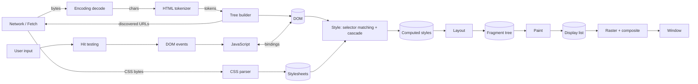
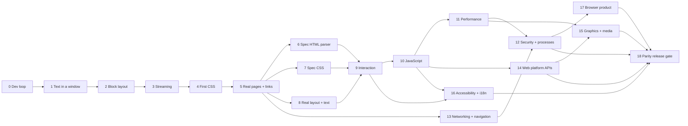

# Rust Browser Architecture and Development Roadmap

This document describes the architecture we are building toward and the order
in which we should build it.

The roadmap is organized for learning. We first build a **thin, naive version
of the whole pipeline** so that something appears on screen early. Then we
repeatedly replace naive pieces with spec-correct, production-style versions.
The page keeps rendering throughout, so every improvement is visible.

Real browsers such as Chromium, Firefox (Gecko/Servo), and WebKit differ in
details, but they share the same core ideas. We follow those ideas while
keeping the codebase small enough to learn from.

## How to use this roadmap

- Work through milestones in order. Within a milestone, do steps in order.
- Each step should fit in roughly one work session and one commit.
- Every step ends with **You'll see**: a new passing test, a debug dump, or a
  visible change in the window. If a step can't show a result, split it or
  add a debug tool that makes the result visible.
- Naive shortcuts are intentional. Each is marked **(naive)** and has a later
  step that replaces it. Keep the shortcuts behind the same interface as the
  real version so the replacement is local.
- Check off steps (`- [x]`) as they land, and update the "Current state"
  table when a milestone is complete.
- Later steps that cover a whole specification or test suite are umbrellas.
  When you start one, split it into session-sized substeps below it and keep
  the umbrella checkbox until its conformance target is met.
- A milestone with **Exit criteria** is complete only when those criteria
  pass, not when every step has been started.

## Guiding principles

1. **Follow the specifications.** HTML, CSS, DOM, URL, Fetch, and Encoding are
   defined by WHATWG and W3C specs. Name types and steps after the spec where
   practical, and link the relevant section in comments.
2. **Never reject the web.** Browsers recover from malformed input instead of
   failing. Parsers should record parse errors for diagnostics, but still
   produce a document or stylesheet.
3. **Stream and work incrementally.** Parse data as it arrives. Later, restyle,
   re-layout, and repaint only what changed.
4. **Keep stages separate.** Each pipeline stage consumes the previous stage's
   output through a narrow interface. Layout should not parse CSS; paint should
   not inspect the DOM.
5. **Test against shared test suites.** Use html5lib-tests, the CSS parsing
   tests, and Web Platform Tests (WPT) rather than only hand-written examples.
6. **Build what teaches us; reuse what does not.** Implement engine concepts
   ourselves. Use proven crates for specialized infrastructure such as TLS,
   image decoding, font rasterization and shaping, and GPU access.
7. **Design for untrusted content.** Everything from the network is hostile.
   Avoid panics on input, bound resource usage, and plan for process isolation.
8. **Measure parity; don't assume it.** "Works like Chrome and Firefox" is a
   set of measured gates (see [Standards parity target](#standards-parity-target)),
   rechecked every release because the platform keeps changing.

## Current state

| Area | Location | Status |
| --- | --- | --- |
| App entry | `src/app` | Loads a page, builds layout, and supports DOM/layout/display-list dumps. |
| Networking | `src/net` | Streams HTTP and file bodies with incremental UTF-8 decoding. |
| HTML | `src/html` | Resumable parser for a limited HTML subset; not WHATWG-compliant. |
| DOM | `src/dom` | Arena of nodes addressed by `NodeId`; supports append only. |
| CSS | `src/css` | Rule-level parser. Selectors and values are kept as raw strings. |
| Layout | `src/layout` | Naive block/inline boxes, vertical flow, basic text styling, and list markers. |
| Paint | `src/paint` | Builds and rasterizes a display list from layout fragments. |

The DOM arena with stable IDs is a good foundation. The existing CSS rule
parser is used in Milestone 4 and rebuilt on a tokenizer in Milestone 7.

## Target architecture

This is the end state. The milestones build toward it one stage at a time.

### Rendering pipeline



| Stage | Input | Output | Notes |
| --- | --- | --- | --- |
| Fetch | URL, request | Response bytes and metadata | Handles redirects, headers, and eventually caching and cookies. |
| Decode | Bytes and charset | Unicode text | Uses the Encoding spec's sniffing rules. |
| HTML parse | Text chunks | DOM mutations | Uses a resumable tokenizer and insertion modes. |
| CSS parse | Text | Stylesheet object model | Tokenizes, then parses rules, selectors, and values. |
| Style | DOM and stylesheets | Computed value per element | Handles specificity, origin, inheritance, and initial values. |
| Box generation | DOM and styles | Box tree | Applies `display`, generates anonymous boxes, and skips `display: none`. |
| Layout | Box tree and viewport | Fragment tree | Computes positioned rectangles, line boxes, and glyph runs. |
| Paint | Fragment tree | Display list | Creates drawing commands in paint order and stacking contexts. |
| Raster/composite | Display list | Pixels | Starts in software; later uses GPU layers. |

### Target module layout

Add modules when a milestone first needs them. Split into a Cargo workspace
when compile times or dependency boundaries justify it.

```text
src/
  app/        window, event loop, browser UI shell (tabs, URL bar)
  engine/     navigation, per-document "frame" that owns the pipeline
  net/        fetch, HTTP, redirects, cache, cookies
  html/       tokenizer/  tree_builder/  (streaming, spec-based)
  dom/        nodes, document, mutation API, events
  css/        tokenizer/  parser/  selectors/  values/
  style/      matching, cascade, computed values, invalidation
  layout/     box tree, block, inline, text, flex, grid
  text/       font loading, shaping, line breaking
  paint/      display list and stacking contexts
  gfx/        rasterization and compositing
  script/     JS engine integration, DOM bindings, event loop
  media/      image, audio, and video decoding and playback
  a11y/       accessibility tree and platform bridges
  webdriver/  WebDriver and WebDriver BiDi automation
  devtools/   DOM, style, layout, and display-list dumps
```

### Key data-model decisions

- **The DOM is an arena, not `Rc<RefCell<...>>`.** Keep `NodeId` indexes. This
  avoids reference cycles and supports style caches and layout side tables
  keyed by `NodeId`. Node removal will require tombstones or
  generation-checked IDs so old IDs cannot refer to reused slots.
- **Layout does not mutate the DOM.** Styles, boxes, and fragments are
  separate trees or side tables that can be rebuilt. This keeps incremental
  invalidation manageable.
- **Paint produces a display list, not pixels.** Layout and paint never call
  the rasterizer directly. This lets us swap software rendering for GPU
  rendering later and makes paint output testable.
- **Strings will need interning.** Tag names, attribute names, and CSS
  identifiers repeat constantly. Introduce an atom type (similar to Servo's
  `string_cache`) before selector matching becomes expensive.
- **Parsers own resumable state.** HTML and CSS tokenizers should become state
  machines driven by `feed(chunk)` and `finish()`.

## Standards parity target

The finished browser should be interchangeable with current stable Chrome and
Firefox for users and web developers. No roadmap can guarantee that once and
for all: standards change every release, and both engines also implement
de facto behavior that specifications describe only partially. Parity is
therefore defined as measurable gates that are enforced continuously.

### Standards in scope

| Area | Standards | Conformance evidence |
| --- | --- | --- |
| Markup and DOM | WHATWG HTML, DOM, Infra, DOM Parsing; XML 1.0 and Namespaces in XML; SVG 2; MathML Core | html5lib-tests, WPT |
| Script | ECMA-262, ECMA-402 (Intl), ECMA-404 (JSON), WHATWG Web IDL, WebAssembly Core, JS API, and Web API | Test262, WebAssembly spec tests, WPT `webidl/` and `wasm/` |
| Style and layout | CSSWG modules in the current CSS snapshot, CSSOM, CSSOM View, Web Animations, WHATWG Compat and Quirks Mode | css-parsing-tests, WPT `css/` reftests |
| Networking | WHATWG URL, Fetch, Encoding, MIME Sniffing, Streams, XHR, WebSockets; IETF HTTP (RFC 9110–9114), QUIC (RFC 9000), TLS 1.3 (RFC 8446), cookies (RFC 6265bis), HSTS (RFC 6797) | WPT, h2spec, QUIC Interop Runner |
| Storage and workers | WHATWG Storage, HTML Web Storage and workers, IndexedDB, Service Workers | WPT |
| Graphics and media | HTML canvas and media elements, WebGL, WebGPU and WGSL, Media Source Extensions, Web Audio, WebCodecs, WebRTC | Khronos WebGL CTS, WebGPU CTS, WPT |
| Security and privacy | HTML origins, CORS, CSP, Mixed Content, Referrer Policy, Fetch Metadata, Permissions Policy, SRI, Trusted Types, COOP/COEP | WPT, fuzzing, external audit |
| Accessibility and i18n | WAI-ARIA, Core-AAM, HTML-AAM, Accessible Name Computation, WCAG for browser UI, Unicode (UAX #9, #14, #29) and CLDR | WPT `accname/`, `*-aam/`, `wai-aria/`; screen reader scripts; Unicode test data |
| Automation | W3C WebDriver and WebDriver BiDi | WPT `webdriver/`, `wptrunner` |

### Parity gates

1. **Feature coverage.** Track features with
   [web-features](https://github.com/web-platform-dx/web-features) and
   [MDN browser-compat-data](https://github.com/mdn/browser-compat-data).
   Implement every Baseline feature and every feature shipped in both stable
   Chrome and Firefox. Generate a report of missing features by milestone.
2. **Conformance.** For each WPT directory, pass at least as many tests as
   the lower of stable Chrome and Firefox on [wpt.fyi](https://wpt.fyi/), with
   the higher as the long-term target. Match or exceed both on
   [Interop](https://wpt.fyi/interop) focus areas. For Test262, match the
   pass rate of V8 or SpiderMonkey. Other suites, such as html5lib-tests and
   the graphics CTSs, must pass apart from documented, justified exclusions.
3. **Web compatibility.** Load a corpus of top sites, such as the Tranco top
   1,000, and compare screenshots, console errors, and scripted user flows
   with Chrome and Firefox. Classify every difference as our bug, a spec
   issue, or an entry for the WHATWG Compat or Quirks Mode standards.
4. **Performance.** Score within an ADR-recorded margin (initially 20%) of
   Chrome and Firefox on the same hardware for Speedometer 3, JetStream 2,
   MotionMark, page-load metrics (LCP, INP, CLS), and memory use.
5. **Security and stability.** Continuously fuzz parsers and IPC boundaries,
   run sanitizers in CI, sandbox renderers, isolate sites, and pass an
   external security review before release.
6. **Accessibility.** Expose an accessibility tree through platform APIs,
   meet the accessibility conformance gate, and complete scripted screen
   reader workflows on every supported platform.

Each remaining milestone has **Exit criteria** that apply these gates to its
area. Milestone 18 applies them to the whole browser and keeps them enforced.

## Milestones

Milestones 1–5 build the thin end-to-end browser. Milestones 6–8 make each
stage correct against the specs. Milestones 9–12 add interactivity, scripting,
performance, and security. Milestones 13–17 complete the web platform and the
browser product, and Milestone 18 enforces parity with Chrome and Firefox.



Milestones 6, 7, and 8 are independent and can be interleaved. Milestone 13
can start after Milestone 5 and must provide Fetch before 12.1 needs CORS.

### Milestone 0: A fast development loop

**Goal:** Make it easy to load any page and inspect each pipeline stage.

- [x] **0.1 Take the URL from the command line.** `cargo run -- <url>`, with
  `https://example.com` as the default.
  *You'll see:* the DOM dump for any site you choose.
- [x] **0.2 Load local files.** Accept a file path or `file://` URL, and add
  `tests/pages/` with small hand-written HTML pages.
  *You'll see:* your own test pages parsed without network access.
- [x] **0.3 Pretty-print the DOM as an indented tree.** Add a `devtools`
  module with `dump_dom`, and a `--dump=dom` flag, instead of `{:#?}`.
  *You'll see:* a readable tree such as `<body>` → `<p>` → `"Hello"`.
- [x] **0.4 Add snapshot tests.** Compare `dump_dom` output for test pages with
  committed `.expected` files, for example using the `insta` crate.
  *You'll see:* parser changes show up as readable diffs.

### Milestone 1: Text in a window

**Goal:** See the page's words in a real window as early as possible.

- [x] **1.1 Open a window.** Use `winit` for the window and `softbuffer` for a
  CPU framebuffer. Fill it with white.
  *You'll see:* an empty browser window that closes cleanly.
- [x] **1.2 Draw one string.** Bundle an open-licensed font (for example Noto
  Sans, under `assets/fonts/`) and rasterize glyphs with `fontdue` or
  `ab_glyph`. **(naive)** No shaping yet; replaced in 8.6.
  *You'll see:* "Hello, browser" rendered in the window.
- [x] **1.3 Draw the document's text.** Walk the DOM, collect text nodes, and
  skip `head`, `script`, and `style`. Draw them one after another on a single
  line. **(naive)** Replaced by layout in Milestone 2.
  *You'll see:* example.com's words in the window.
- [x] **1.4 Wrap words.** Split text on whitespace and start a new line when
  the next word would overflow the window width. **(naive)** Replaced by
  inline layout in 8.4.
  *You'll see:* readable paragraphs.
- [x] **1.5 Re-wrap on resize.** Recompute line positions on window resize.
  *You'll see:* text reflowing as you drag the window edge, which is layout
  reacting to viewport changes.
- [x] **1.6 Scroll.** Offset drawing by a scroll position controlled by the
  mouse wheel and arrow keys. Draw only lines that are visible.
  *You'll see:* long pages that you can scroll.
- [x] **1.7 Introduce a display list.** Have text placement produce
  `Vec<DisplayItem>` values such as `Text { x, y, text, size }` and
  `Rect { x, y, w, h, color }`, then have a separate rasterizer draw them.
  *You'll see:* the same output, now with the paint/raster separation real
  browsers use. Add `--dump=display-list`.

### Milestone 2: Boxes and block layout

**Goal:** Turn the DOM into a layout tree and render document structure.

- [x] **2.1 Build a layout tree.** Create a `layout` module with a box tree
  parallel to the DOM. Classify elements as block or inline using a
  hard-coded list (`div`, `p`, `h1`–`h6`, `ul`, `li`, and so on).
  **(naive)** Replaced by the CSS `display` property in 4.5.
  *You'll see:* `--dump=layout` prints the box tree.
- [x] **2.2 Stack blocks vertically.** Give each block box `x`, `y`, `width`,
  and `height`. Children stack from top to bottom, and each block's width is
  its parent's width.
  *You'll see:* paragraphs separated into their own lines.
- [x] **2.3 Add a debug overlay.** Toggle outlines around each box with F12.
  *You'll see:* the box tree drawn over the page, much like browser
  developer tools.
- [x] **2.4 Size headings and add spacing.** Hard-code larger font sizes for
  `h1`–`h6` and vertical margins for `p` and headings. **(naive)** Replaced by
  the user-agent stylesheet in 4.4.
  *You'll see:* a page hierarchy that looks roughly like a real browser.
- [x] **2.5 Support inline formatting.** Handle `b`, `strong`, `i`, and `em`
  with bold and italic styling, and handle `br`. Styles are synthesized from
  the bundled regular face until font-face selection is added.
  *You'll see:* emphasis and manual line breaks.
- [x] **2.6 Add list markers.** Indent `ul` and `ol`, and draw bullets or
  numbers for `li`.
  *You'll see:* lists rendered as lists.

### Milestone 3: Streaming parsing

**Goal:** Parse HTML while it downloads, as real browsers do.

- [x] **3.1 Add a resumable parser API.** Introduce
  `HtmlParser::feed(&str) -> Result<(), HtmlError>` and
  `finish() -> Result<Document, HtmlError>`, and keep `parse(&str)` as a
  wrapper around them. Buffer incomplete tags between chunks for now.
  *You'll see:* all existing parser tests still pass through the new API.
- [x] **3.2 Test chunk boundaries.** Assert that splitting input at every
  possible character boundary produces the same DOM.
  *You'll see:* tests catching splits inside tags, attributes, comments, and
  multi-byte characters.
- [x] **3.3 Stream the network body.** Read the response in chunks, decode
  UTF-8 incrementally without splitting multi-byte characters, and feed each
  chunk to the parser.
  *You'll see:* `--trace` logs the DOM node count after each chunk.
- [x] **3.4 Move loading off the UI thread.** Fetch and parse on a worker
  thread and send results to the window through a channel.
  *You'll see:* the window opens and stays responsive while a page loads.
- [x] **3.5 Render progressively.** Re-run layout and paint on partial DOMs.
  Use `--throttle-ms <milliseconds>` to slow chunks so the effect is visible.
  *You'll see:* a slow page render from top to bottom as it arrives.

**Measure the tradeoff:** Run `cargo bench --bench streaming` for a
dependency-free, release-mode comparison. It reports median parsing CPU time
with and without DOM snapshots, and time to first text versus complete DOM
over a controlled slow loopback HTTP response. The buffered reference uses
the same parser after downloading the entire body; this isolates streaming,
not changes from the old tokenizer. These are DOM timings, not first-paint
timings, and the benchmark excludes the UI channel, layout, and rasterization.

**Naive limitations:** Each progress update clones the entire DOM and rebuilds
layout. The UI consumes at most one snapshot per event-loop turn so a busy
loader cannot indefinitely postpone redraws. Trailing text waits for the next
`<` or EOF, and incomplete markup is rescanned on each feed. Streaming improves
early-content latency, but these costs can make total processing slower.

Example measurements on ARM64 macOS with Rust 1.98.0 (2026-10-10, medians of
seven release-mode samples; 64 KiB HTTP body, 40 ms before headers, eight 8 KiB
writes 20 ms apart):

| Measurement | Buffered | Streaming |
| --- | --- | --- |
| HTTP: first text in DOM | 216.8 ms | 44.9 ms |
| HTTP: complete DOM | 216.8 ms | 211.0 ms |
| 1 MiB paragraphs: parsing only | 2.62 ms | 2.75 ms |
| 1 MiB paragraphs: parsing and progress snapshots | N/A | 97.18 ms |
| 1 MiB single attribute: parsing only | 4.38 ms | 186.79 ms |

The HTTP streaming measurements include snapshots, but not rendering. First
text was about 79% earlier; total-load differences were small and varied
between runs. The large-attribute case demonstrates the cost of rescanning
incomplete markup, not a typical page.

### Milestone 4: First CSS

**Goal:** Apply real styles using the existing CSS parser.

- [ ] **4.1 Collect `<style>` text.** Parse each `<style>` element's contents
  with `css::parse` and list the resulting rules.
  *You'll see:* `--dump=stylesheets` prints the page's rules.
- [ ] **4.2 Parse simple selectors.** Parse type, `.class`, `#id`, and
  descendant selectors from rule preludes. Compute specificity.
  *You'll see:* unit tests for selectors and their specificity.
- [ ] **4.3 Match and apply `color` and `background-color`.** Build a
  `style` module that matches rules against elements and parses named and
  hexadecimal colors. Apply the winning value by specificity and source order.
  *You'll see:* the first styled page, with colors taken from its CSS.
- [ ] **4.4 Replace hard-coded styles with a user-agent stylesheet.** Move the
  font sizes, margins, and block/inline list from Milestone 2 into a built-in
  stylesheet based on the HTML spec's rendering section.
  *You'll see:* the same rendering, now driven entirely by CSS.
- [ ] **4.5 Use `display`, `font-size`, `margin`, and `padding`.** Read these
  from computed styles in layout. Support `px`, `em`, and `%` for margins,
  padding, and widths.
  *You'll see:* page CSS changing spacing and layout.
- [ ] **4.6 Add inheritance.** Inherit `color`, `font-size`, and
  `font-family` from parent elements.
  *You'll see:* text inheriting its container's color.
- [ ] **4.7 Draw borders and backgrounds.** Paint `border-width`,
  `border-color`, and `background-color` rectangles.
  *You'll see:* boxes with visible borders and backgrounds.
- [ ] **4.8 Support `style=""` attributes.** Parse inline declarations and
  apply them above stylesheet rules.
  *You'll see:* inline styles overriding stylesheet rules.

### Milestone 5: Real pages and links

**Goal:** Browse between real pages.

- [ ] **5.1 Resolve URLs.** Use the `url` crate to resolve relative URLs
  against the document URL and `<base href>`.
  *You'll see:* unit tests for relative, absolute, and fragment URLs.
- [ ] **5.2 Load external stylesheets.** Fetch `<link rel=stylesheet>` files
  and add them to the cascade in document order.
  *You'll see:* sites with external CSS render with their styles.
- [ ] **5.3 Make links clickable.** Hit-test a click to a layout box, find
  the enclosing `<a href>`, and navigate. **(naive)** Replaced by full hit
  testing and DOM events in Milestone 9.
  *You'll see:* clicking a link loads the next page.
- [ ] **5.4 Add back and forward.** Keep a history stack with keyboard
  shortcuts. **(naive)** Replaced by navigables and session history in 13.7.
  *You'll see:* navigation back and forth between pages.
- [ ] **5.5 Show the URL in the title bar.** Also show a loading indicator.
  *You'll see:* the current page and loading state.
- [ ] **5.6 Render images.** Fetch `` sources, decode them with the
  `image` crate, and lay them out using their intrinsic size and `width` and
  `height` attributes.
  *You'll see:* images on pages.
- [ ] **5.7 Handle redirects and errors.** Follow redirects and show an error
  page for failed loads. **(naive)** Replaced by Fetch redirects in 13.2.
  *You'll see:* failed loads produce a helpful page instead of a crash.

**Checkpoint:** You now have a small working browser. Milestones 6–8 make its
stages spec-correct one at a time.

### Milestone 6: A spec-correct HTML parser

**Goal:** Parse HTML the way the WHATWG HTML Standard specifies.

**Scope:** Cover all applicable tokenizer states and tree-construction rules,
not only the examples below. Track missing rules against their specification
sections; script-execution integration belongs to 10.6.

- [ ] **6.1 Add the html5lib-tests harness.** Add the suite as a git
  submodule or vendored data. Run tokenizer, document, and fragment cases,
  reporting tokenizer and tree-construction pass rates separately without
  failing CI yet. Also run cases across chunk boundaries: equivalent chunked
  output alone does not establish HTML5 correctness.
  *You'll see:* a baseline pass rate. Each following step should raise it.
- [ ] **6.2 Tokenizer: data, tag, and attribute states.** Replace the
  tokenizer with the spec's state machine, starting with the core states in
  [HTML section 13.2.5]. Keep the `feed` API, retaining state and partially
  built tokens rather than rescanning buffered input. Implement the specified
  tag-name, attribute, case-folding, and duplicate-attribute rules, character
  and EOF tokens, and self-closing tag metadata.
  *You'll see:* tokenizer test pass rate increase, and the large split
  attribute benchmark no longer pays for repeated scans.
- [ ] **6.3 Tokenizer: comments and doctypes.** Emit comment and doctype
  tokens, and add comment and doctype nodes to the DOM. Cover malformed and
  bogus comments, doctype public/system identifiers, and the force-quirks
  flag consumed by the tree builder.
  *You'll see:* comments and doctypes in `--dump=dom`.
- [ ] **6.4 Tokenizer: character references.** Decode named and numeric
  character references using the spec's entity table. Cover decimal and
  hexadecimal forms, context-dependent text/attribute and semicolon rules,
  and invalid-code-point recovery.
  *You'll see:* `&amp;`, `&copy;`, and `&#8212;` render correctly.
- [ ] **6.5 Tokenizer: contextual text states.** Handle RCDATA for `title`
  and `textarea`, RAWTEXT for `style` and other raw-text elements, script data
  including escaped and double-escaped states, and PLAINTEXT. Have the tree
  builder switch tokenizer states, with context-appropriate end-tag matching.
  *You'll see:* `<style>` contents containing `<` no longer break parsing.
- [ ] **6.6 Make parse errors non-fatal.** Record errors as diagnostics with
  source positions and apply the spec's tokenizer and tree-builder recovery
  rules rather than aborting on malformed HTML. Cover literal `<` in text,
  malformed attributes, state-specific NULL handling, input control-character
  and noncharacter diagnostics, and EOF recovery for incomplete constructs.
  *You'll see:* `--dump=parse-errors` lists problems while pages still render.
- [ ] **6.7 Tree builder: implied `html`, `head`, and `body`.** Implement the
  `initial`, `before html`, `before head`, `in head`, `after head`, and
  `in body` insertion modes, and select no-quirks, limited-quirks, or quirks
  document mode from doctype information.
  *You'll see:* bare text such as `Hello` produces a full document structure.
- [ ] **6.8 Tree builder: implied end tags.** Automatically close elements
  such as `p` and `li` when the spec requires it.
  *You'll see:* `<p>a<p>b` produces sibling paragraphs.
- [ ] **6.9 Tree builder: active formatting elements.** Implement the list of
  active formatting elements and the adoption agency algorithm.
  *You'll see:* misnested markup such as `<b><i></b></i>` matches browsers.
- [ ] **6.10 Tree builder: tables.** Implement table insertion modes and
  foster parenting.
  *You'll see:* stray content in tables is moved where browsers place it.
- [ ] **6.11 Tree builder: SVG and MathML.** Add namespaces and foreign
  content rules, including HTML integration points, tag/attribute name
  adjustments, and self-closing tag handling. Feed foreign-content context
  back to the tokenizer so CDATA is recognized only where permitted.
  *You'll see:* inline SVG elements have the correct namespace in the DOM.
- [ ] **6.12 Detect encodings.** Use `encoding_rs` with the BOM,
  `Content-Type` charset, and `<meta charset>` prescan. Apply encoding
  precedence, fallback, replacement decoding, and parser-restart rules rather
  than assuming strict UTF-8. This belongs before tokenization.
  *You'll see:* non-UTF-8 pages display correctly.
- [ ] **6.13 Fuzz the parser.** Add a `cargo fuzz` target.
  *You'll see:* fuzzing runs without panics.
- [ ] **6.14 Tree builder: templates and remaining parsing rules.**
  Implement template contents and the template insertion-mode stack. Complete
  remaining insertion modes and element-specific rules, including `noscript`
  behavior controlled by the scripting flag, select handling, after-body
  modes, and legacy frameset parsing.
  *You'll see:* template content stays outside the document's rendered tree,
  and the remaining tree-construction conformance cases pass.
- [ ] **6.15 Parse HTML fragments with context.** Initialize tokenizer and
  tree-builder state from the context element, namespace, document mode, and
  scripting flag. Reuse this parser for markup-insertion DOM APIs later.
  *You'll see:* fragment tests for contexts such as `textarea`, `table`,
  `template`, and SVG match the specification.
- [ ] **6.16 Parse XML documents.** Add an XML 1.0 and Namespaces in XML
  parser for `application/xhtml+xml`, `image/svg+xml`, and other XML MIME
  types. Display well-formedness errors as browsers do, and reuse it for
  `DOMParser` and `XMLSerializer` later.
  *You'll see:* XHTML and standalone SVG documents load with the right
  namespaces, and malformed XML shows an error document.

**Exit criteria:** A 90% tree-construction pass rate is an intermediate
checkpoint, not proof of WHATWG completeness. Complete this milestone when
the applicable html5lib tokenizer and tree-construction suites pass and CI
prevents regressions. Document any script-execution-dependent exclusions and
carry them explicitly into 10.6; chunk-boundary tests must continue to pass.
WPT `html/syntax/`, `encoding/`, and the parsing parts of `domparsing/` must
meet the conformance gate once 9.8 can run WPT.

### Milestone 7: Spec-correct CSS

**Goal:** Parse and cascade CSS as the CSS specifications define.

- [ ] **7.1 Add a CSS tokenizer.** Implement CSS Syntax Level 3 tokens:
  identifiers, functions, hashes, strings, numbers, dimensions, and
  percentages.
  *You'll see:* `--dump=css-tokens` and passing css-parsing-tests token cases.
- [ ] **7.2 Rebuild the rule parser on tokens.** Keep the current AST, and use
  spec error recovery so an invalid declaration or rule drops only itself.
  *You'll see:* broken CSS no longer discards the rest of the stylesheet.
- [ ] **7.3 Complete selectors.** Add attribute selectors, child and sibling
  combinators, and pseudo-classes such as `:first-child` and `:not()`.
  *You'll see:* selector tests for each new form.
- [ ] **7.4 Implement the full cascade.** Handle origins, `!important`,
  `inherit`, `initial`, and `unset`.
  *You'll see:* `!important` and explicit keywords behaving as in browsers.
- [ ] **7.5 Parse typed values and shorthands.** Represent lengths, colors,
  keywords, and percentages as types, and expand shorthands such as `margin`,
  `border`, `font`, and `background`.
  *You'll see:* `--dump=style` shows typed computed values per element.
- [ ] **7.6 Speed up matching.** Match selectors right to left, add a rule hash
  keyed by ID, class, and tag, and add an ancestor Bloom filter.
  *You'll see:* a benchmark showing style time drop on a large page.
- [ ] **7.7 Add media queries.** Support `@media` width queries.
  *You'll see:* responsive sites changing layout as the window resizes.
- [ ] **7.8 Add custom properties.** Support `--name` declarations and
  `var()`.
  *You'll see:* sites using CSS variables render their themes.
- [ ] **7.9 Complete values and units.** Implement CSS Values and Units 4:
  `calc()` and the other math functions, `rem`, `ch`, `ex`, `lh`, viewport
  units including `svh`, `lvh`, and `dvh`, and angle, time, and resolution
  types. Distinguish specified, computed, used, and actual values.
  *You'll see:* `calc(100% - 2rem)` and `clamp()` layouts match browsers.
- [ ] **7.10 Complete colors.** Implement CSS Color 4 and 5: all color
  functions, `lab()`, `lch()`, `oklab()`, `oklch()`, `color()`,
  `color-mix()`, relative colors, `currentcolor`, system colors, and
  interpolation color spaces.
  *You'll see:* WPT `css/css-color/` reftests pass for wide-gamut colors.
- [ ] **7.11 Complete at-rules and cascade control.** Support `@import` with
  layer, supports, and media conditions; `@supports`; `@namespace`;
  `@layer`; `@scope`; CSS Nesting; `@property`; and `revert` and
  `revert-layer`. Compute the cascade exactly as CSS Cascade 5 and 6 define.
  *You'll see:* layered frameworks and nested stylesheets cascade correctly.
- [ ] **7.12 Complete Selectors Level 4.** Add `:is()`, `:where()`,
  `:has()`, `:nth-child(An+B of S)`, link, input, and user-action
  pseudo-classes, and pseudo-elements including `::before`, `::after`,
  `::marker`, `::first-line`, `::first-letter`, `::placeholder`,
  `::selection`, and `::backdrop`. Connect interaction states to Milestone 9.
  *You'll see:* WPT `css/selectors/` reaches the conformance gate.
- [ ] **7.13 Add conditional rules.** Implement Media Queries 4 and 5,
  including range syntax and `prefers-*` features, container queries, and
  container query units.
  *You'll see:* components responding to their container size.
- [ ] **7.14 Generate property support from spec data.** Generate property
  grammars, initial values, inheritance, computed-value rules, and animation
  types from machine-readable data such as
  [webref](https://github.com/w3c/webref). Report snapshot properties that
  remain unimplemented.
  *You'll see:* a generated CSS coverage report that shrinks over time.
- [ ] **7.15 Implement CSS compatibility behavior.** Apply the Quirks Mode
  Standard for documents in quirks mode from 6.7, and support the prefixed
  aliases and behaviors required by the WHATWG Compat Standard.
  *You'll see:* quirks-mode pages and `-webkit-` properties render like
  Chrome and Firefox.

**Exit criteria:** Every Baseline CSS feature parses, cascades, and computes
correctly. css-parsing-tests pass, and WPT directories for syntax,
selectors, cascade, values, color, variables, nesting, conditional rules,
and the CSSOM parts covered here meet the conformance gate.

### Milestone 8: Real layout and text

**Goal:** Replace naive layout with the CSS visual formatting model.

- [ ] **8.1 Generate anonymous boxes.** Wrap inline content that sits next to
  blocks in anonymous block boxes.
  *You'll see:* mixed block and inline content matches browsers in the
  debug overlay.
- [ ] **8.2 Compute widths and auto margins.** Implement the CSS 2 width
  equations, including `margin: auto` centering.
  *You'll see:* centered page containers.
- [ ] **8.3 Collapse margins.** Implement vertical margin collapsing.
  *You'll see:* spacing between paragraphs matches browsers.
- [ ] **8.4 Implement inline layout.** Build line boxes with baselines,
  `line-height`, `vertical-align: baseline`, and `text-align`, and split inline
  boxes across lines.
  *You'll see:* mixed font sizes on one line align on a common baseline.
- [ ] **8.5 Break lines correctly.** Use Unicode line breaking (UAX #14) with
  `unicode-linebreak` and support `white-space`.
  *You'll see:* URLs, CJK text, and `<pre>` wrap correctly.
- [ ] **8.6 Shape text.** Use `rustybuzz` or `swash` for shaping, discover
  system fonts with `fontdb`, and add font fallback.
  *You'll see:* ligatures, kerning, and non-Latin scripts render correctly.
- [ ] **8.7 Load web fonts.** Support `@font-face`.
  *You'll see:* sites render in their chosen fonts.
- [ ] **8.8 Implement positioned layout and stacking.** Support `relative`,
  `absolute`, `fixed`, `z-index`, and CSS 2 Appendix E painting order.
  *You'll see:* overlays and fixed headers.
- [ ] **8.9 Handle overflow.** Support `overflow: hidden` and nested
  scroll containers.
  *You'll see:* clipped content and scrollable panels.
- [ ] **8.10 Implement flexbox.**
  *You'll see:* navigation bars and card rows as designed.
- [ ] **8.11 Implement grid.**
  *You'll see:* grid-based page layouts.
- [ ] **8.12 Implement floats and tables.**
  *You'll see:* older sites and data tables laid out correctly.
- [ ] **8.13 Add reftests.** Render test pages and compare screenshots with
  reference pages or committed images. Use the WPT reftest format so the
  same tests run through `wptrunner` after 9.8.
  *You'll see:* layout regressions caught automatically.
- [ ] **8.14 Support writing modes and bidirectional text.** Implement the
  Unicode Bidirectional Algorithm (UAX #9), CSS Writing Modes 4, logical
  properties, and vertical text.
  *You'll see:* Arabic, Hebrew, and vertical Japanese pages lay out
  correctly.
- [ ] **8.15 Complete display types, sizing, and replaced elements.**
  Implement CSS Display 3 (`contents`, `flow-root`, and multi-keyword
  values), Box Alignment 3, CSS Sizing 3 and 4 (`min-content`,
  `max-content`, `fit-content`, `aspect-ratio`), `object-fit`, and
  `object-position`. Size replaced elements such as `img`, `video`,
  `canvas`, and `iframe` by their intrinsic dimensions.
  *You'll see:* intrinsic-sizing WPT reftests pass.
- [ ] **8.16 Complete text and fonts.** Implement CSS Text 3 and 4 (including
  justification, hyphenation, `word-break`, and `text-transform`), Text
  Decoration 4, CSS Fonts 4 (including variable, color, and emoji fonts),
  Unicode text segmentation (UAX #29), CSS Lists 3, and Counter Styles 3.
  *You'll see:* text-heavy multilingual pages match browser rendering.
- [ ] **8.17 Add transforms, effects, and compositing.** Implement 2D and 3D
  transforms, `opacity`, filters, `backdrop-filter`, Compositing and Blending,
  masking, `clip-path`, and the stacking contexts they create.
  *You'll see:* transformed and filtered content matches reference images.
- [ ] **8.18 Add animations.** Implement CSS Transitions, CSS Animations, the
  Web Animations model, and scroll-driven animations. Integrate their timing
  with the HTML rendering update steps in 10.11.
  *You'll see:* animated pages move at the same times as in browsers.
- [ ] **8.19 Complete scrolling.** Implement `position: sticky`, scroll
  snapping, `scroll-behavior`, overscroll behavior, scrollbar styling, and
  scrolling to fragments.
  *You'll see:* sticky headers and snap carousels behave correctly.
- [ ] **8.20 Add fragmentation and printing layout.** Implement multicolumn
  layout, CSS Fragmentation, and paged media with `@page`.
  *You'll see:* multicolumn articles and print preview pages split
  correctly.
- [ ] **8.21 Render SVG and MathML.** Implement SVG 2 rendering, including
  paths, text, gradients, patterns, markers, `use`, and SVG images, and
  implement MathML Core layout.
  *You'll see:* inline SVG icons and equations render as in browsers.
- [ ] **8.22 Support high-DPI and color management.** Render at the device
  pixel ratio, support page zoom, and convert images and CSS colors between
  color spaces for the display profile.
  *You'll see:* crisp text on Retina displays and accurate wide-gamut color.

**Exit criteria:** Every Baseline layout and rendering feature is
implemented. WPT `css/` layout, text, fonts, writing modes, transforms,
animations, `svg/`, and `mathml/` directories meet the conformance gate.

### Milestone 9: Interaction

**Goal:** Support the input and events that make pages interactive.

- [ ] **9.1 Hit-test with the fragment tree.** Account for stacking order,
  positioning, and scrolling.
  *You'll see:* a hover debug overlay highlighting the element under the
  cursor.
- [ ] **9.2 Implement DOM events.** Dispatch through capture, target, and
  bubble phases, with `preventDefault`.
  *You'll see:* an event log in `--trace` for clicks and key presses.
- [ ] **9.3 Add focus and keyboard navigation.** Support focus and tab order.
  *You'll see:* Tab moving a focus ring through links.
- [ ] **9.4 Implement text selection and copying.**
  *You'll see:* highlighted text copied to the clipboard.
- [ ] **9.5 Add form controls.** Support `<input>`, `<button>`, and
  `<textarea>`.
  *You'll see:* text typed into fields.
- [ ] **9.6 Submit forms.** Support GET and POST.
  *You'll see:* working search boxes on real sites.
- [ ] **9.7 Build browser UI.** Add a URL bar and tabs.
  *You'll see:* the program feels like a browser.
- [ ] **9.8 Implement WebDriver and run WPT.** Implement enough W3C
  WebDriver and WebDriver BiDi to run Web Platform Tests through `wptrunner`
  with `testdriver.js`. Run WPT in CI, publish results in wpt.fyi format, and
  compare them with Chrome and Firefox.
  *You'll see:* a per-directory WPT dashboard with all three browsers.
- [ ] **9.9 Complete input events.** Implement UI Events, including keyboard
  `key` and `code` values and composition events, plus Pointer Events, Touch
  Events, wheel events, and platform input method editors (IMEs).
  *You'll see:* CJK input through an IME and pointer-driven drawing apps
  work.
- [ ] **9.10 Complete forms and top-layer UI.** Support every `<input>` type,
  `<select>`, `<datalist>`, `<dialog>`, `popover`, constraint validation,
  form submission encodings, and form-associated custom elements after 10.10.
  *You'll see:* WPT `html/semantics/forms/` meets the conformance gate.
- [ ] **9.11 Add editing.** Implement `contenteditable`, the Selection API,
  Input Events, undo and redo, and the legacy behavior required for
  `execCommand` compatibility.
  *You'll see:* a rich-text editor works on real sites.
- [ ] **9.12 Add clipboard, drag and drop, and find in page.** Implement the
  Clipboard API, HTML drag and drop, and find in page.
  *You'll see:* content dragged between pages and copied through scripts.

**Exit criteria:** WPT `uievents/`, `pointerevents/`, `touch-events/`,
`html/semantics/forms/`, `editing/`, `selection/`, `clipboard-apis/`, and
`webdriver/` meet the conformance gate.

### Milestone 10: JavaScript

**Goal:** Run scripts that read and change the page.

- [ ] **10.1 Embed an engine.** Choose between `boa` (pure Rust and easy to
  embed) and a faster engine such as V8 through `rusty_v8`. Record the
  decision in an ADR and hide the engine behind a `script` interface. The ADR
  must show a path to the Test262 and benchmark parity gates. Run inline
  `<script>` with `console.log`.
  *You'll see:* script output in the terminal.
- [ ] **10.2 Add the first DOM bindings.** Expose `document`,
  `getElementById`, `querySelector`, `textContent`, and `setAttribute`.
  *You'll see:* a script changing text on the page.
- [ ] **10.3 Support DOM mutation.** Add insertion and removal, and trigger
  restyle and re-layout.
  *You'll see:* script-built content appearing on screen.
- [ ] **10.4 Implement the event loop.** Add tasks, microtasks, and
  `setTimeout`.
  *You'll see:* timers updating the page.
- [ ] **10.5 Add event listeners.** Support `addEventListener`.
  *You'll see:* click handlers running.
- [ ] **10.6 Load scripts correctly.** Support external scripts, `async`,
  `defer`, parser blocking, and `document.write` into the streaming parser.
  Implement parser pause/resume and reentrant tree construction, and close
  the script-execution-dependent parsing exclusions recorded in Milestone 6.
  *You'll see:* script-driven sites loading correctly.
- [ ] **10.7 Add web APIs incrementally.** Add `fetch()`,
  `requestAnimationFrame`, `localStorage`, and ES modules.
  *You'll see:* animations and data-driven pages.
- [ ] **10.8 Run Test262.** Run the full Test262 suite for ECMA-262,
  including Annex B, and ECMA-402. Track finished proposals and staging
  tests separately, and update the engine as TC39 publishes new editions.
  *You'll see:* Test262 pass rates compared with V8 and SpiderMonkey.
- [ ] **10.9 Generate bindings from Web IDL.** Generate DOM bindings from
  spec IDL, implementing Web IDL type conversions, exceptions, overloads,
  extended attributes, and legacy platform objects.
  *You'll see:* WPT `idlharness` tests passing for implemented interfaces.
- [ ] **10.10 Complete the DOM Standard.** Implement ranges, traversal,
  `MutationObserver`, `AbortController`, complete event dispatch, Shadow DOM
  and slots, custom elements, and markup insertion through `innerHTML` and
  related APIs using 6.15.
  *You'll see:* web-component-based sites render and update correctly.
- [ ] **10.11 Complete the HTML event loop.** Implement task sources, timer
  nesting and clamping, `queueMicrotask`, microtask checkpoints, the
  "update the rendering" steps, `requestIdleCallback`, and page lifecycle
  events.
  *You'll see:* event-ordering WPT tests match browsers.

**Exit criteria:** Test262 meets the conformance gate, and WPT `dom/`,
`webidl/`, `custom-elements/`, `shadow-dom/`, `html/webappapis/`, and script
loading directories meet the conformance gate.

### Milestone 11: Performance

**Goal:** Stay responsive on large, changing pages. Measure before optimizing.

- [ ] **11.1 Add tracing and benchmarks.** Time each pipeline stage and add
  `criterion` benchmarks.
  *You'll see:* a per-frame timing breakdown.
- [ ] **11.2 Add dirty tracking.** Restyle and re-layout only changed
  subtrees.
  *You'll see:* timings dropping for small DOM changes.
- [ ] **11.3 Invalidate styles precisely.** Determine which elements a class
  or attribute change can affect.
  *You'll see:* fewer restyled elements reported per change.
- [ ] **11.4 Add a preload scanner.** Find resources in unparsed HTML while the
  parser is blocked on scripts.
  *You'll see:* faster page loads in the loading trace.
- [ ] **11.5 Add layers and compositing.** Scroll and animate by moving layers
  instead of repainting.
  *You'll see:* smooth scrolling on long pages.
- [ ] **11.6 Rasterize on the GPU.** Use `wgpu` or `vello`.
  *You'll see:* lower CPU usage and faster frames.
- [ ] **11.7 Parallelize style computation.** Use `rayon`, as Servo's Stylo
  does.
  *You'll see:* faster styling on multi-core machines.
- [ ] **11.8 Run standard browser benchmarks.** Run Speedometer 3,
  JetStream 2, and MotionMark against Chrome and Firefox on the same
  hardware, and record the results in CI.
  *You'll see:* a benchmark dashboard showing the gap to each browser.
- [ ] **11.9 Make JavaScript fast.** Reach the JavaScript benchmark gate
  through the chosen engine's JIT tiers, inline caches, and generational or
  concurrent garbage collection, or by upgrading the engine selected in
  10.1.
  *You'll see:* the JetStream 2 gap within the parity margin.
- [ ] **11.10 Optimize page loading.** Add speculative parsing, resource
  priorities and Priority Hints, lazy loading, a back/forward cache, and
  off-main-thread scrolling and animations. Measure LCP, INP, and CLS.
  *You'll see:* Core Web Vitals on the compatibility corpus compared with
  Chrome and Firefox.
- [ ] **11.11 Bound memory and power.** Add memory budgets, tab discarding,
  background timer throttling, and memory-pressure handling.
  *You'll see:* memory per tab compared with Chrome and Firefox for the same
  sites.

**Exit criteria:** The performance gate passes for all listed benchmarks,
page-load metrics, and memory measurements.

### Milestone 12: Security and multi-process architecture

**Goal:** Contain untrusted web content.

- [ ] **12.1 Enforce origins.** Implement the same-origin policy, CORS, and
  mixed-content blocking.
  *You'll see:* disallowed requests blocked and logged.
- [ ] **12.2 Add cookies and caching.** Support `Secure`, `HttpOnly`, and
  `SameSite` cookies, HTTP caching, and storage partitioned by origin.
  *You'll see:* logged-in sessions and faster repeat visits.
- [ ] **12.3 Enforce Content Security Policy.**
  *You'll see:* CSP violations reported in the console.
- [ ] **12.4 Split into processes.** Run a privileged browser process for UI,
  networking, and storage, and sandboxed renderer processes connected by
  validated IPC.
  *You'll see:* a crashing page no longer takes down the browser.
- [ ] **12.5 Add site isolation.** Use a separate renderer process per site.
  *You'll see:* one renderer process per site in the process list.
- [ ] **12.6 Secure transport.** Use TLS 1.3 through `rustls`, verify
  certificates with platform trust stores, and support revocation,
  Certificate Transparency, HSTS with the preload list, and HTTPS upgrades.
  *You'll see:* invalid-certificate interstitials and automatic upgrades to
  HTTPS.
- [ ] **12.7 Add cross-origin protections.** Implement Referrer Policy, Fetch
  Metadata, CORP, opaque-response blocking (ORB), COOP, COEP, and
  cross-origin isolation, which gates `SharedArrayBuffer` and
  high-resolution timers.
  *You'll see:* cross-origin isolation reported correctly by
  `crossOriginIsolated`.
- [ ] **12.8 Enforce document policies.** Implement iframe `sandbox`,
  Permissions Policy, Subresource Integrity, Trusted Types,
  `frame-ancestors`, `X-Frame-Options`, and Mixed Content upgrades.
  *You'll see:* framed and injected content blocked as policies specify.
- [ ] **12.9 Protect privacy.** Partition storage, caches, and network state
  by top-level site, block or partition third-party cookies (including CHIPS),
  add a private browsing mode, and reduce fingerprinting surfaces.
  *You'll see:* the same third-party frame sees different storage on
  different sites.
- [ ] **12.10 Operate a security program.** Run continuous fuzzing and
  sanitizers in CI, test sandbox boundaries, commission external audits,
  publish a vulnerability disclosure policy, and ship signed updates.
  *You'll see:* security fixes released through automatic updates.

**Exit criteria:** WPT `content-security-policy/`, `cors/`, `mixed-content/`,
`referrer-policy/`, `fetch/metadata/`, `html/cross-origin-*`, `trusted-types/`,
and `subresource-integrity/` meet the conformance gate, and the security gate
passes.

To make this possible later, avoid global mutable state and keep engine state
owned per document so it can move into a renderer process.

### Milestone 13: Networking and navigation

**Goal:** Load resources and navigate exactly as the URL, Fetch, HTML, and
IETF protocol specifications define. Reuse proven crates such as `rustls`,
`h2`, and `quinn` for protocol machinery, but own the Fetch and navigation
algorithms.

- [ ] **13.1 Conform to the URL Standard.** Run WPT `url/` against the URL
  wrapper, including IDNA (UTS #46) host processing, query encoding with the
  document's encoding, and `URL`/`URLSearchParams` behavior later used by 14.5.
  *You'll see:* URL tests at the conformance gate.
- [ ] **13.2 Model loads with the Fetch Standard.** Replace ad hoc loading
  with Fetch requests and responses: destinations, modes, credentials,
  redirects (including method changes), MIME type parsing, MIME Sniffing,
  `nosniff`, and the `gzip`, `deflate`, `br`, and `zstd` content codings.
  *You'll see:* `--trace` logs each load as a Fetch request with its
  destination and mode.
- [ ] **13.3 Implement HTTP/1.1 correctly.** Follow RFC 9110 and RFC 9112,
  including connection pooling, keep-alive, range requests, proxies, and
  authentication challenges.
  *You'll see:* connection reuse visible in the trace.
- [ ] **13.4 Add HTTP/2.** Implement RFC 9113 with HPACK and stream
  prioritization.
  *You'll see:* many resources loaded over one HTTP/2 connection.
- [ ] **13.5 Add HTTP/3 and QUIC.** Implement RFC 9114 with QPACK over QUIC
  (RFC 9000), discovered through `Alt-Svc` and HTTPS DNS records (RFC 9460).
  *You'll see:* supporting sites load over HTTP/3.
- [ ] **13.6 Resolve names robustly.** Use the system resolver, support
  DNS over HTTPS (RFC 8484), and connect with Happy Eyeballs (RFC 8305).
  *You'll see:* fast connections on mixed IPv4/IPv6 networks.
- [ ] **13.7 Navigate with navigables and session history.** Replace 5.4 with
  the HTML navigation algorithm: navigables, session history entries,
  fragment navigation, downloads via `Content-Disposition`, error documents,
  and scroll restoration.
  *You'll see:* fragment links scroll without reloading, and history
  behaves as in browsers.
- [ ] **13.8 Add WebSockets and WebTransport.** Implement the WebSocket
  protocol (RFC 6455 and RFC 8441) and WebTransport over HTTP/3. Expose the
  APIs in 14.5.
  *You'll see:* a chat application connected through a WebSocket.

**Exit criteria:** WPT `url/`, `fetch/`, `mimesniff/`, `encoding/`,
`websockets/`, `webtransport/`, and HTML navigation directories meet the
conformance gate. `h2spec` and the QUIC Interop Runner pass.

### Milestone 14: Web platform APIs

**Goal:** Implement the APIs that current web applications depend on.

- [ ] **14.1 Add nested documents and messaging.** Implement `iframe`,
  `WindowProxy`, `Location`, the History and Navigation APIs,
  `postMessage`, `MessageChannel`, `BroadcastChannel`, and structured
  cloning and transfer.
  *You'll see:* embedded frames communicating across origins.
- [ ] **14.2 Add workers and worklets.** Implement dedicated, shared, and
  module workers, and worklets.
  *You'll see:* computation running without blocking the page.
- [ ] **14.3 Add service workers.** Implement registration, lifecycle, Fetch
  interception, the Cache API, and update checks.
  *You'll see:* a progressive web app works offline.
- [ ] **14.4 Add storage APIs.** Implement the Storage Standard (buckets,
  quotas, and persistence), Web Storage, IndexedDB, Cookie Store, the File
  API, and the origin private file system.
  *You'll see:* web applications persisting data across restarts.
- [ ] **14.5 Add networking and data APIs.** Implement XHR, the Streams
  Standard, streaming Fetch bodies, the Encoding API, `URL` and
  `URLSearchParams`, Server-Sent Events, WebSockets, WebTransport, and Beacon.
  *You'll see:* streamed responses rendered progressively by scripts.
- [ ] **14.6 Add observation and timing APIs.** Implement CSSOM, CSSOM View,
  `ResizeObserver`, `IntersectionObserver`, and the Performance Timeline,
  including Navigation, Resource, User, Paint, and Event Timing.
  *You'll see:* infinite scrolling and performance dashboards work.
- [ ] **14.7 Add device and user-experience APIs.** Implement Permissions,
  Notifications, Fullscreen, Screen Wake Lock, Geolocation, Web Share,
  Gamepad, and Page Visibility according to the feature-coverage gate.
  *You'll see:* permission prompts for capabilities requested by pages.
- [ ] **14.8 Add cryptography and credentials.** Implement Web Crypto,
  Credential Management, and WebAuthn, including passkeys.
  *You'll see:* sign-in with a passkey.
- [ ] **14.9 Add WebAssembly.** Implement the WebAssembly Core, JS API, and
  Web API specifications, including streaming compilation and standardized
  features such as SIMD, threads, exception handling, tail calls, and GC.
  *You'll see:* the WebAssembly spec test suite and WPT `wasm/` passing.

**Exit criteria:** Every Baseline API in web-features is implemented, and the
corresponding WPT directories meet the conformance gate.

### Milestone 15: Graphics and media

**Goal:** Match browser support for images, canvas, GPU APIs, audio, video,
and real-time communication.

- [ ] **15.1 Complete image support.** Decode PNG and APNG, JPEG, animated
  GIF, WebP, AVIF, BMP, ICO, and SVG images off the main thread with color
  profiles. Implement `srcset`, `sizes`, `<picture>`, and image decoding APIs.
  *You'll see:* responsive images selecting the correct resolution.
- [ ] **15.2 Implement Canvas 2D.** Implement the complete HTML canvas 2D
  API, `OffscreenCanvas`, and `ImageBitmap`.
  *You'll see:* canvas-based games and charts render correctly.
- [ ] **15.3 Implement WebGL 1 and 2.** Translate WebGL to the GPU backend
  from 11.6, validating shaders and resource limits.
  *You'll see:* the Khronos WebGL conformance suite at the conformance gate.
- [ ] **15.4 Implement WebGPU.** Expose WebGPU and WGSL on top of `wgpu`.
  *You'll see:* the WebGPU CTS at the conformance gate.
- [ ] **15.5 Play audio and video.** Implement `HTMLMediaElement`, `<video>`,
  `<audio>`, WebVTT tracks, autoplay policy, Media Source Extensions, and the
  codecs and containers supported by both Chrome and Firefox, recording codec
  licensing decisions in an ADR.
  *You'll see:* adaptive-streaming video playback with captions.
- [ ] **15.6 Implement Web Audio and WebCodecs.**
  *You'll see:* synthesized audio and frame-level video processing.
- [ ] **15.7 Add capture and WebRTC.** Implement Media Capture and Streams,
  Screen Capture, and WebRTC with ICE, STUN, TURN, DTLS-SRTP, and data
  channels.
  *You'll see:* a video call between this browser and Chrome or Firefox.
- [ ] **15.8 Support Encrypted Media Extensions.** Implement EME and integrate
  a licensed content decryption module, recording the licensing and sandbox
  design in an ADR.
  *You'll see:* DRM-protected streaming services play.

**Exit criteria:** WPT media, canvas, WebRTC, and WebCodecs directories meet
the conformance gate, and the Khronos and WebGPU suites pass.

### Milestone 16: Accessibility and internationalization

**Goal:** Make the browser and the web usable for everyone, in every
language.

- [ ] **16.1 Build an accessibility tree.** Derive roles, names,
  descriptions, and states from the DOM and styles using HTML-AAM, Core-AAM,
  WAI-ARIA, and the Accessible Name and Description Computation.
  *You'll see:* `--dump=accessibility` prints the tree.
- [ ] **16.2 Expose platform accessibility APIs.** Bridge the tree to
  NSAccessibility, UI Automation, and AT-SPI, for example through
  AccessKit.
  *You'll see:* VoiceOver, NVDA, and Orca read and navigate pages.
- [ ] **16.3 Make browser UI accessible.** Meet WCAG 2.2 AA in browser UI,
  including keyboard-only operation.
  *You'll see:* every browser feature usable without a mouse.
- [ ] **16.4 Honor user preferences.** Support zoom, text scaling, minimum
  font size, forced colors, reduced motion, color scheme preferences, and
  caret browsing.
  *You'll see:* pages adapting to operating system accessibility settings.
- [ ] **16.5 Internationalize the browser.** Negotiate locales and
  `Accept-Language`, localize browser UI, use CLDR data through ICU4X for
  ECMA-402, and support spell checking and platform IMEs.
  *You'll see:* localized UI, dates, and numbers in another locale.

**Exit criteria:** WPT `accname/`, `core-aam/`, `html-aam/`, and `wai-aria/`
meet the conformance gate, and scripted screen reader workflows pass on every
supported platform.

### Milestone 17: Browser product

**Goal:** Provide the user-facing features expected from Chrome and Firefox.

- [ ] **17.1 Add profiles and settings.** Support multiple profiles,
  settings, private windows, and site settings for permissions.
  *You'll see:* separate profiles with isolated data.
- [ ] **17.2 Add history, bookmarks, and downloads.** Include download
  safety checks and session restore.
  *You'll see:* restored tabs after restarting the browser.
- [ ] **17.3 Add passwords and autofill.** Support saved passwords, form
  autofill, and passkey management.
  *You'll see:* sign-in forms filled automatically.
- [ ] **17.4 Print and view PDFs.** Use the paged-media layout from 8.20 for
  printing, and add a built-in PDF viewer.
  *You'll see:* printed pages and PDFs displayed inline.
- [ ] **17.5 Add developer tools.** Provide an inspector, console, network
  panel, debugger, and profiler over WebDriver BiDi or a documented
  remote-debugging protocol.
  *You'll see:* a page debugged with breakpoints.
- [ ] **17.6 Support WebExtensions.** Implement the cross-browser
  WebExtensions APIs being standardized by the W3C WebExtensions Community
  Group and shared by Chrome and Firefox.
  *You'll see:* a common content blocker extension working.
- [ ] **17.7 Ship on every desktop platform.** Provide installers for
  Windows, macOS, and Linux, with signed automatic updates and opt-in crash
  reporting. Plan mobile platforms in an ADR.
  *You'll see:* a release installed and updated on all three platforms.

**Exit criteria:** A feature checklist derived from current Chrome and
Firefox releases has no missing user-facing features without an explicit,
documented decision.

### Milestone 18: Parity release gate

**Goal:** Prove, and keep proving, that the browser matches Chrome and
Firefox for standards conformance, compatibility, performance, security, and
accessibility.

- [ ] **18.1 Build a parity dashboard.** Combine web-features coverage,
  per-directory WPT results with Chrome and Firefox, Interop scores, Test262,
  graphics CTSs, benchmarks, and accessibility results.
  *You'll see:* one page showing every gate and its trend.
- [ ] **18.2 Test web compatibility continuously.** Run the top-site corpus
  against Chrome and Firefox, compare screenshots, console errors, and
  scripted flows, and triage each difference.
  *You'll see:* the compatibility difference count trending toward zero.
- [ ] **18.3 Track standards as they change.** Monitor WHATWG, W3C, TC39,
  Khronos, and IETF changes through webref and spec repositories. Add new
  Baseline features to the roadmap and report spec issues upstream.
  *You'll see:* new standards work added to the roadmap before it becomes
  Baseline.
- [ ] **18.4 Enforce release criteria.** Block releases when any parity gate
  regresses, and require all gates to pass for two consecutive release
  candidates before a stable release.
  *You'll see:* release candidates rejected automatically for regressions.

**Exit criteria:** All parity gates pass in CI for two consecutive releases.
This milestone never closes: parity is reasserted with every release.

## Engineering practices

### Testing

| Layer | Test source |
| --- | --- |
| Pipeline dumps | Snapshot tests for `tests/pages/` (Milestone 0) |
| HTML tokenizer and tree builder | [html5lib-tests](https://github.com/html5lib/html5lib-tests) |
| CSS syntax | [css-parsing-tests](https://github.com/servo/rust-cssparser/tree/main/src/css-parsing-tests) and WPT `css/css-syntax` |
| Selectors, style, and layout | [Web Platform Tests](https://github.com/web-platform-tests/wpt) with reftests |
| DOM, HTML, and web APIs | WPT through `wptrunner` (Milestone 9.8), including `idlharness` tests |
| JavaScript | [Test262](https://github.com/tc39/test262) for ECMA-262 and ECMA-402 |
| WebAssembly | [WebAssembly spec tests](https://github.com/WebAssembly/spec/tree/main/test) and WPT `wasm/` |
| GPU APIs | Khronos WebGL conformance suite and WebGPU CTS |
| Network protocols | WPT `fetch/` and `url/`, `h2spec`, and the QUIC Interop Runner |
| Accessibility | WPT `accname/`, `*-aam/`, and `wai-aria/`, plus screen reader scripts |
| Web compatibility | Top-site corpus compared with Chrome and Firefox (Milestone 18) |
| Performance | Speedometer 3, JetStream 2, MotionMark, and page-load metrics |
| Rendering regressions | Screenshot comparisons with committed reference images |
| Robustness | `cargo fuzz` targets for every parser |

Record pass rates for conformance suites so that progress is measurable, and
compare them with Chrome and Firefox as defined in the parity gates.

### Performance habits

- Avoid per-character `String` allocations in tokenizers.
- Prefer indexes and arenas over pointer-heavy structures.
- Add benchmarks before optimizing.
- Keep the UI thread free of network and parsing work.

### Robustness habits

- Do not use `unwrap` or `expect` on network-controlled data in library code.
- Bound recursion depth for DOM and CSS nesting, and cap resource sizes.
- Keep `unsafe` code isolated, justified, and reviewed.

### Documentation habits

- Record significant choices as short architecture decision records (ADRs) in
  `docs/adr/`, such as a choice of JS engine or async runtime.
- Keep module-level comments documenting known deviations from the spec, as
  `src/html/parser.rs` already does.
- Update this roadmap when a milestone is complete or priorities change.

## References

- [Web Browser Engineering](https://browser.engineering/): a practical book
  that builds a browser in the same incremental style as this roadmap
- [HTML Standard](https://html.spec.whatwg.org/multipage/), especially
  [parsing](https://html.spec.whatwg.org/multipage/parsing.html),
  [rendering](https://html.spec.whatwg.org/multipage/rendering.html), and the
  [event loop](https://html.spec.whatwg.org/multipage/webappapis.html#event-loops)
- [DOM Standard](https://dom.spec.whatwg.org/)
- [URL Standard](https://url.spec.whatwg.org/),
  [Fetch Standard](https://fetch.spec.whatwg.org/), and
  [Encoding Standard](https://encoding.spec.whatwg.org/)
- [CSS Syntax Level 3](https://www.w3.org/TR/css-syntax-3/),
  [Selectors Level 4](https://www.w3.org/TR/selectors-4/),
  [CSS Cascade](https://www.w3.org/TR/css-cascade-5/), and
  [CSS 2.2 visual formatting model](https://www.w3.org/TR/CSS22/visuren.html)
- [CSS current work](https://www.w3.org/Style/CSS/current-work), the CSSWG
  index of module maturity
- [ECMA-262](https://tc39.es/ecma262/), [ECMA-402](https://tc39.es/ecma402/),
  [Web IDL](https://webidl.spec.whatwg.org/), and the
  [WebAssembly specifications](https://webassembly.github.io/spec/)
- [Compat Standard](https://compat.spec.whatwg.org/) and
  [Quirks Mode Standard](https://quirks.spec.whatwg.org/)
- [RFC 9110: HTTP Semantics](https://www.rfc-editor.org/rfc/rfc9110) and
  related HTTP, QUIC, and TLS RFCs
- [WAI-ARIA](https://www.w3.org/TR/wai-aria/) and
  [HTML-AAM](https://www.w3.org/TR/html-aam-1.0/)
- [wpt.fyi](https://wpt.fyi/), [Interop](https://wpt.fyi/interop),
  [web-features](https://github.com/web-platform-dx/web-features), and
  [webref](https://github.com/w3c/webref) for measuring parity
- [Inside look at modern web browsers](https://developer.chrome.com/blog/inside-browser-part1),
  a series on Chrome's architecture
- [Servo](https://github.com/servo/servo) and
  [Ladybird](https://github.com/LadybirdBrowser/ladybird), open-source engines
  worth reading

[HTML section 13.2.5]: https://html.spec.whatwg.org/multipage/parsing.html#tokenization
